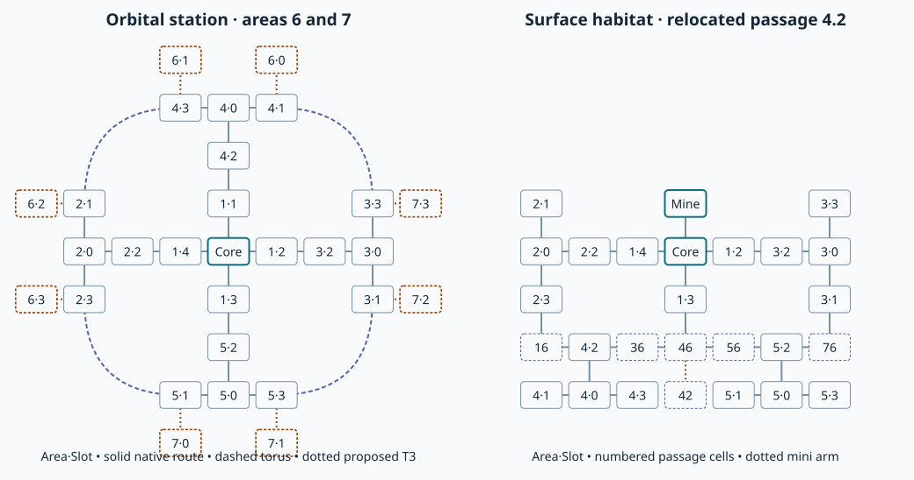

# Phase 2 station expansion to 28 facilities

Design for EEO 0.11.19 and Terra Invicta 1.0.65, reviewed 2026-11-22.

Design target is **12 / 20 / 28 facility positions for human orbitals** under
all three area allocations. Add two T3 lots to each outer arm. The core is
additional, so a fully expanded station has 29 positions. The surface habitat
floorplan keeps the mine in place and moves the passage cell above it below
junction 4.6. Apply the
phase 1 human, alien, and fixed-hab eligibility rules.

The drawings show possible graphical routes. Visibility depends on occupancy,
module footprint, and ring or passage predicates. The pitches come from the
UI and provide no 3D mesh dimensions. See the [asset extraction and edge list](phase2-floorplan-data.json)
and the [earlier 24-slot investigation](../hab-slot-expansion-assessment.md#phase-2-retained-capacity-research-deferred).

## Sector allocation

The native progression was **4 / 12 / 20** positions for both hab types.
Counts exclude the core and include the surface mine. Visible area 1 opened
at T1, areas 2–3 at T2, and areas 4–5 at T3.

| Visible area | Orbital internal sector | Surface internal sector | Native tier | Phase 1 tier |
|---:|---|---|---:|---:|
| 1 | 0, center | 0, center and mine | 1 | 1 |
| 2 | 4, west | 2, west | 2 | 1 |
| 3 | 2, east | 1, east | 2 | 1 |
| 4 | 1, north | 4, southwest | 3 | 2 |
| 5 | 3, south | 3, southeast | 3 | 2 |

Restore the original **area unlock schedule** by changing which positions
belong to each area. The active footprint at T1 and T2 stays the same as in
phase 1, including the original positions of occupied and empty lots.

| Remapped area | Unlock | Positions it owns |
|---:|---:|---|
| 1 | T1 | Today's center and east/west arms. 12 facilities plus the core. |
| 2 | T2 | Today's north arm. Four facilities. |
| 3 | T2 | Today's south arm. Four facilities. |
| 4 | T3 | Four new lots. Proposed grouping uses the north and west pairs. |
| 5 | T3 | Four new lots. Proposed grouping uses the south and east pairs. |

All three choices use the same physical floorplan and preserve
**12 / 20 / 28**. Compare the gameplay meaning of an area separately from the
runtime representation of its slots.

| Option | Where the eight T3 lots belong | Compatibility cost |
|---|---|---|
| Extend existing areas | Two in each of areas 2–5 | Keeps five sector records and ownership groups. Requires per-lot tier gates and larger outer-sector lists. |
| Remap areas 1–5 | Four each in remapped areas 4 and 5 | Restores the vanilla area unlock schedule. Requires a legacy address and ownership bridge for the regrouped T1 and T2 footprint. |
| **Add areas 6 and 7** | Four each in two new T3 areas | Retains the addresses, names, and owners of areas 1–5. Requires the consumers that assume five sectors to handle seven if the new areas are native sectors. |

Prefer **areas 6 and 7** when T3 should gain distinct ownership groups.
Put the north and west pairs in area 6 and the south and east pairs in
area 7 as the prototype. Their connectors follow the physical arms that
host them. Each new area has coherent ownership for construction, transfer,
capture and income. Test the grouped ownership against separately owned
host arms, and use the common resolver for area selection and targeting.

Area ownership has real consequences. A legacy orbital's center, east and
west sectors can belong to different factions. Combining these into one
native sector with a single faction would change construction rights, income,
and capture outcomes. Preserve legacy ownership as address-level groups
inside the enlarged area if the common resolver can make every ownership
consumer respect those groups. Otherwise keep those legacy ownership sectors
as backing records and expose the remapped areas separately. Both options
need ownership and capture parity in old saves. Fresh remapped T3 areas 4 and
5 should each have one coherent owner and group for transfer and capture.

If areas 6 and 7 are native sector records, append internal indices 5 and 6
with four module states each. Allocate through the native registries and
preserve all earlier sector and module IDs and indices. Audit maxSectors,
maxSectorIdx, display numbers and saves, UI iteration and selection, sector
icons/panels, construction and AI, sector transfers and capture, and battle
enumeration. Merely widening list limits would leave these consumers split.
If the native model cannot support two appended sectors reliably, an
EEO-owned area representation must provide equivalent ownership and behavior
through the same resolver before it can stand in for native sectors.

## Geometry proposal

Give each arm two new physical addresses, M4 off M1 and M5 off M3, one UI
pitch radially outward. Use those addresses as stable geometry keys. The
append-only variant can also use them as native storage addresses. The remap
assigns those same keys to areas 4 and 5 through catalog membership. The
seven-area option assigns them to areas 6 and 7. Each
branch gets a separate connector outside the ring. The native torus still
uses all four corner pairings. Compact placement in those quadrants competes
with the torus, defense geometry and UI space.

- Measure the original attachment poses in station-root space. Fit a single
  pair and check the rotated pairs against all four native quadrants. Author
  the socket at each end or a complete span, with fit for mixed module sizes.
  The stock 3D side lots lack the required outward branches. Use the native
  T3 ring and nearby spines as visual references for proportions and art.
  Check the silhouette and joints on an occupied T3 orbital in game.
- Build an extra module with its parent lot empty. The graph must connect it
  across the empty parent and arm hub to the core. Compare queued, completed,
  decommissioning, destroyed and empty transitions. Match native connector
  collision and targeting categories. New modules need their own native
  target reference, health, hit geometry and destruction effects.
- Keep the surface mine at S0_M1 in its original position, with its native
  link to the core and a clear front. Move only the passage cell formerly
  above it, C_42, to the open position below junction 4.6 (C_46). Join the
  relocated passage to that junction with a short mini arm. C_42 is an
  authored connector cell. Keep facility counts and the mine-only rule.
  Resolve the new arm through C_46's active route. Test its visibility
  independently of mine occupancy and keep the corridor in front of the
  mine clear for empty, occupied, building, destroyed, and rebuilt states.

## Shared layout resolver and consumer parity

Put native and expanded topology, tier gates, addresses, capacity and edge
eligibility in one versioned layout catalog and resolver. Reconcile module
states at load, founding and upgrade. Resolve and refresh affected edges on
construction, ownership and damage changes. Views and battle systems consume
the same slot and connector addresses. Profile the refresh at those boundaries.

| Consumer | Current seam and integration check |
|---|---|
| Founding, templates, upgrades and load | InitializeSector, InitializeNewHab, OnHabCreated, CompleteModuleConstruction and PostEverythingSaveRepair_8. Phase 1 HasValidTopology expects 5/4/4/4/4. Drive validation and reconciliation from the resolved layout. Compare direct T3, completed and canceled upgrades, legacy T3 and scenario creation. |
| Player and AI decisions | AvailableSlots, GetModule, ValidModuleForSlot, build action validation and execution, AI slot selection, maxModules consumers, and HabRefuellingCapacityPatch. Audit full and specialty goals comparing against 21. With other slots occupied, ask UI, AI, quote, validation and execution for M5. Repeat with insufficient tier, foreign ownership and unavailable slots. |
| Hab screen and list | PreviewStation has a size-five template array, a five-slot populated loop, and a separate four-cell clear path. Startup builds dictionaries from serialized cells. Route registration, preview, clearing, selection, placement and counts through resolved slots. Test changing layouts while M5 is selected. |
| Overworld and 3D preview | CreateVisualizer, HabComponent.CacheHabModules, Update3DModel, EmptySector, HabModule3D and HabModelController.Initialize discover native objects. Fixed loops miss M5. Register new nodes before either controller cache is built. Verify preview clones and strategy instances bind the same meshes, IDs and links independently. |
| Rendered and simulated battle | SpaceCombatManager borrows the strategy model and walks GetModuleControllers when returning it. Confirm rendered initialization, simulated enumeration, destruction and restoration observe the same defense instances. Test successive battles for restored transforms and duplicate colliders or controllers. Coordinate firing arc checks with the orbital defense mount work. |
| Connector resolution | UpdateModuleConnectorMap switches on native addresses. UpdateAllModuleConnectors separately invokes ActivateRings or ActivateBaseConnections. Put native directional branches, ring predicates, base passages and new radial edges under one graph contract. Compare all stock-sized controls and sparse layouts before enabling the new edges. |

## Save bridge

1. **Preflight the graph.** Detect old native and phase 1 shapes and read an
   EEO-owned layout revision through the game serializer. Validate sector
   IDs, list positions, owners and the allocator before mutation. Distinguish
   a complete expanded graph, known repairable partial states, malformed
   states and unknown future revisions. Preserve the native global save version.
2. **Append and commit.** Reuse each existing sector and module instance.
   Allocate eight empty expansion states only on eligible T3 orbitals through
   the native allocator and initialization. In the native seven-sector
   variant also allocate and register the two expansion sectors. Replay
   interrupted migration with either missing sector or a partial module
   list and check that a second successful pass creates zero IDs. Publish
   registrations, counts and the layout
   marker after successful validation, before visualizer or combat binding.
   Roll back staged additions or abort load on failure. Preserve the input save.
3. **Compare identities.** Preserve original IDs and physical slot keys.
   Keep legacy storage addresses if the backing records are retained. If
   storage changes, record an explicit old-to-new address map and update
   index-only references as part of the same transaction. Test both ID-backed
   and sector/slot-backed tasks and UI selections. Check mixed ownership,
   powered and damaged states, prior templates, build/decommission dates,
   queues, scheduled events and external references. Rebuild connector flags
   and controller bindings. A second pass after save/reload allocates zero IDs.
   Trace any native tier decrease or core replacement in the current game.
   If it can reduce an expanded station's tier, preserve existing lots and
   jobs under an explicit recovery policy. Test this before enabling T3
   expansion. An occupied extra lot must stay visible and addressable.
4. **Define rollback.** Keep a pre-upgrade checkpoint. Treat older builds as
   unable to consume expanded states until demonstrated otherwise. If a
   downgrade exporter is needed, operate on a separate copy and allow removal
   only when all eight lots are empty and unreferenced. Never discard occupied
   or referenced expansion states. Preserve FullSerializer tokens and identity,
   gzip/text container, BOM, CRLF and four-space formatting for offline edits.

Replay copied native and phase 1 saves plus synthetic edge cases. Cover full,
empty, partial, foreign-owned, captured, building, damaged, decommissioning
and docked-hostile stations. Verify serializer and allocator round trips,
future-version rejection, repeated migration, and save → reload → battle →
save. Compare every pre-existing reference by ID and identity. Keep personal
saves and raw replays in temporary output. [Save format and editing rules](../tooling/terra-invicta-save-format-and-editing.md)

## Delivery and acceptance

1. Capture headless phase 1 parity, then prototype one extra lot and its
   continuous core path, including an empty parent.
2. Author one arm. Exercise both added addresses through construction, UI,
   strategic model, rendered and simulated battle paths, and a save round
   trip. Check large legal modules, ring clearance, docking, shipbuilding,
   defense arcs, collider fit and repeated preview/battle lifecycles.
3. Extend to all four arms. Assert 29 unique positions, eight new routes,
   and the same module identity through selection, targeting, destruction
   and rebuild. Assert the native-layout remap has 13 / 4 / 4 / 4 / 4
   positions by area, including the core. Assert the seven-area layout has
   5 / 4 / 4 / 4 / 4 / 4 / 4 positions, with only the eight additions in areas
   6 and 7. Compare active physical keys at each tier across all three layouts.
   Run headless replays and automated validators through normal
   deployment. The user checks visual fit and interaction in the habitat
   screen, overworld and station combat.

This checkpoint contains the design and static asset evidence. Mesh fit,
save migration and rendered behavior are implementation and acceptance gates.
