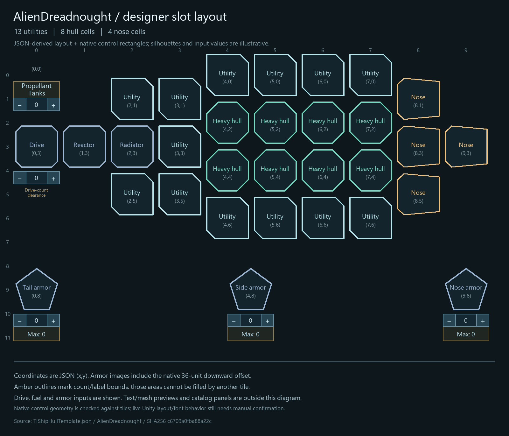
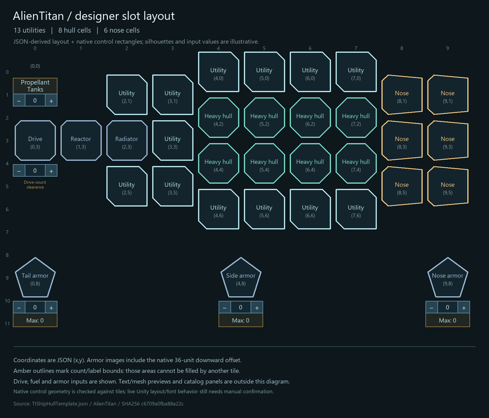
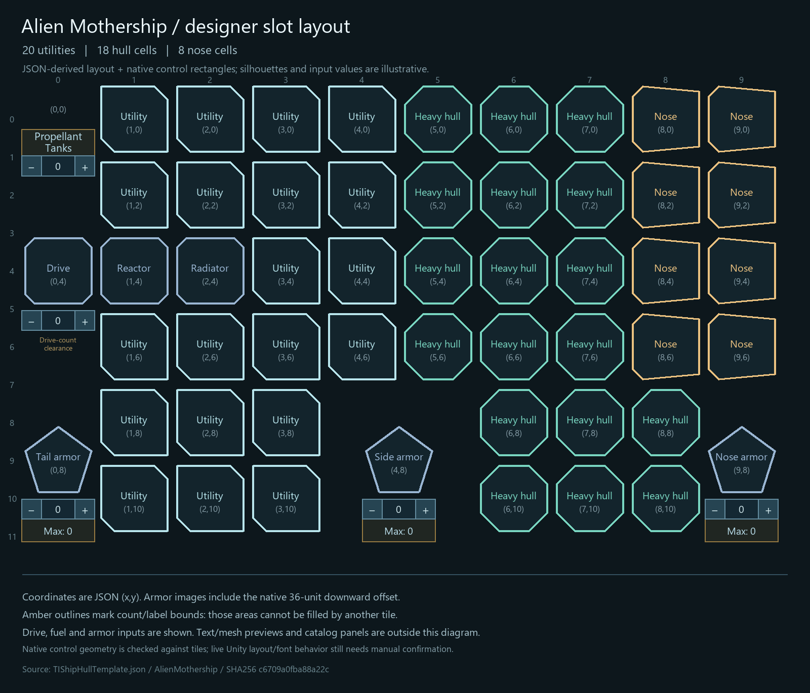

# Alien capital symmetry and canonical designer layout — 0.11.2

Status: **revised 0.11.2 deployed for manual testing on 2026-11-04.**
The user authorized reusing 0.11.2 for this untested iteration.

## Final values

| Hull | Utilities | Noses | Heavy hull cells | Crew | Structure / bare mass (t) |
| --- | ---: | ---: | ---: | ---: | ---: |
| Alien Dreadnought | 13 | 4 N4 | 8 | 50 | 2,810 / 2,960 |
| Alien Titan | 13 | 6 N4 | 8 | 60 | 2,880 / 3,060 |
| Alien Mothership | 20 | 8 N5 | 18 | 100 | 9,240 / 9,540 |

Dreadnought/Titan each gain one reflected utility at (4,6), +20 t structure,
unchanged crew. Titan's lower three-utility row translates together to y=6,
preserving horizontal footprints and restoring reflection about y=3.
Mothership gains two N5 noses, two heavy hull cells and nine utilities relative
to 0.11.1. Its reinforcement is 20 t × (2×5 + 2×4 + 9) = 540 t.
Counts, positions and reinforcement remain JSON-authored.

## Fixed controls and forward layout

Fixed Mothership anchors: drive (0,4), reactor (1,4), radiator (2,4), fuel
(0,0), tail armor (0,8), middle armor (4,8), nose armor (9,8). They are not
packing variables. Only weapon and utility cells are rearranged around them.

Hull cells are all forward: column 5 at rows 0/2/4/6; columns 6/7 at rows
0/2/4/6/8/10; column 8 at rows 8/10. Noses form two complete columns, x=8/9
and y=0/2/4/6. No weapon or utility is admitted in the aft x=0 column.

Middle armor is centered between columns 4 and 5 by the native half-cell
image offset; nose armor is at the far right, column 9. Their real icon and
control rectangles block overlapping tiles, including the four positions
around centered armor. No separate 2x2 protected-area element is drawn or
needed in the schema. Final utility count is 20.

## JSON schema and UI

The [layout document](../../TIEconomyMod/ModFiles/Config/ship-designer-layout.eeo)
separates **11 allocated half-rows** from **9 window half-rows**. New destinations
use existing space between armor controls; fixed logical nodes remain unchanged.
The initial window/center requests are 974/536. The later
[viewport correction](designer-viewport-fit-2026-11-04.md) measures actual header/
content space, expands those sizes if necessary and fits the outer screen budget. Column membership, reserved aft cells and actual icon/control overlap
reject invalid data at template initialization and UI preparation.
No class-specific tile placement is hardcoded in the UI adapter.

Native spinner containers are prepared where declared systems need them. The
72×24 propellant label, offset and font limit are JSON-authored. Diagrams show
count inputs, armor maxima and native offsets. Their example
values and silhouettes are illustrative, not screenshots or live UI proof.
The renderer's `--verify-only` path checks bounds without creating images.

## Model and save compatibility

Added nose slots 40/41 use guarded cloned controllers 7/8 at mesh-probed mirrored
bow points (-136,0,240.9154)/(136,0,240.9154) metres. Added hull slots 42/43 use
dormant symmetric pairs 8/11. All active mappings are distinct. The minimum new
nose-to-hull anchor distance is 36.729 m; this is not swept-volume/aiming proof.

All 0.11.1-and-earlier utility indices/types remain stable. Their utility group
translates rigidly one column right, retaining two-/four-cell footprints.
Weapon model mappings remain index-based despite UI packing changes. New
untested cells are finalized within the same iteration and start empty on
older designs. Propellant retains index 33; fuel and hardware are not rewritten.

`LegacyWeaponSlots` JSON retains the original schema-0 shared hull coordinates
for conversion, including stock Ship21. Schema-1+ compact hull entries stay
independent. The mod-owned `eeoCapitalLayout` marker stays 3; native save versions
remain upstream and unchanged.

## Evidence and manual acceptance

[Runtime snapshot](alien-capital-expansion/runtime-0.11.2.json),
[deployment receipt](alien-capital-expansion/deployment-0.11.2.json),
[bow probes](alien-capital-expansion/nose-geometry-0.11.2.json),
[control rectangles](alien-capital-expansion/designer-control-clearance-0.11.2.json),
[0.11.1 fixture](alien-capital-expansion/before-0.11.2.json).

After guarded deployment, restart and check old designs, multi-cell utilities,
fixed system controls, forward hull placement, all weapon models/aiming and
save/reload/refit. Manual acceptance remains pending.

Final guarded deployment passed **43 validators and 1,376 formula assertions**;
the matrix covers 121 features / 262 Harmony patches. All **55 installed
and release-archive files** match. Native-assembly checks validate all 28 hull
grids, canonical armor anchors, column membership, fixed systems, eight rejected
armor-overlap fixtures, seven malformed-layout cases, old utility footprints,
stock/legacy migration, and distinct weapon model mappings. UI target resolution
and managed geometry are not live Unity acceptance. No commit was created.

DLL SHA256: `BAB9528E43C921D30CA31EBAD8942C9A9F8A7A08B90E7A994C77D2E325BDCE69`.
