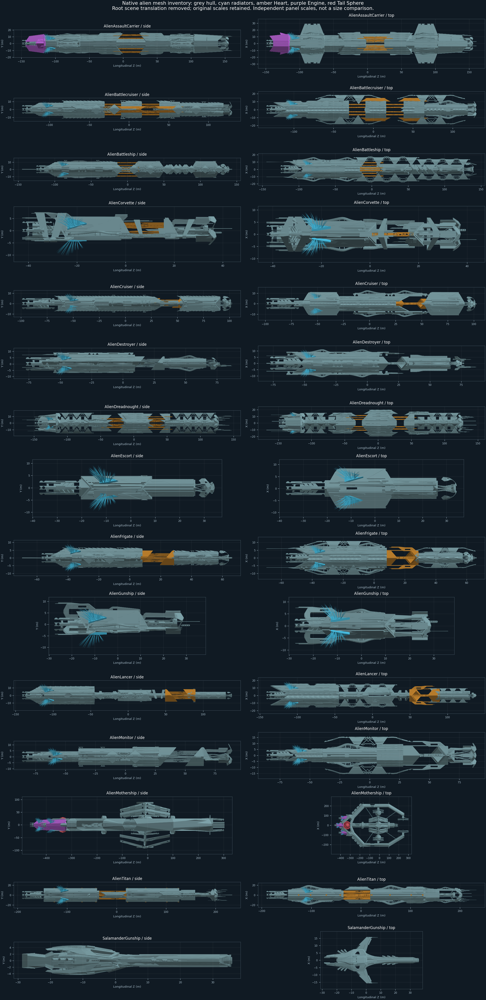
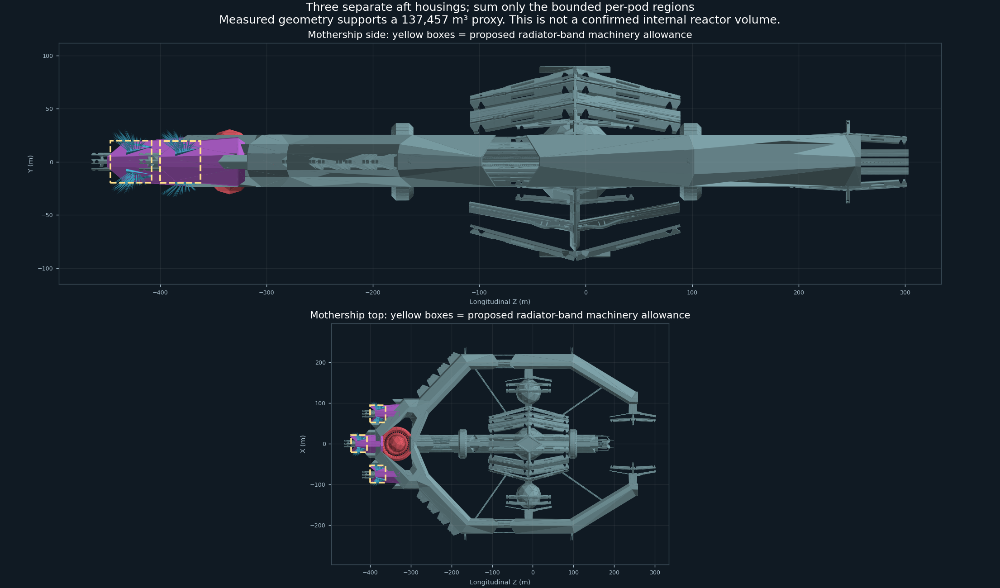
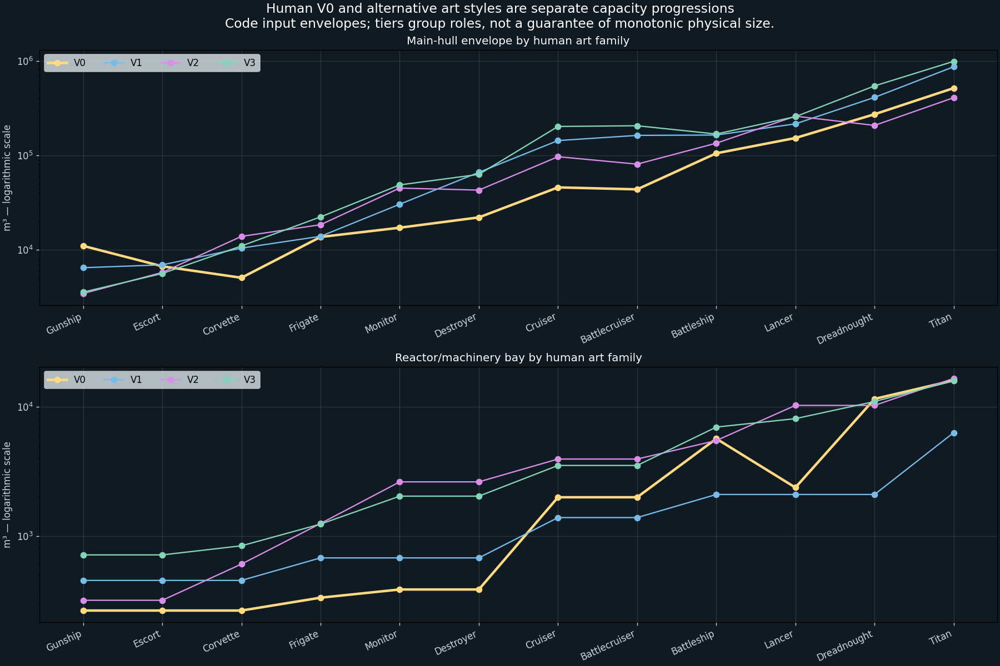
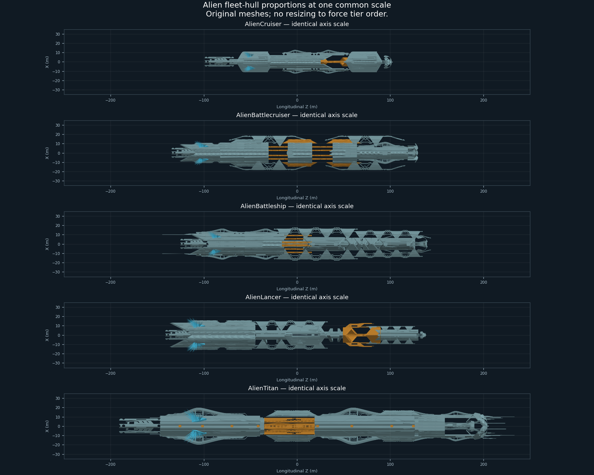

# Alien reactor/machinery bay geometry audit — 2026-11-04

Status: completed source-geometry audit. **The allowances were subsequently
authorized and deployed in [0.10.24](alien-reactor-bay-implementation-2026-11-04.md).**
This document and its JSON retain the measurement-stage before/after evidence;
the tier and N5 changes remain proposals. This follows the
[all-class runtime capacity comparison](hull-volume-capacity-comparison-2026-11-03.md).

## Measurement rules

Inspect the installed ships bundle directly, including complete transforms,
active renderer state, mesh vertices/triangles and radiator-controller locations
for all fifteen alien hull prefabs. Remove only prefab scene translation from
reported positions. Exclude weapon placeholders, VFX, separate thrusters,
decorative fins and radiator spikes from a reactor housing's volume.

No artist part name alone proves reactor function. A repeatable, separate aft
housing surrounded by radiator hardware can supply a **measured machinery-bay
proxy**, comparable to the existing human methodology. Its volume is an outer
envelope, not a measured internal reactor vessel. If the hull mesh does not
separate such a compartment, report an explicitly **modeled fallback** instead.

For ordinary single housings, record the transverse X/Y dimensions, longitudinal
Z extent and circular-cross-section envelope `pi/4 * min(X,Y)^2 * Z`, matching
the runtime human-bay convention. Retain the larger elliptical envelope as an
outer-bound comparison. Do not treat radiating spikes or the union bounding box
of widely separated components as a usable chamber.

For a long monolithic aft hull with no separate chamber, a reproducible fallback
candidate is the principal aft housing **clipped to the axial band occupied by
its radiator mesh**. This measures a bounded geometric region but assumes that
the region can serve as machinery allowance; it is not an independently authored
reactor compartment. Preserve that distinction in tables and future code.

The Mothership has three large connected housings within `Engine_A`; measure
each separately and sum only nonoverlapping candidate regions. Its complex
`Tail_Sphere` is additional geometry evidence, not automatically another reactor
vessel or an extra volume to add to the engine housings. Salamander and light
hulls with no defensible separate region may retain a stated conservative
small-hull fallback until better evidence exists.

## Results and proposed allowances

The audit resolves all fifteen alien prefabs. **No mesh is explicitly named as
a reactor chamber.** Eleven classes have usable aft-housing geometry from which
to construct a measurement-based machinery proxy. Four lack a defensible separate
region and need an explicitly modeled fallback. These are not measurements of
internal reactor vessels. At the measurement stage the code still used its
original class-maximum fallbacks. The selected allowances below are now installed
by 0.10.24; the first numeric column retains the prior baseline.

The common proposed rule clips each selected housing to the full axial range
of its nearby authored radiator meshes, then uses the same circular-envelope
formula as the human bay convention. Exact triangle/plane intersections bound
the clipped region; it is not merely a subset of vertices or a screenshot box.
The axial association is a modeling assumption, not proof that the whole clipped
region is available to a reactor. Full housing envelopes are retained as upper
comparison geometry. They are not additional volumes to sum with the proxy.

| Class | Prior 0.10.23 bay (m³) | Whole selected housing envelope (m³) | Adopted 0.10.24 allowance (m³) | Evidence/method |
| --- | ---: | ---: | ---: | --- |
| Alien Assault Carrier | 16,549.5 | 8,176.4 | 6,865.6 | Housing + radiator-band proxy |
| Alien Battlecruiser | 3,930.6 | 14,537.5 | 3,544.6 | Housing + radiator-band proxy |
| Alien Battleship | 16,549.5 | 37,543.3 | 5,860.1 | Housing + radiator-band proxy |
| Alien Corvette | 2,617.6 | — | 317.8 | Human-V0 calibrated fallback |
| Alien Cruiser | 3,930.6 | 8,285.6 | 2,332.4 | Housing + radiator-band proxy |
| Alien Destroyer | 3,930.6 | 22,532.2 | 2,571.8 | Housing + radiator-band proxy |
| Alien Dreadnought | 16,549.5 | 40,791.5 | 6,012.8 | Housing + radiator-band proxy |
| Alien Escort | 2,617.6 | — | 177.5 | Human-V0 calibrated fallback |
| Alien Frigate | 2,617.6 | 6,478.4 | 1,152.6 | Housing + radiator-band proxy |
| Alien Gunship | 2,617.6 | — | 262.8 | Human-V0 calibrated fallback |
| Alien Lancer | 16,549.5 | 106,384.0 | 9,486.2 | Housing + radiator-band proxy |
| Alien Monitor | 3,930.6 | 2,120.2 | 776.3 | Housing + radiator-band proxy |
| Alien Mothership | 16,549.5 | 378,120.8 | 137,456.8 | Three separately bounded housings |
| Alien Titan | 16,549.5 | 71,244.6 | 14,625.7 | Housing + radiator-band proxy |
| Salamander Gunship | 2,617.6 | — | 350.8 | Human-V0 calibrated fallback |

For the four fallback classes, use the median measured bay/main-hull ratio of
the six human **V0** hulls with native smallHull classification: Gunship, Escort,
Corvette, Frigate, Monitor and Destroyer. This gives **2.41254%** of main-hull
envelope. V0 is used deliberately because the alternative art-family capacities
are much less coherent. The empirical reference range is 1.743–5.211%; it is a
sensitivity range, not a statistical confidence interval. This produces working
fallbacks around 260 / 180 / 320 / 350 m³ for Alien Gunship / Escort / Corvette /
Salamander respectively. They are much smaller than the prior 2,617.6 m³
maximum-of-small-human-art fallback. Adoption required compatibility checks;
the user subsequently authorized 0.10.24, whose native-helper preflight and
normal validators passed. Manual campaign/refit/AI acceptance remains pending.
Their adoption does not turn these calibrated estimates into measured chambers.

The full [source and candidate snapshot](alien-reactor-bay-audit-2026-11-04.json)
records exact source mesh paths, fingerprints, active states, transforms/bounds,
the selected radiator windows, fallback calibration and production reactor-limit
checks. Vertex arrays remain disposable under .tmp rather than duplicating the
game's raw meshes in persistent documentation.

The contact sheet uses independent panel scales to make parts readable. It is
not a common-scale comparison. Cyan identifies radiator hardware, amber named
Heart parts, purple Engine parts and red the Mothership Tail_Sphere. Those names/
colors do not establish reactor function.

## Mothership: a distinct category with three measurable aft housings

The user's expectation of no uniquely identified reactor compartment is correct,
but there is useful separate machinery geometry. `Hydra_Mothership_Engine_A`
contains three large, separated housings surrounded by three radiator groups.
After welding positional seams for connectivity analysis, their outer circular
envelopes are approximately **126,040 m³ each**, totaling **378,121 m³**. Tiny
detached decorative pieces are excluded. A single aggregate circular envelope
would give about 218,473 m³, which is not an appropriate substitute for summing
three separate candidate regions. No empty inter-pod space is added.

Clipping each housing to its own radiator band gives **45,237 + 45,237 + 46,983 =
137,457 m³**. The mirrored outer pair matches; the center housing is axially
staggered and its radiator group has a slightly different span. The three
transverse boxes are disjoint, so the sum has no region overlap. **About
140,000 m³ is a reasonable rounded working allowance** if this geometry-based
fallback is adopted. It is approximately **8.31x** the prior 0.10.23 fallback
and **9.40x** the similarly modeled Alien Titan region.

`Hydra_Mothership_Tail_Sphere` is also distinct, roughly 84.1 x 60.8 x 84.1 m.
It is a complex multi-part assembly, not an unambiguous solid reactor sphere.
Its elliptical/circular/spheroidal outer envelopes are retained in the snapshot,
but it is **not added** to the three housing regions. If later evidence assigns
it reactor function, revisit that assignment explicitly rather than counting both
the sphere and the surrounding engine structure by default.

The Mothership is clearly in a league of its own. Under the maintained main-hull
envelope definition it is about **140.6x Alien Titan**, not merely 10x; it is
also about 49.8x the largest human Titan appearance. Much of its enormous union
envelope spans a wide ring/outlying structure, so that does not establish 140.6x
usable reactor space or structural material. Independent evidence still supports
a distinct strategic class: about 9.4x this machinery proxy, 3.48x the alien
drive-art coefficient, twice the heavy hull mounts, and 512 versus 90 native
integrity. A shared generic Large/Huge allowance loses that distinction.

## Reactor-limit check: larger geometry is not automatically more output

The packaged production `ReactorBayOutputLimit_GW` and `EffectiveReactorOutput_GW`
were invoked for all fifteen candidate allowances and all three currently merged
alien power plants: **45 comparisons**. Their theoretical maxima are
5,000 / 32,000 / 107,550 GW. Current runtime density/fraction and specific-mass
rules apply, not a guessed conversion from m³ to GW.

**Mothership and Alien Titan already reach those three theoretical maxima with
their current bay fallback. They still reach exactly those maxima with these
new candidate allowances.** The earlier observation that their bay inputs were
identical was a geometry/progression concern; it did not demonstrate that the
old shared allowance was limiting either ship's selected reactor. Correcting the
geometry alone therefore does not grant a Mothership reactor-output buff with
current plant templates. A distinct larger-output reactor would be a separate
equipment/research/balance decision. Verify full propulsion, electrical, thermal
and battery requirements before changing those limits.

The candidates would reduce one or more effective maxima on **six** smaller
classes: Alien Gunship, Escort, Corvette, Frigate, Monitor and Salamander.
For example, the basic reactor on Alien Gunship falls from its 5,000 GW
theoretical maximum to about **1,401 GW**. This is why the small-class fallback
and bounded-region proposals are analysis inputs, not a drop-in safe deployment.
The other nine classes retain the current effective maxima for all three plants.

## Art-family and alien size progression

The user's observation is borne out by the maintained volumes. Human V0 has a
mostly ascending middle/late progression, with role-based exceptions: Cruiser
45,820 m³ and Battlecruiser 43,684 precede Battleship 105,143, Lancer 152,598,
Dreadnought 272,229 and Titan 514,552. Early Gunship/Escort/Corvette are not a
strict ascending sequence even in V0.

Alternatives break that ordering more strongly. V3 Cruiser/Battlecruiser are
202,070 / 205,739 m³, exceeding their Battleship's 168,181. V2 Lancer is
259,685 m³ versus Dreadnought 207,413. A larger main hull need not have a larger
bay: V1 Dreadnought has about 410,482 m³ of hull but only a 2,090 m³ bay, while
V0 has 272,229 m³ of hull and an 11,476 m³ bay. Fuel envelope, reactor bay and
engine-art area are independent measurements; do not normalize them as one stat.

Aliens are not a monotonic size ladder either. Cruiser is **28.8%** of Battleship
main-hull volume, Battlecruiser **85.8%**, and Lancer **82.8%**. Lancer is about
96.4% of Battlecruiser volume, so it is not especially tiny by that measure;
its proportions and slender sections explain part of the visual impression.
Alien Monitor's envelope is larger than Cruiser's. The common-scale geometry
view below helps distinguish longitudinal length, transverse bulk and widely
separated structures from the single envelope number.

The new proxy does not erase those inconsistencies. Cruiser's candidate bay is
about 2,332 m³ versus Destroyer's 2,572; Lancer's 9,486 exceeds Dreadnought's
6,013. These are independent physical inputs with different confidence and
compartment assignments, not a reason to secretly resize or buff a class until
the table sorts by tier.

## Updated planning conclusions and next decision

- Retain Mothership as its own strategic tier. The original 16,549.5 m³ generic
  bay is not an art-derived Mothership measurement; the three housing regions
  provide a substantially better, explicitly modeled starting point near
  140,000 m³. Keep its current theoretical reactor-output ceilings separate.
- Do not finalize alien tier-3/4/5 physical capacity or N5 support budgets from
  hull labels or one scalar volume. Keep the human and alien classifications
  distinct from their mesh/bay/drive measurements. The proposed Mothership
  9,000 t bare target is only prior capacity-unit bookkeeping, not a fresh
  structural-mass calibration of this much larger geometry.
- If physical variation by appearance is retained, show fuel/bay/drive capacity
  and price differences explicitly and test every appearance. Tier then groups
  research/roles, not a guaranteed physical upgrade for each art choice.
- If normalization is desired, choose it as a separate policy: class-based
  virtual allowances preserve art but decouple capability from geometry; actual
  art rescaling changes volume as scale³ and nozzle area as scale² and also
  affects anchors, collision, visual precision, mass/cost and saved designs.
  Neither is performed by this audit, and neither should be hidden in a tier rename.
- Before any runtime adoption, preflight stock/AI/player designs against candidate
  limits, distinguish normal versus legacy-capacity behavior, validate reactor/
  drive/weapon support and save/refit paths, then use the normal guarded deployment
  workflow. The subsequent 0.10.24 release adopts only the numerical bay inputs;
  stored layouts, equipment/fuel and the proposed tier/N5 rules are not rewritten.
- If allowances are adopted, store the selected values in prepared lookup data.
  The vertex/triangle audit is an offline measurement operation, not a proposal
  for repeated live mesh scans or per-frame capacity calculations.

## Verification limits

The direct asset audit inventories active/inactive mesh nodes and renderer states
for all fifteen prefabs, with complete authored transforms and real decoded
vertices/triangles. Geometry clipping includes boundary intersections; Mothership
regions were checked for transverse overlap and symmetry. Human V0 fallback
calibration and the 45 reactor-limit checks are recorded numerically. All figures
use full source triangles rather than point clouds or triangle subsampling.
As a unit/transform control, the same direct-vertex pipeline reproduced the
already-calibrated human Battlecruiser V0 machinery envelope at 1,989.2417 m³
versus the runtime calibration's 1,989.2425 m³ (relative difference 4.2e-7).

This does not establish intended internal anatomy, habitable/solid volume,
watertight reactor containment, operating radiator deployment, actual in-game
power behavior or balanced AI fleets. The allowances were subsequently adopted
as an explicit modeling policy in 0.10.24, not established as internal anatomy.
The asset audit itself was read-only; the separate authorized implementation
and deployment are recorded in the linked implementation report.
