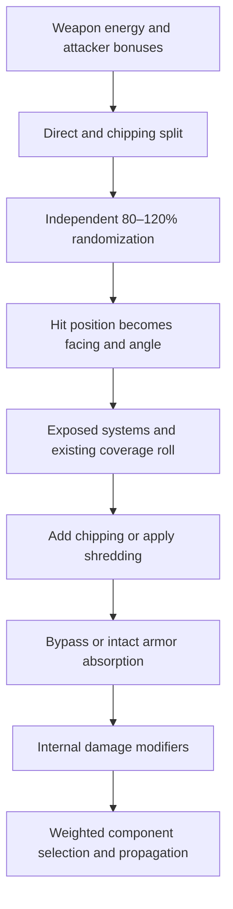

# Armor, chipping, penetration and critical hits: current system

Design follow-up: the [armor rework plan](armor-rework-plan.md) now records officer hit-quality rather than damage bonuses, a modest general armor buff, and stronger first-hit protection for maximally armored capitals against standard hull weapons. The formulas and bonus examples below remain descriptions of the current system, not proposed behavior.

Subsequent same-day material change: [Alien Adamantane/Exotic update](alien-armor-material-update-2026-11-04.md) is deployed in 0.11.2. The material table and hashed snapshot below retain the **pre-change Step 0 baseline**; use that implementation record for current alien material values. The underlying armor/chipping/critical algorithms described here were not changed.

2026-11-04. Step 0 research for a possible armor rework. **No gameplay change or rework implementation is proposed or delivered here.** The requested next direction is laser ablation and reconsideration of armor-bypassing critical hits; design decisions belong to the next planning turn.

The current system is four independent armor facings, each with one integer thickness value and one scalar fraction of missing coverage. Ordinary chipping makes holes in coverage, not gradually thinner armor. A subsequent hit randomly lands in intact coverage or in a hole. This is the armor bypass described by the codex as a critical hit. Lasers already produce some chipping, but their principal strength is range-dependent penetration; magnetic weapons both chip and penetrate.

## Evidence and baseline

Fresh type decompilations of the installed game were read alongside native templates, English localization, current EEO source, and the installed EEO package. Game root: `D:/Games/SteamLibrary/steamapps/common/Terra Invicta`. Native `TerraInvicta_Data/Managed/Assembly-CSharp.dll` SHA-256:

`4A4B9AAE4154E444E9727204205D2D42AE8ED9E1C5F92CDC1280074A259D8350`.

At capture, EEO repository package and installed metadata both report **0.11.2**, targeting TI 1.0.53/1.0.53b. The mod DLL, settings, metadata, and all inspected EEO template overrides matched their installed counterparts byte-for-byte. There is no EEO `TIShipArmorTemplate.json` override. The tree already contained extensive uncommitted work; this investigation preserved that work.

At final verification, the repository's `TIShipHullTemplate.json` changed concurrently outside this investigation. The installed file still matches the captured hash, and comparison found no change to the snapshot's hull dimensions, construction tier, structural integrity or armor-depth fields. The snapshot retains the original baseline and records this drift separately; it is not a claim that the entire working package remains identical to the installation after capture.

The [hashed data snapshot](armor-as-is/snapshot-2026-11-04.json) records all 12 armor materials; relevant fields for 125 laser, 70 magnetic, 8 gun, 33 particle, 16 plasma and 57 missile templates; hull dimensions/armor limits; component armor; and numerical examples. Counts include base/region defenses and alien weapons, not just ship-fit weapons. These are **static native-plus-EEO field projections**, not a fresh live `TemplateManager` dump. Unlisted fields retain their native meanings/defaults. The snapshot separately records the graser precision correction used in examples.

The [selected native code excerpts](armor-as-is/native-code-evidence-2026-11-04.md) preserve the central resolution branches and their decompiled line ranges. Full type decompilations and disposable calculation scripts remain under `.tmp/armor-as-is/`. The earlier [laser optics and jitter study](laser-armor-penetration-and-jitter.md) remains useful for detailed optical tables; this report supplies the current armor-wide baseline and critical-hit interpretation.

No battle, save edit, runtime probe, build or deployment was performed. Formula examples establish what the inspected code calculates under stated assumptions; they do not measure a particular battle's critical-hit frequency or prove every mod hook is active in a running process.

## 1. What armor stores

`TISpaceShipState.armor` is a dictionary of `ArmorFacing -> ArmorData`. The normal ship initialization creates Nose, Left, Right and Tail entries. Left and Right start from the same lateral design value but take damage independently. Core is an internal-routing location, not a fifth purchasable exterior armor bank. Dorsal and ventral enum values do not create separate armor banks here.

| Stored value | Meaning |
|---|---|
| `maxArmor` | Original integer armor points, restored by repair |
| `armorValue` | Current integer points; reduced by shredding |
| `chippedPct` | Fraction of abstract coverage lost, initially 0, capped at 1 by `ChipArmor` |
| `GetArmorIntegrity()` | `armorValue * (1 - chippedPct) / maxArmor`, or 0 when max is 0 |

Thus an integrity bar of 50% could mean full thickness with 50% holes, half thickness with no holes, or a combination. Those states resist incoming fire differently. `sumArmorValue` sums the current four integer values without discounting chipped coverage.

The [state/volume excerpt](armor-as-is/native-code-evidence-2026-11-04.md#armor-state-and-volume) shows no tile array, local depth distribution, thermal state, or persistent impact coordinates. Chipping does not directly subtract ship mass: design/template armor mass still derives from the installed points and materials. Refit and repair accounting use the original design plus damage state.

## 2. Armor points, physical material and geometry

Native `TIShipArmorTemplate` defines a 20 MJ damage point and a 0.005 m² reference plate. For material density `rho` in kg/m³ and heat of vaporization `H` in MJ/kg:

```text
mass per reference damage point = 20/H kg
volume per reference damage point = 20/(H*rho) m³
thickness per armor point t = 20/(H*rho*0.005) m
thickness for A points = A*t
mass per m² per point = 4000/H kg
```

This establishes construction thickness, mass, depth caps, radiation shielding, and the volume used in chipping. Tactical intact-hit laser absorption does not explicitly vaporize a material mass or simulate plate temperature.

| Material | cm/point | kg/m²/point | Chipping multiplier | Kinetic multiplier | Laser multiplier |
|---|---:|---:|---:|---:|---:|
| Steel | 7.4934 | 588.24 | 0.75 | 1 | 1 |
| Titanium | 9.4627 | 456.10 | 0.75 | 1 | 1 |
| Silicon carbide | 12.5869 | 404.04 | 1 | 1 | 1 |
| Boron carbide | 22.2311 | 560.22 | 1 | 0.75 | 1 |
| Composite | 13.8169 | 266.67 | 1 | 1 | 1 |
| Foamed metal | 18.1159 | 166.67 | 0.75 | 1 | 1 |
| Nanotube | 7.8567 | 135.14 | 1 | 1 | 1 |
| Adamantane | 3.7327 | 67.19 | 1 | 0.75 | 1 |
| Exotic | 2.5974 | 57.14 | 1 | 1 | 1 |
| Hybrid | 2.5000 | 50.00 | 1 | 1 | 0.75 |
| Alien adamantane | 3.7327 | 67.19 | 1 | **1** | 1 |
| Alien exotic | 2.5974 | 57.14 | 1 | 1 | 1 |

Multipliers act on damage, so smaller is better protection. Alien adamantane lacks human adamantane's kinetic resistance. The X-ray/baryon half-value fields and resource costs are also preserved in the [snapshot](armor-as-is/snapshot-2026-11-04.json).

For hull length `L`, width `W`, and installed lateral thickness `tL`, let `capArea = pi*(W+2*tL)^2/4` and `shell = pi*((W+2*tL)^2-W^2)*L/4`:

| Volume used for chipping | Realistic mode | Cinematic mode |
|---|---:|---:|
| Nose or tail | facing thickness × capArea × 3 | facing thickness × capArea |
| Each lateral facing | shell / 4 | shell × 0.375 |

The extra lateral division by two occurs in `ArmorData.GetArmorFacingVolume_m3`, after the armor-template volume calculation. These are native analytical volumes from hull length/width and **design** armor values, not mesh surface measurements, current chipped volume, or `armorValue` after shredding. Cosmetic/physical contact mesh changes do not automatically redefine armor volume.

Armor fitting caps use the hull's maximum depth for the slot, multiplied by `1 + sum(utility armorMaxBonus)`, then truncate `maximum depth / material thickness per point`. Native mass is volume × density; construction cost is material-weighted mass. No current projected utility has a positive `armorMaxBonus`.

## 3. From a shot to internal damage



`TIShipWeaponTemplate.DamageAtRange_points` first obtains full damage in MJ with `applyChipping:false`, divides by 20, and splits `P` into `D=P*(1-c)` direct and `C=P*c` chipping. `Ship.Damage` independently randomizes D and C to 80–120% of nominal. Shredding is a separate integer channel and is not randomized by that constructor. The following order is important; see the [full central excerpt](armor-as-is/native-code-evidence-2026-11-04.md#armor-resolution).

1. **Exposed systems first.** Radiator interception, a narrow rear-drive chance and sensor damage are evaluated before ordinary armor. They can report internal damage even when the main hit does not penetrate. Some radiator branches return early.
2. **Roll existing coverage.** An ordinary single hit checks `random < chippedPct` before adding its own chipping. A hole hit sets the bypass flag, adds C back to D and removes that C from the chipping channel.
3. **Chip intact coverage.** For a positive-volume, positive-point, not-fully-chipped facing, multiply C by the material's chipping modifier, then add `C / facingVolume` to `chippedPct`. Normal chipping is consumed here. A hit that completes coverage loss can itself trigger bypass. Zero-point/zero-volume/already-exhausted handling also enables bypass when entering this positive-C branch.
4. **Shred if applicable.** Subtract the integer shredding amount from `armorValue`. Excess beyond remaining armor becomes direct damage. If armor remains but coverage is chipped, shredding can deliver `shreddingAmount * chippedPct` internally. The branch replaces incoming direct damage; it is not ordinary direct subtraction plus a bonus.
5. **Compute intact absorption.** Begin with current `armorValue`. In realistic mode, lateral hits divide it by the cosine of incidence relative to the side normal. For lasers apply `A^1.5 * armorEffectiveness`; apply laser/kinetic material resistance only inside the intact, positive-armor branch. A bypass skips those material multipliers as well as armor subtraction.
6. **Apply faction defensive effects.** `DamageReductionAgainstAllShips`, and against alien attackers `DamageReductionAgainstAlienShips`, modify direct damage even on the bypass route.
7. **Handle fragmentation or particle channels**, described below. For ordinary direct damage, return `max(0, D - effectiveArmor)` on intact coverage, or unabsorbed damage on bypass. This is not a universal doubled-damage critical multiplier.
8. **Apply internal protection and route.** `ApplyDamage` multiplies returned damage by `InternalDamageModifier`, then calls `ApplyInternalDamage`. The method also adds this incoming internal amount to the hit report; that report is not a sum of every downstream component HP loss or secondary explosion.

Two unusual implementation details are relevant to any later faithful baseline: `ChipArmor` returns excess **coverage fraction**, which the saturation branch can add as though it were damage points; and exit chipping uses `remainingInternalDamage * weaponChipValue / volume`, where the caller passes the original chipping **amount**, not the template fraction. These are observed code behaviors, not corrections applied by this investigation.

## 4. Lasers

For range `r` in metres, wavelength `lambda` in metres, beam quality Q, optic diameter `dOptic = 2*mirrorRadius_cm/100`, and angular jitter j:

```text
spot diameter = r * sqrt((1.22*lambda*Q/dOptic)^2 + (2*j)^2)
spot area S = pi * spot diameter² / 4
armor effectiveness E = S / 0.005
intercepted fraction = min(1, target cross-sectional area / S)
P = (shot MJ + utility bonus + applicable faction/officer bonuses) * intercepted fraction / 20
chipping fraction c = clamp(E/1000, 0, 0.25)
intact nominal penetration = max(0, P*(1-c)*laserResistance - A^1.5*E)
```

The last equation omits RNG and other defensive modifiers. A includes lateral obliquity where applicable. Bonuses are evaluated in native order; this notation is not a claim they all multiply independently. `DamageAtRange_MJ` for lasers itself does not apply its `applyChipping` parameter; the shared points function performs the split.

Large apertures and short wavelengths reduce E and improve penetration. They also reduce the fraction sent to chipping. Wider spots at longer range divert more energy into chipping, up to 25%; they do not keep eroding a selected patch's depth. Absorbed direct energy is not automatically converted into more armor loss. Jitter is a fixed spot-broadening term, not a sampled aim error for each hit.

Nominal single shots at **400 km**, full spot intercepted, 10 intact armor, normal incidence, no bonuses or resistance:

| Weapon | Full damage points | Chipping fraction | Chip points | Direct points penetrating |
|---|---:|---:|---:|---:|
| 60 cm green phaser battery | 5 | 0.9417% | 0.047086 | 0 |
| 960 cm green phaser cannon | 20 | 0.005279% | 0.001056 | 18.3295 |
| Alien 1024 cm graser cannon | 22.4 | 0.001005% | 0.000225 | 22.0819 |

These values explain the observed penetration role. They do not imply the weapon can fire outside its targeting range; additional snapshot ranges are mathematical illustrations. Nor is the chipping fraction the percentage of armor coverage removed: that still divides by facing volume and applies material resistance.

Ordinary, UV, Xaser and Graser lasers all return **thermal** damage under `WeaponClass.Laser`. Armor X-ray half-value shielding is not consulted for those hits. The current EEO precision patch restores 0.1 nm physical wavelength for the two zero-rounded graser records, with cache invalidation; see [the current precision implementation](asymmetric-tiers-implementation-2026-11-04.md) and source `Core/WavelengthPrecision.cs` / `Patches/ProgressionAndPrecisionPatches.cs`.

## 5. Magnetic weapons and other damage families

Magnetic kinetic energy uses surviving projectile warhead mass and impact speed relative to the target:

```text
energy MJ = 0.5 * mass_kg * relativeVelocity_kps²
P = mass_kg * relativeVelocity_kps² / 40
D = P*(1-flatChipping); C = P*flatChipping
intact nominal penetration = max(0, D*kineticResistance - obliquityAdjustedArmor)
```

Faction magnetic-damage and officer gun/global bonuses are applied before the common split. Projectile flight, ship motion and PD mass loss matter: muzzle figures are not guaranteed impact damage. In the projected magnetic data, 33 templates use 25% chipping and 37 use 35%. These are not 25%/35% critical-hit chances.

| Current EEO template | Full points at muzzle speed | Chip points | Direct points before armor |
|---|---:|---:|---:|
| LightRailgunBatteryMk1 | 2.3625 | 0.5906 | 1.7719 |
| LightCoilgunBatteryMk3 | 15.6025 | 3.9006 | 11.7019 |
| HeavyCoilgunBatteryMk3 | 112.2110 | 28.0528 | 84.1583 |
| SpinalCoilerMk3 | 418.9960 | 146.6486 | 272.3474 |
| AlienHeavyMagCannon | 346.1120 | 121.1392 | 224.9728 |

Magnetic weapons can therefore penetrate intact armor directly when D exceeds its protection; they are not restricted to gradually peeling armor. With strong hits and small armor volumes, coverage destruction can also be rapid.

| Family | Armor-relevant distinction |
|---|---|
| Naval guns | Same kinetic-energy/flat-chipping framework; current gun fractions range 0–30%. EEO changes mass, velocity, cadence and projectile durability. |
| Plasma | Gun-type energy and flat chipping, but thermal damage, so it avoids kinetic resistance. All 16 inspected templates use 80% chipping. |
| Conventional missiles | Flat warhead energy plus class-dependent kinetic contribution, split by `flatChipping`. An ECM roll can suppress a non-AOE missile's delivered damage before armor. |
| Fragmentation | Number of abstract fragments is `RoundToInt(warheadMass_kg/5)`. Each rolls against existing coverage; intact fragments face armor separately. Mixed hits return the sum of penetrating fragments and bypass fragments, not a single full-shot bypass. |
| AOE nuclear/antimatter | Integer shredding is distinct from coverage chipping. `TIMissileTemplate.GetComplexDamage` converts its AOE chip channel to integer shredding for ships. Tactical `MissileController.BurstDamage` normally converts the burst value to shredding directly; station targets instead receive thermal direct damage ×3, and shaped nuclear angles under 1° use direct thermal damage. These source paths must not be conflated. |
| Particle beams | Chipping fraction is zero. Divide damage into heat, X-rays and baryons. Heat sees ordinary armor subtraction; radiation has separate shielding and internal routing. Existing holes can bypass that shielding. |

For particle radiation on intact ship coverage, each radiation channel is multiplied by `min(0.0625, 0.5^(thickness_cm/halfValue_cm))`. The **min** caps transmission at 6.25%, rather than setting a minimum leakage. Officers modify radiation damage; baryons have a fivefold effect on susceptible systems, and internal radiation can provoke reactor/drive explosions. This is separate from laser penetration. Detailed material half-value interpretation is retained in the [laser/X-ray study](laser-armor-penetration-and-jitter.md#x-ray-protection-and-penetration).

## 6. What “critical” means, and why it can appear frequently

The native English codex (`UICodex.en`, `UI.Codex.codex_damage2`) calls a hit through chipped coverage a critical hit. The inspected shot-to-armor path has no independent fixed critical-strike parameter or extra crit roll: the ordinary coverage-bypass probability is the struck facing's current `chippedPct`.

Consequences:

- A new, intact facing has zero existing-hole bypass chance. It can still take ordinary penetration, exposed-system damage, or same-hit coverage exhaustion.
- At 10% coverage loss, each subsequent ordinary hit has a 10% existing-hole chance. Holding that state fixed, ten independent hits have a 65.13% chance of at least one bypass. At 25%, that ten-hit probability is 94.37%. Real sequences also change the coverage state.
- A bypass restores the shot's diverted chipping to direct damage and skips armor/material resistance, so a low-energy shot that cannot penetrate intact armor can suddenly damage internals substantially.
- As coverage loss rises, fewer hits land on intact armor to add new chips. With constant chip increment q below saturation, the expected increment per hit is `(1-p)*q`, not always q.

**The UI label is an imperfect proxy.** `HullSection.ApplyDamage` sends randomized direct damage D as “raw,” excluding C. `CombatantListItemController.ShowHitData` displays Critical when `rawDamage - penetratedDamage < 0`; positive radiation damage hides the label. It does not receive an explicit bypass flag. See [the display excerpt](armor-as-is/native-code-evidence-2026-11-04.md#critical-display).

For a nominal 25%-chipping shot, the display starts from raw D = 0.75P. A hole restores D+C = P, so the display can show 33.3% more internal damage than its “raw” number without any damage-multiplier crit mechanic. Conversely, fully functional component armor's ×0.75 reduction can bring that bypass back to 0.75P, suppressing the label. Exposed-system reporting and other modifiers can also change the comparison. Counting “Critical” popups alone does not measure the underlying bypass rate.

### Material and facing sensitivity

For an illustrative **100 m long, 10 m wide hull with 10 nose and 10 lateral points**, the coverage increase caused by one nominal chipping point hitting intact armor is:

| Material | Realistic nose | Cinematic nose | Realistic each side | Cinematic each side |
|---|---:|---:|---:|---:|
| Steel | 0.3213 percentage points | 0.9638 pp | 0.1186 pp | 0.0790 pp |
| Adamantane | 0.9845 pp | 2.9536 pp | 0.3288 pp | 0.2192 pp |
| Exotic | 1.4766 pp | 4.4298 pp | 0.4778 pp | 0.3185 pp |
| Hybrid | 1.5398 pp | 4.6195 pp | 0.4969 pp | 0.3312 pp |

This is an explicitly chosen analytical hull, not a sampled ship design or a simulated survival result. Advanced materials can chip faster **at equal point values** because their thinner armor yields less volume; steel also has its 0.75 chip multiplier. At equal mass or depth the comparison changes. A heavy magnetic hit's tens/hundreds of chip points can therefore be very different from a laser's tiny chip channel.

The user's observed high critical frequency is plausible under these rules, but its actual cause in a particular battle remains unmeasured. Armor material, design points, facing, native realism setting, impact velocity, volley size, existing damage and the UI test all affect interpretation. The mod's 10× ship-render/contact scale is not itself the native cinematic-armor toggle.

## 7. Exposed systems, internals and repair

Armor penetration is not the only route to damage:

- Radiators have an interception roll based on vulnerability while extended/in motion, with half exposure during extension/retraction and bombardment conditions. The routine can change the amount passed onward and return early. Its literal accounting is in the [armor-resolution excerpt](armor-as-is/native-code-evidence-2026-11-04.md#armor-resolution); it should not be silently simplified to “armor stopped everything.”
- Within 5° of the rear axis, a tail hit has a 25% drive-hit check before main armor.
- Beam hits have a sensor chance `0.1 * sensor function`; when that beam test fails, the following `else if` can still make the generic `0.01 * sensor function` test. At full function that is 10.9% for a beam, versus 1% for an ordinary non-beam hit. Shredding takes its own sensor-damage branch. These damage amounts are small and separate from an armor critical.
- Before hull resolution, active thrusters can destroy a non-AOE projectile arriving at the tail, based on drive thrust power, angle and projectile mass, capped at a 50% chance (`CombatShipController.ApplyDamage`).

`InternalDamageModifier` includes the defending officer modifier and the first qualifying ComponentArmor utility's functioning fraction. Its current utility value is 0.75, giving 25% reduction at full function; the native utility is also radiation-hardened and immune to damage. This modifier is applied to the returned ordinary internal channel, not retroactively to all exposed-system or separately routed radiation damage.

`BuildInternalDamageTables` creates weighted choices by facing:

| Region | Principal contents/weights |
|---|---|
| Nose | Nose structure weight 1; nose weapons summed by `internalSize` |
| Left/right | Central structure, plant, drive fraction, radiators, propellant, couplings, sensors, thrusters, hull weapons and eligible utilities; weights include component `internalSize` and tank count |
| Tail | Drive, drive coupling, radiators, power coupling, plant weight 1 and tail structure |
| Core | Three structure systems plus bridge, life support, fire control, damage control, sensors, systems reactor and eligible utilities |

After selecting a system, weapon/utility groups select a particular part by another weighted draw. The component's designer slot or visible mesh coordinate is not used to tie it to the impact patch. Parts take damage relative to part `hitPoints`; directly damaged systems use hull `structuralIntegrity`. Excess damage propagates to other regions using weighted routing, and explosive parts can add secondary damage. A ship's destruction predicate requires all three structural systems destroyed.

Nonexplosive damage can leave the ship; entry/original facing, current region, angle, diffusion and hull construction tier affect routing. The exit can chip the exiting facing. This is an abstract random internal path, not a traced ray through a modeled interior.

Armor state is held in the persistent ship state, copied by the ship copy path, and used in post-combat repair. `RepairArmor` restores `armorValue=maxArmor` and clears coverage loss. Combat `DamageControl` repairs selected systems/parts and does not replenish armor coverage. `ArmorFacingRepairCost` accounts separately for shredded points and chips; the inspected code uses **integer division** for `(maxArmor-armorValue)/maxArmor`, and takes the template lateral cost for either lateral facing. Those accounting quirks are recorded as existing behavior, not fixed. Save round-trip and repair-cost behavior were not exercised this turn.

## 8. Spatial information and the requested ideal

The user's preferred direction, recorded on 2026-11-04, is a 2D surface tile array (or a simpler abstraction) that represents **what fraction of the surface has lost what fraction of its thickness**. A hit could select a random armor spot, damage an area, and expose components associated with that coverage. We should preserve this intent when planning; this report does not select tile size, topology, sampling distribution, persistence format, or a substitute model.

Current capability versus that ideal:

| Concern | Current implementation |
|---|---|
| Impact location | `DamageSource.hitPosition` carries a world-space point. Ballistics use a contact point; beam construction raycasts target colliders. It is not yet a persistent material coordinate. |
| Facing selection | `Hull.ApplyDamage` uses the vector from ship origin to the hit point, a signed angle about global up, and the facing angular ranges. This is not an incidence test against each armor tile's surface normal. |
| Coverage geometry | Realistic cap half-angle is `2 * hull.baseArmorCapAngleCoverage_deg_realisticScaling`; cinematic half-angle is 30°. Lateral regions fill the remainder. |
| Information boundary | `HullSection.ApplyDamage` passes facing, angle and damage channels to `TISpaceShipState.ApplyDamage`. The world point and collider/triangle identity are no longer available there. |
| Armor condition | Per-facing scalar coverage holes plus integer thickness; no partially thinned local patches. |
| Damaged area | Laser spot area affects penetration/interception/chipping fraction, but no surface cells are marked. Fragmentation samples abstract holes. |
| Components | Weighted region/group draws; no component-under-tile association. `Hull` component maps support fitting, but the damage routine does not use them as a physical interior. |
| Current EEO contacts | Prepared mesh contact infrastructure improves ballistic contact selection. It does not attach an armor material coordinate or component ownership to persistent damage state. |
| Visual marks | Damage-layer visuals are separate from armor state and cannot be treated as an authoritative hole map. |

The [spatial boundary excerpts](armor-as-is/native-code-evidence-2026-11-04.md#spatial-information-loss) identify where richer information is discarded. This is the concrete starting point for considering either a surface model or a statistical distribution of remaining thickness. An aggregate distribution would preserve more depth information than `chippedPct`, but by itself would not establish adjacency or components beneath a particular location; that is a distinction to resolve next turn, not a chosen implementation.

The native tactical beam constructor stops at the first intersecting collider in the target's collider enumeration, rather than comparing all hit distances. It has no explicit fallback assignment if every raycast misses. These details matter before treating every beam `hitPosition` as a reliable surface coordinate. Target acquisition supplies `targetedPosition`; none of the armor routines samples a persistent tile from it.

## 9. Other consumers and compatibility boundaries

**Autoresolve:** `SimulatedCombat.SimulatedShip.ApplyDamage` calls the same `TISpaceShipState.ApplyDamage` on its copied ship, with a generated facing/angle. Its targeting, PD, velocity and synthetic contact generation differ from tactical combat. A patch only at a tactical controller would miss that shared consumer; a persistent spatial model would need a defined sampling path for simulation. Shared methods alone do not prove identical outcomes.

**Stations:** `CombatHabModuleController.ApplyDamage` has a separate armor routine, also used by simulated stations. It applies laser armor scaling, then rolls armor use against `hitPoints/baseHitPoints`. Thus station bypass chance rises with HP loss. It does not use ship `ArmorData`, does not consume the ship chipping channel, and does not decrement the referenced armor scalar in this method. Radiation affects weapon disable handling separately. Converting only ship armor leaves a materially different station model. See [the station excerpt](armor-as-is/native-code-evidence-2026-11-04.md#station-armor).

**PD projectiles:** They do not use ship armor. Magnetic rounds lose mass at 10 kg per direct damage point (or shredding equivalent), with special particle behavior; EEO naval-shell durability uses 100 kg × (direct + chipping). Laser area/intercepted-energy formulas are shared with PD. A broad change to laser damage generation can therefore alter PD even if the intended change concerns ship armor only.

**Strategy damage:** Ship bombardment/damage paths and `ApplyThermalShredInStrategyLayer` can reach shared ship methods, including calls with a null attacking weapon. New logic cannot assume every hit has a tactical controller, non-null weapon, or mesh contact.

**AI and tooltips:** Native laser penetration/range/estimated-DPS functions and role scores embed current formulas or cache their results. Fitting caps, mass/cost, targeting estimates, hit reports, armor integrity displays, repair cost and autoresolve are all dependent consumers. The EEO direct-fire commitment estimate also uses integer total armor and structural integrity, not local armor condition. These are scope boundaries for a future plan, not a proposed patch list.

## 10. Existing EEO changes relevant to the baseline

The current source survey found no EEO replacement of `AbsorbAndApplyArmorDamage`, `ChipArmor`, `ShredArmor`, the internal damage router or the Critical display condition. Relevant surrounding changes are:

- [Magnetic progression data](tables/magnetic-tier-progression-rework.csv) and current `ModFiles/TIMagneticGunTemplate.json`: mass/cadence changes alter per-hit chipping and rate of coverage loss. Use the fresh snapshot for exact current fields rather than assuming the older table contains every N5 adjustment.
- `ModFiles/TILaserWeaponTemplate.json`: PD crew and Alien1024cmGraserCannon cooldown override (18 s); physical graser precision is code-owned. The older statement that PD crew was the only laser change is historical.
- [Asymmetric tier/N5 implementation](asymmetric-tiers-implementation-2026-11-04.md): five N5 weapons have doubled cadence/output; current capital hull stats and fitting affect loadouts and survival.
- `Patches/AlienShipDesignPatches.cs`: guarded native alien armor-allocation constant changes from 3500 to 10000 kg/m³. This affects generated designs, not the absorption formula.
- `Patches/ProjectileCollisionPatches.cs`, `Core/BallisticContactRuntime.cs`, and [immutable contacts](immutable-combat-contact-2026-10-30.md): contact selection, projectile area and shell durability affect hits and surviving impact mass.
- `Patches/WeaponCadencePatches.cs` / `Core/WeaponCadenceMath.cs`: 0.05 s weapon checks affect realized fire cadence; the cadence constants are not crit probabilities.
- Component armor, officer/faction effects, hull geometry and current settings remain part of any particular ship's result even without a direct armor patch.

## 11. Findings to carry into the planning turn

The baseline establishes a distinction between **depth loss**, **coverage holes**, **ordinary penetration**, **internal/exposed-system damage**, and the **Critical UI label**. Treating these as a single damage/crit number would obscure what the rework changes.

Laser ablation and persistent partial-thickness weak spots are not current mechanics. Existing laser chipping is small for tightly focused weapons and is coupled to a penetration formula that rewards tight focus. Magnetic hits already combine penetration and large chipping channels. Current “critical chance” belongs mainly to the defender's damaged coverage, while displayed crit counts also depend on accounting and modifiers.

The next turn can choose how much of the ideal surface model to preserve and then define behavior and balance. Still unmeasured: real-battle coverage/crit rates, save compatibility for any new state, tile/contact mapping quality across hull appearances, performance cost, and manual tactical/autoresolve behavior. There is no claim that this static investigation eliminates the need for those checks once a design exists.

Documentation validation passed: local Markdown paths across `docs/`, anchors in the changed documents, code-fence/whitespace checks, snapshot counts and numerical spot checks. The final package-hash check detected the concurrent repository-only hull-file drift described above; all other compared package hashes and the installed baseline remained unchanged at that check. The existing implementation-matrix validator also passed (121 rows, 24 settings groups, 262 Harmony patches). The catalog now indexes 516 artifacts. These are documentation/static checks; no runtime build or manual combat test was performed. No commit was made.

## 12. Late-game coiler lethality: 400-armor Titans and 200-armor Battlecruisers

Follow-up, 2026-11-04, after the alien material update. User observation: Titans
with nearly 400 Hybrid armor went down to a handful of spinal coiler hits;
Battlecruisers with over 200 armor went down in two siege-coiler hits. The stated
balance preference is to avoid routine one-hit kills as the dominant late-game
outcome. This subsection explores the math, without changing balance.

The [current case snapshot](armor-as-is/late-game-coiler-cases-2026-11-04.json)
records exact inputs, hashes, probability calculations and velocity/bonus cases.
Relevant magnetic, hull and armor override files matched the installed files
at this audit. The native DLL hash remains the one above. Human Hybrid was not
changed by the alien material update.

### Assumptions and damage scale

Use Mk3 weapons, full surviving projectile mass, **400 or 200 points on the
actual struck facing**, intact coverage and normal incidence. These are rounded
representatives of the reported armor values, not a reconstruction of the
ships. If 400/200 refers to another facing or a total across facings, its value
cannot be used to protect the hit location. No save, battle log, exact facing,
relative velocity, officer roster or shot-versus-volley count was supplied.

Hybrid's specialty is 25% **laser** resistance. It has no kinetic resistance.
For a kinetic projectile of mass m kg, relative impact speed v km/s, chipping
fraction c, attacker damage multiplier B, pre-armor defensive multiplier R and
post-penetration internal multiplier K:

```text
P = m*v²/40 * B                       full damage points
D = P*(1-c)                          direct channel
C = P*c                              chipping channel
intact internal input = max(0, D*U*R - A) * K
U is uniform 0.8–1.2; C has its own independent 0.8–1.2 roll.
ordinary existing-hole internal input = (randomized D + randomized C)*R*K
```

The last expression is for the ordinary hole branch, excluding exposed systems,
fragmentation, and chip saturation. Kinetic-resistant materials multiply intact
direct damage before subtraction; bypass skips their resistance. B, R and K
must be derived in native order rather than assumed to be interchangeable.

| Weapon | Warhead kg | Muzzle km/s | Chip share | Full points | Direct points | Past 200 Hybrid | Past 400 Hybrid |
|---|---:|---:|---:|---:|---:|---:|---:|
| Spinal Coiler Mk3 | 109 | 12.4 | 35% | 419.0 | 272.3 | 72.3 | 0 |
| Heavy Siege Coiler Mk3 | 821 | 5.9 | 25% | 714.5 | 535.9 | 335.9 | 135.9 |
| Spinal Siege Coiler Mk3 | 1,094 | 6.3 | 25% | 1,085.5 | 814.1 | 614.1 | 414.1 |

These are **per projectile**, at muzzle-relative speed, B=R=K=1, before the
damage randomizer. The heavy siege round has about 7.5 times the ordinary
spinal's mass, and the spinal siege round about 10 times, offset by lower muzzle
speed. Distinguish **Spinal Coiler** from **Spinal Siege Coiler**: their per-hit
outputs are very different. The current N5 spinal-siege cadence change increases
frequency; it does not multiply each projectile's kinetic energy.

Native salvo sizes are five projectiles for the ordinary spinal and three for
both listed siege weapons. Multiple mounted guns add further concurrent shots.
One firing cycle/volley is therefore not necessarily one impact; every numerical
hit here means one projectile reaching the armor resolver.

Current hull `structuralIntegrity` is **64 for Titan and 24 for Battlecruiser**.
Each directly damaged system uses that scale. The three structural systems sum
to 192/72 points, but these sums are **not a shared ship HP pool**: routing picks
systems/parts, some damage exits, component HP differs, and secondary explosions
can add damage. All three structures must be destroyed for `ShipDestroyed()`.
Nevertheless, hundreds of penetrating points are enormous relative to this
internal durability scale. Armor points are a per-hit subtraction, not hundreds
of additional internal HP.

For Heavy Siege Mk3 against 200 Hybrid, even the lowest direct roll leaves
**228.7** points; the highest leaves **443.0**. Two-hit destruction is therefore
consistent with ordinary penetration, without needing any critical bypass.
An extra 20 armor points reduces each already-penetrating hit by only 20 before K.
For comparison, 200 human Adamantane would leave 201.9 nominal points through its
0.75 kinetic multiplier: material specialization helps but still leaves a very
large internal hit.

### Closing speed turns a blocked shot into a large internal hit

Impact speed is the magnitude of projectile velocity minus target velocity.
The following adds collinear head-on closure to muzzle velocity; it is not a
universal rule to add ship speed regardless of firing geometry. Ship acceleration
after launch and PD projectile-mass loss can change the result.

Ordinary **Spinal Coiler Mk3 vs intact 400 Hybrid**, no bonuses:

| Added closure, km/s | Impact km/s | Direct points | Nominal internal | Internal range over damage roll | Chance of ordinary penetration |
|---|---:|---:|---:|---:|---:|
| 0 | 12.4 | 272.3 | 0 | 0–0 | 0% |
| 2 | 14.4 | 367.3 | 0 | 0–40.7 | 27.7% |
| 3 | 15.4 | 420.1 | 20.1 | 0–104.1 | 61.9% |
| 5 | 17.4 | 536.3 | 136.3 | 29.0–243.5 | 100% |
| 10 | 22.4 | 888.7 | 488.7 | 311.0–666.5 | 100% |

The nominal 400-point threshold is **+2.628 km/s closure**. High rolls begin
penetrating above +1.318 km/s; all rolls penetrate above +4.401 km/s. A nominal
zero in the table is not zero average damage near the threshold: at +2 km/s the
mean after clamping is 5.65 points; at +3 km/s it is 32.24.

Siege weapons gain especially strongly from the same closure because their base
speed is lower: +3 km/s multiplies Heavy Siege damage by about **2.28**, versus
about **1.54** for the ordinary spinal. Unbuffed Heavy Siege Mk3 then puts about
1,019.3 nominal points through 200 Hybrid.

### A representative veteran/technology case

Native templates and officer evaluation establish a concrete high-end example:
Vital Point Shell Targeting supplies +10% magnetic damage; rank-3 Gunnery gives
+30%, Captain +6%, and Intelligence +15%. `TIMagneticGunTemplate.DamageAtRange_MJ`
adds their deltas evaluated on the same base, producing **B=1.61**, rather than
multiplying 1.1×1.3×1.06×1.15. Officer effects use the current rank's entries,
not the sum of ranks 1–3. This is a representative available combination, not a
claim that every max-tech attacker has it or that it is the absolute maximum.

For the defender, include Smart Spacecraft Defenses (**R=0.95**), rank-3
Engineering and Damage Control officers (−0.15 internal modifier each), and
functioning Component Armor. Then **K=(1−0.15−0.15)*0.75=0.525**. The attacker
and defender are different ships; their officer rosters are not pooled.

| Matchup | Closure | Nominal internal input with both sides' listed bonuses | Damage-roll range |
|---|---:|---:|---:|
| Ordinary spinal vs 400 Titan | 0 km/s | 8.7 | 0–52.4 |
| Ordinary spinal vs 400 Titan | +3 km/s | 127.3 | 59.8–194.8 |
| Ordinary spinal vs 400 Titan | +5 km/s | 220.6 | 134.5–306.7 |
| Heavy siege vs 200 Battlecruiser | 0 km/s | 325.3 | 239.2–411.3 |
| Spinal siege vs 400 Titan | 0 km/s | 443.7 | 313.0–574.5 |

Thus even strong listed internal protection does not resolve siege lethality.
For the ordinary spinal, the veteran attacker has 438.5 nominal direct points
at muzzle speed before R, already above 400. With the listed defender, about
59.9% of rolls penetrate even at zero added closure. These probabilities are
ordinary penetration, not critical-hit chance.

### Chipping is a second escalation, not necessary for the siege result

For an explicit example with **20 lateral Hybrid points**, native Titan dimensions
are 300×35 m and Battlecruiser dimensions are 175×20 m. Titan nose thickness at
400 points is 10 m; Battlecruiser nose thickness at 200 is 5 m. The unknown real
lateral armor matters because it enlarges the cap area used in volume.

| First hit on intact nose, muzzle-relative speed, no bonuses | Realistic coverage loss | Cinematic coverage loss |
|---|---:|---:|
| Ordinary spinal into 400-point Titan nose | 0.480 percentage points | 1.441 percentage points |
| Heavy siege into 200-point BC nose | 3.438 percentage points | 10.314 percentage points |

The next ordinary hit's existing-hole bypass probability equals the resulting
coverage loss. These values vary ±20% with the chip roll. They exclude exit
chipping and other incoming fire. With nominal constant entry chips and no other
damage, the Titan's probability of at least one hole hit in the first five hits
is 4.72% realistic / 13.70% cinematic. It is not a fixed 35% crit chance.

A hole hit from the unbuffed ordinary spinal restores its chip channel, sending
about **419 points** inward at muzzle speed, versus zero through intact 400
armor. With the veteran/defender combination above, the nominal hole input is
336.4 even with zero closure. This jump is large compared with a 64-point system.

The **exit-chip formula deserves particular scrutiny** before balancing around
current critical rates. The traced native caller supplies original chip damage
C as `weaponChipValue`; on exit, `ApplyInternalDamage` adds
`remainingInternalPoints * C * chipResistance / exitFacingVolume` to coverage
loss. This is an amount-times-amount term, not the original template fraction c.

For the 20-side-armor Titan, each side's volume is 4,182.25 m³ realistic or
6,273.37 m³ cinematic. If 50 internal points remain when an ordinary muzzle-speed
spinal exits that side, `50*146.6486/volume` is **175.3% / 116.9%** coverage loss,
capped at 100%. That is a conditional example, not a guaranteed trajectory: the
hit must first get through the nose (e.g. a hole), reach that side, survive the
intervening component damage, and take the exit branch. It illustrates how a
penetration can leave a very weak exit facing after a single shot. It cannot
explain the first penetration through otherwise intact armor by itself.

### Balance implications and limits

The evidence supports the reported siege deaths without invoking a separate
critical mechanic. An unbuffed ordinary spinal at muzzle speed cannot directly
penetrate intact 400 Hybrid even with its highest damage roll; that particular
case needs closure, bonuses, holes, a weaker struck facing, or a different spinal
weapon. The available observations do not identify which applied.

The main balance issue is **penetrating energy versus internal durability**.
Per-shot flat absorption produces a sharp transition from harmless hits to
large internal damage; velocity squared and attacker bonuses push shots across
that transition, while hole hits remove it altogether. Exit chipping can then
accelerate later bypasses. Reducing critical frequency alone leaves the heavy
siege's large ordinary internal hits intact.

The future rework should evaluate per-projectile internal damage, accumulation
of armor damage, velocity/bonus sensitivity and the lower tail of hits-to-disable
or hits-to-destroy together. A partially thinned surface model would help define
degradation but does not by itself guarantee longer exchanges. The user's
preference against routine one-hit kills is a balance criterion; no replacement
formula, target hit count or gameplay change is selected here.

Validation: current template/source readback and analytical calculations only.
The continuous-uniform penetration calculation was checked against numerical
integration; damage split, threshold and material-volume examples were checked
independently. No full internals Monte Carlo, battle replay, runtime test, build,
deployment or commit was performed for this follow-up.
