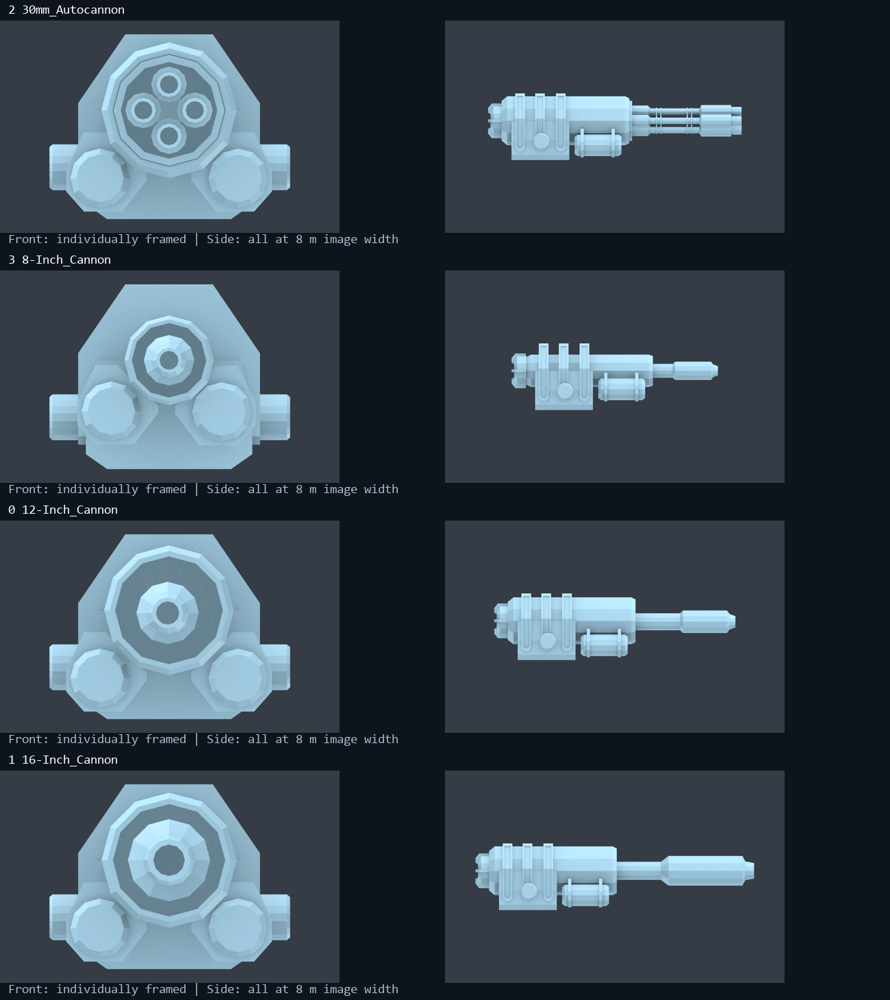
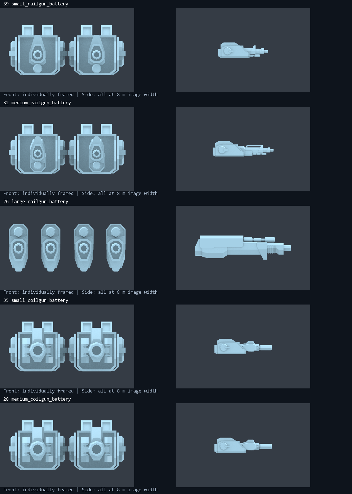
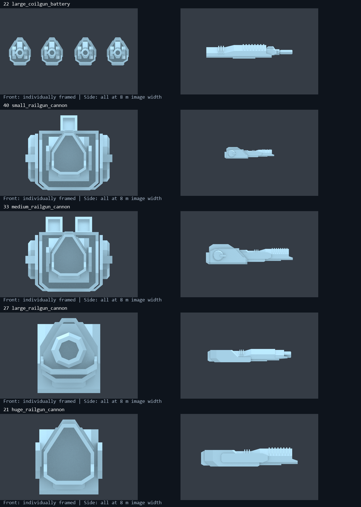
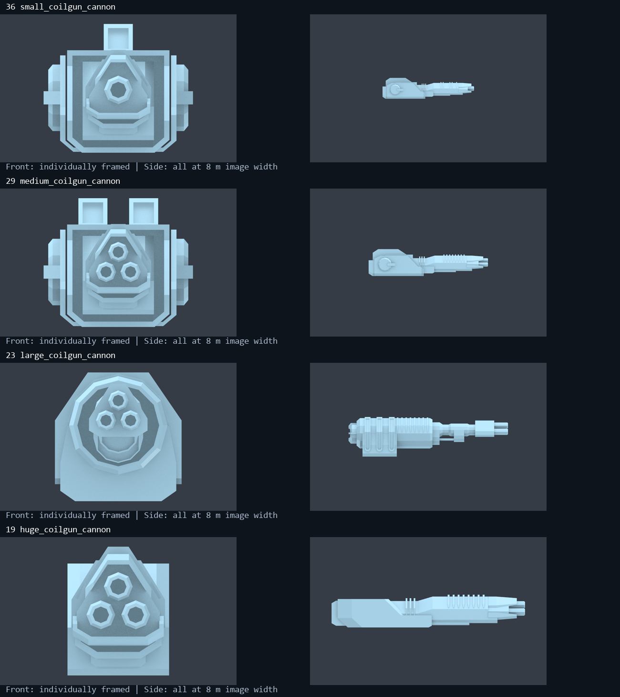
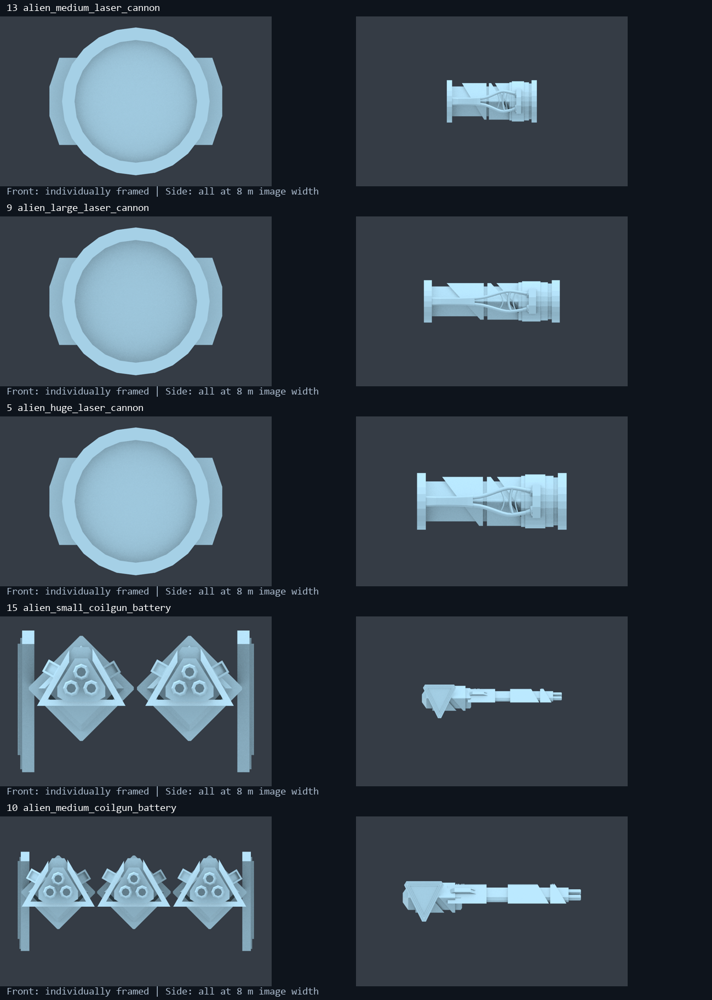
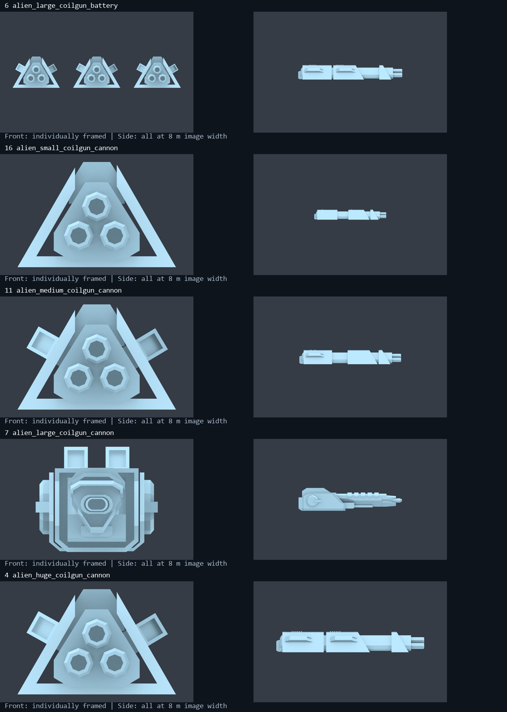
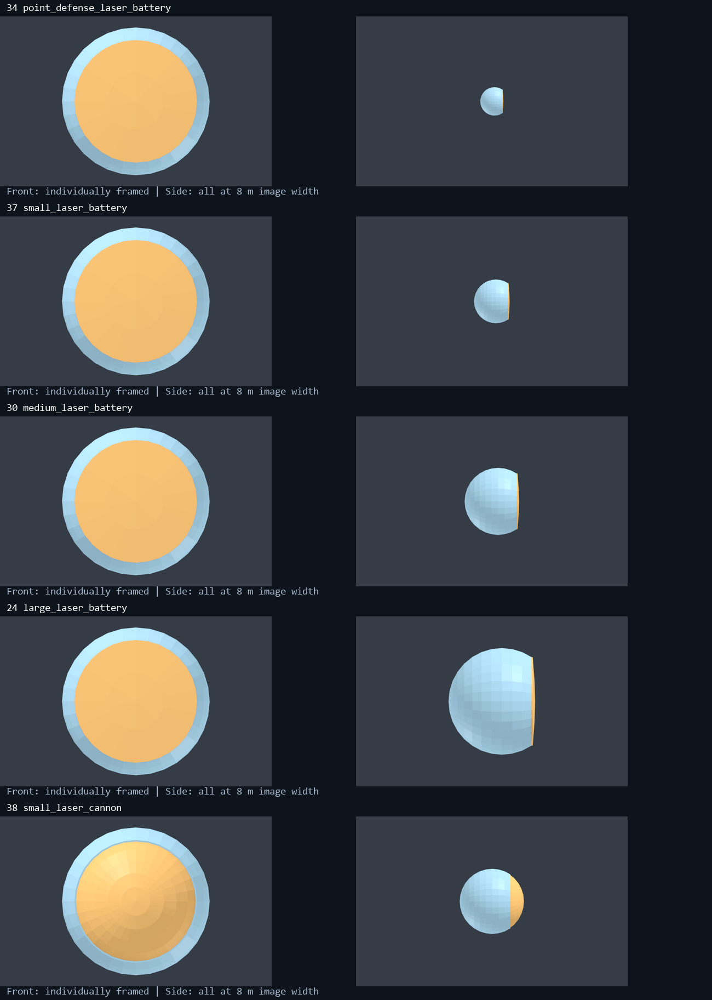
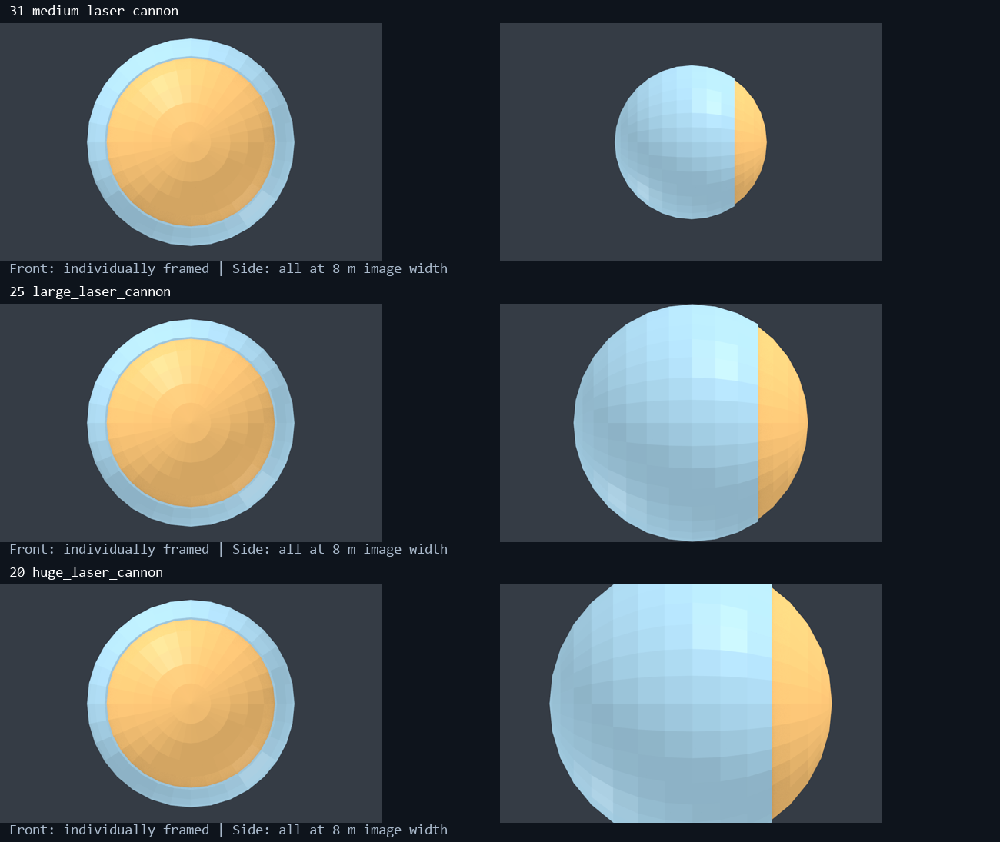
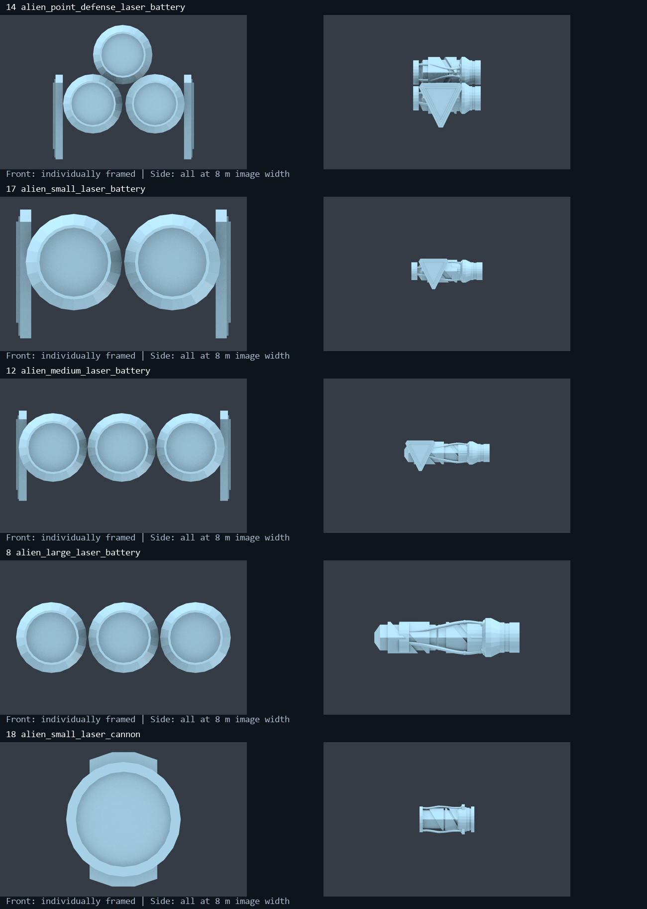

# Barrel and laser aperture dimensional audit

2026-10-21. **Research only; no weapon, template, mesh, mount or balance changes.**

The small and medium hull coils really are the same size: their 3,214 moving-mesh
vertices match after removing translation to within 0.0000017 m. Both have two
approximately 177 mm muzzle openings and 3.421 m moving assemblies. This is not
just a camera effect. The strongest gunpowder mismatch is the 30–40 mm
autocannon: each of its four visible openings is about 155 mm across. Human and
especially alien laser apertures are generally much smaller than the diameters
used by the simulation.

## Coverage and evidence

| Inventory | Templates | Resources | Treatment |
|---|---:|---:|---|
| Gunpowder ship weapons | 8 | 4 | Every hull and nose weapon |
| Magnetic ship weapons | 70 | 21 | Human rail/coil, siege, alien and all generations |
| Laser ship weapons | 88 | 16 | Human/alien, PD, hull, nose, Xasers and Grasers |
| Region/base lasers without ship art | 37 | 0 | Data inventoried; no geometry inferred |
| Total | 203 | 41 | 166 ship templates have measured art |

The [complete numerical inventory](barrel-lens-audit/numerical-inventory.md)
contains all 203 template mappings, all 41 resources, dimensions, ratios and
deltas. The [source inventory](barrel-lens-audit/inventory.json),
[derived dimensions](barrel-lens-audit/dimensions.json),
[cross-sections](barrel-lens-audit/sections.json),
[compressed geometry](barrel-lens-audit/measured-geometry.npz) and
[reproduction recipe](barrel-lens-audit/reproduction.md) preserve the evidence.
The [larger-laser proposal](larger-laser-aperture-proposal-2026-10-21.md) separately
quantifies gameplay options. This is static asset/code inspection and offline
calculation, not an in-game rendering or battle test.

Installed English names/descriptions were also checked in `TIGunTemplate.en`,
`TIMagneticGunTemplate.en` and `TILaserWeaponTemplate.en`. Gun names supply
calibers, but their prose supplies no specific real-world mark or barrel-length
standard. Magnetic descriptions identify classes/technology rather than a
numeric caliber. Laser names supply the cm values; some descriptions explicitly
call phasers phased arrays. The audit therefore treats magnetic collision
diameters as derived proxies and does not claim the game's own phased-array
terminology establishes a particular visible multi-aperture layout.

Measurements apply weapon-resource root and moving-child scales. Native
`ShipModelController.SetWeapon` copies these scales for a normal combat ship;
designer and `simpleHull` paths can retain placeholder scales. These are
**nominal combat-resource metres**, not a promise that every preview displays
these dimensions. Hull parent transforms can also affect apparent size.
[Source hashes](barrel-lens-audit/source-hashes.json) identify the inputs;
the freshly inspected game DLL is
`4A4B9AAE4154E444E9727204205D2D42AE8ED9E1C5F92CDC1280074A259D8350`.

## Measurement definitions and limits

* **Opening X/Y:** visible inner polygon width/height at a plane 0.1 mm behind
  the muzzle lip, excluding outer walls and the span across multiple barrels.
* **Inscribed diameter:** largest centered circle within that polygon. This
  distinguishes flats from corners; it is not a rifling measurement.
* **Outer lip:** outside contour at the same plane, not receiver width.
* **Assembly length:** the moving component's full forward-axis extent,
  including receiver and housing. It is not internal acceleration length.
* **Laser aperture:** projected human optical-cap submesh width, or alien inner
  front-rim width. These are visible clear-face proxies, not ray-traced pupils.

Human lens caps are curved. Cutting at their foremost vertex would produce a
nearly zero diameter, so the whole separate cap submesh was measured. Three
human nose rails have projecting lower lips and closed broad faces: their tip
cross-section is not a bore. They are marked unresolved, with face dimensions
reported separately. These semantic checks prevent misleadingly tiny numbers.

Values are rounded to 0.1 mm for comparison and 0.001 m for assemblies; that
arithmetic precision does not make the artwork an engineering drawing. Front
views below are independently framed closeups. **Side views share an 8 m image
width**, excluding the stationary base. Flat analysis materials expose geometry;
orange marks human optical-cap submeshes. Original textures, VFX and live
animation are not reproduced.

## Gunpowder: a useful but uneven yardstick

| Weapon | Caliber mm | Opening X mm | Inscribed mm | X error mm | X error % | Moving assembly m |
|---|---:|---:|---:|---:|---:|---:|
| 30 mm hull | 30.0 | 155.4 | 150.1 | +125.4 | +418.0% | 5.972 |
| 35 mm nose | 35.0 | 155.4 | 150.1 | +120.4 | +344.0% | 5.972 |
| 40 mm hull / nose | 40.0 | 155.4 | 150.1 | +115.4 | +288.5% | 5.972 |
| 6-inch hull | 152.4 | 160.7 | 155.2 | +8.3 | +5.5% | 4.859 |
| 8-inch hull | 203.2 | 198.3 | 191.5 | -4.9 | -2.4% | 5.680 |
| 10-inch nose | 254.0 | 198.3 | 191.5 | -55.7 | -21.9% | 5.680 |
| 12-inch nose | 304.8 | 267.0 | 257.9 | -37.8 | -12.4% | 6.562 |

The 6-inch opening is within a centimetre under either convention. The 8-inch
opening is close across the measured axes, although its polygon flats are
11.7 mm below nominal. Neither proves engineered bore precision. The 10- and
12-inch discrepancies clearly exceed a centimetre.

| Resource / use | Receiver-front Z m | Tip Z m | Exposed forward assembly m | Outer muzzle lip mm |
|---|---:|---:|---:|---:|
| `30mm_Autocannon` / 30–40 mm | 2.08138 | 4.72582 | 2.64444 | 215.0 per tube |
| `8-Inch_Cannon` / 6-inch | 2.07038 | 3.60136 | 1.53098 | 215.1 |
| `12-Inch_Cannon` / 8- and 10-inch | 2.06338 | 4.41559 | 2.35221 | 265.4 |
| `16-Inch_Cannon` / 12-inch | 2.08838 | 5.32283 | 3.23445 | 364.4 |

Exposed lengths use the visually identifiable broad receiver's front shoulder,
in posed-resource coordinates, and include projecting tube/shroud/muzzle
hardware. Internal bore behind that shoulder is not modeled sufficiently to
measure full barrel length. The common receiver family has different forward
extensions. Filenames are misleading: `8-Inch_Cannon` contains a moving mesh
named `6-Inch_Cannon`, while the in-game 8-inch gun uses `12-Inch_Cannon`.
Template-to-resource mapping defines the comparison.

### Real-world interpretation

A 30 mm bore is 30 mm; 6/8/10/12 inches correspond to
152.4/203.2/254.0/304.8 mm. Those are defensible diameter yardsticks. Caliber
alone does **not** specify barrel length, shroud, recoil mechanism or mount.
The Navy identifies a **6-inch/30 Mk 3** gun; a separate DLA record identifies
an **8-inch Mark 16, 55-caliber** barrel. Those additional design and length
designations matter. No exact real-world mark or barrel-length ratio was
established for these fictional space weapons.
[US Navy collection](https://www.history.navy.mil/our-collections/artifacts/arms-and-ordnance/cannons/USSMaineGun.html),
[DLA barrel record](https://quicksearch.dla.mil/qsDocDetails.aspx?ident_number=83234).

The game's autocannon has **four** barrels. Goalkeeper's GAU-8/A has **seven**,
so this is not an exact GAU-8 model. General Dynamics' current drawing puts
the gun itself at roughly 2.8–2.85 m long; its printed 112.28-inch and 2,800-mm
labels are not exact conversions. The game's 5.972 m moving assembly includes
its own large receiver, making that length comparison approximate. Its roughly
fivefold bore excess is stronger evidence of exaggeration than length alone.
[Manufacturer description](https://www.gdots.com/armaments/naval-platforms-system/),
[dimensional brochure](https://www.gdots.com/wp-content/uploads/2025/06/400003355-30mm-GAU-8-A-Gatling-Gun-Product-Brochure-2025-06.pdf).

A similar receiver across 30 and 40 mm is not inherently implausible: Northrop
describes a Mk44S conversion changing the barrel and a few other parts. Keeping
the **same opening** across 30/35/40 mm is the shortcut here.
[Northrop's Mk44S description](https://news.northropgrumman.com/bushmaster/northrop-grumman-enhances-usmc-amphibious-combat-vehicles-with-bushmaster-chain-guns).

### Consequence for the deferred 25 mm proposal

Scaling the existing model by 25/30 gives approximately **129.5 mm openings**,
not 25 mm, preserving the original 5.18× opening/caliber ratio. The
[earlier 25 mm proposal](archive/25mm-autocannon-2026-10-21/25mm-autocannon-and-two-cell-upgrade-proposal-2026-10-21.md)
remains a clearance/balance concept, but would not establish centimetre-scale
realism. Matching the current 30 mm opening alone requires about 0.193×
transverse scaling. Applying that to the whole model would also shrink the
receiver and length excessively. Prefer separate bore/tube edits and an
explicit receiver footprint. Distinct calibers need distinct art or per-weapon
scaling; editing the shared resource changes all four templates.

## Magnetic guns: bore, barrel count and accelerator packaging

Magnetic templates have no declared caliber field equivalent to gunpowder.
EEO derives collision diameter from **complete round mass**, density
19,300 kg/m³ and length/diameter 10:

`D = (4 × ammoMass / (pi × 19300 × 10))^(1/3)`.

This is a mod convention, not proof of intended bore, sabot size or accelerator
architecture. Outer coil housings need not scale exactly with projectile
diameter. It nevertheless provides a consistent relative check: doubling mass
predicts 1.260× diameter, not 2×. Use `ammoMass_kg`, not the smaller damaging
mass. See [collision math](../../TIEconomyMod/Core/ProjectileCollisionMath.cs)
and [registry](../../TIEconomyMod/Core/ProjectileGeometryRegistry.cs).

| Hull family | Small / medium / large openings | Bore X mm | Moving assembly lengths m | Ordinary proxy mm |
|---|---|---|---|---|
| Rail | 2 / 2 / 4 | 99.5 / 85.5 / 176.5 | 2.967 / 3.620 / 5.706 | 45.2 / 58.3 / 68.2 |
| Coil | 2 / 2 / 4 | 177.1 / 177.1 / 144.6 | 3.421 / 3.421 / 5.000 | 44.1 / 54.8 / 69.1 |

Medium hull coils change neither receiver, opening, barrel count nor length
meaningfully. Their pivot/placement differs slightly, explaining the previous
whole-turret box differences. Small-to-medium mass ratio is 25/13 = 1.923,
implying a **24.4%** diameter increase under the collision convention. Actual
opening ratio is 1.000, a **19.6% shortfall relative to that expected ratio**.

Large hull coils add two barrels and lengthen the assembly, but each opening
becomes **18.4% smaller**. Small-to-large expected diameter is 1.567×; actual
per-barrel ratio is 0.816×. Retaining the small gun's bore ratio would require
roughly **1.000 / 1.244 / 1.919×** transverse corrections to the existing
small/medium/large forward tubes. This is an art-coherence option, not a
recommendation to enlarge every base or a claim that 177 mm is an accurate
absolute small-coil bore.

Hull rails also invert: the medium is longer but its opening is 14.0% narrower.
Large openings are elliptical, about 176.5 × 193.0 mm. A single diameter hides
that distortion. Address per-barrel geometry before relying on total turret
width as a size signal.

| Nose coil | Openings | Bore X mm | Assembly m | Ordinary proxy mm | Siege proxy mm |
|---|---:|---:|---:|---:|---:|
| Light | 1 | 88.5 | 3.092 | 58.9 | — |
| Medium | 3 | 81.2 | 4.035 | 74.6 | — |
| Heavy | 3 | 120.0 | 5.391 | 85.3 | 183.6 |
| Spinal | 3 | 140.8 | 6.541 | 93.8 | 202.0 |

Medium nose coils add barrels but each opening is 8.2% narrower than the
light's, despite a 26.7% expected projectile-diameter increase. Heavy-to-spinal
is closer: openings grow 17.3%, versus 10.0% for the ordinary proxy. Siege
variants reuse these meshes with approximately ten times the mass and
**2.154×** derived diameter. The 183.6/202.0 mm proxies exceed even the
120.0/140.8 mm opening widths; allowing sabot clearance would not resolve an
already undersized opening.

Light/medium/spinal rails have closed broad accelerator faces, not measurable
cylindrical bores. Face widths are 307.0/537.3/743.7 mm; moving assembly lengths
are 2.882/5.043/5.609 m. Heavy rail changes to a visible 208.5 mm round opening
and is 4.845 m long. Do not label face width as caliber or treat this design
change as a like-for-like bore regression. Internal rail lengths are unresolved.

Human Mk I/II/III share geometry and complete round mass. Different velocity,
cadence or damaging fraction need not require a larger bore. Extra visible
barrels do not independently multiply configured shots or DPS.

### Alien magnetic exceptions

| Alien magnetic art | Openings | Opening X × Y mm | Assembly m | Base → Gen3 proxy mm |
|---|---:|---|---:|---|
| Light battery | 6 | 66.0 × 66.0 | 4.118 | 50.0 → 61.3 |
| Medium battery | 9 | 93.5 × 93.5 | 5.245 | 63.1 → 76.9 |
| Heavy battery | 9 | 98.2 × 98.2 | 4.302 | 79.1 → 96.9 |
| Light cannon, including mini | 3 | 67.9 × 67.9 | 2.976 | 69.1 → 85.0 |
| Medium cannon | 3 | 96.0 × 96.0 | 4.203 | 87.1 → 106.7 |
| Heavy cannon | 1 | 161.2 × 94.9 | 4.271 | 99.7 → 134.4 |
| Spinal cannon | 3 | 139.6 × 139.6 | 6.115 | 109.7 → 169.3 |

Heavy batteries are **18.0% shorter** than medium while adding only 5.1% to
each opening, retaining nine barrels. Heavy nose art instead uses a single
oval mouth: its 161.2 mm width conceals a 94.9 mm vertical restriction below
even the base 99.7 mm circular proxy. Several Gen3 rounds exceed openings.
The heavy battery's 96.9 mm proxy fits within the 98.2 mm corner span but
exceeds its inscribed polygon clearance. Advanced versions retain base mass
and geometry; Gen3 mass increases have no corresponding art growth. All
generations and the half-nose mini exception are retained in the full inventory.

## Lasers: visible optics versus simulation

Fresh inspection of `TILaserWeaponTemplate` confirms
`mirrorDiameter_m = 2 × mirrorRadius_cm / 100`. The numeric weapon name matches
the stored **radius**, not simulation diameter. Calling the 360 cm battery a
3.6 m diameter lens understates its simulation aperture by two. The code does
not read mesh geometry when calculating beam focus.

| Human optic | Simulation D m | Visible D m | Art deficit / excess | Art factor to current D |
|---|---:|---:|---:|---:|
| PD, radius 30 cm | 0.600 | 0.694 | +15.7% | 0.865× |
| Hull 60 cm | 1.200 | 1.069 | -10.9% | 1.123× |
| Hull 120 cm | 2.400 | 1.639 | -31.7% | 1.464× |
| Hull 360 cm | 7.200 | 2.608 | -63.8% | 2.760× |
| Nose 240 cm | 4.800 | 1.591 | -66.8% | 3.017× |
| Nose 480 cm | 9.600 | 2.683 | -72.1% | 3.578× |
| Nose 720 cm | 14.400 | 4.138 | -71.3% | 3.480× |
| Nose 960 cm | 19.200 | 4.984 | -74.0% | 3.852× |

Hull art ratios from small are **1 : 1.533 : 2.441**, against simulation
**1 : 2 : 6**. Nose art is **1 : 1.686 : 2.601 : 3.132**, against
**1 : 2 : 3 : 4**. Medium-to-heavy nose progression is close (+2.8% ratio
error); the other nose steps are compressed. Wavelength and laser/arc/phaser
generation share art at constant radius, which is coherent.

Even interpreting labels as diameters would not remove the discrepancies:
the 960 cm nose would still have only a 4.984 m face, and family ratios would
remain unchanged. Halving radius fields to reinterpret labels changes combat
balance; it is not a cosmetic correction.

| Alien optic | Lenses | Simulation D m | Each visible D m | Equal-area D m | Per-lens art factor |
|---|---:|---:|---:|---:|---:|
| PD | 3 | 0.640 | 0.722 | 1.251 | 0.886× |
| Hull 64 cm | 2 | 1.280 | 0.528 | 0.747 | 2.424× |
| Hull 128 cm | 3 | 2.560 | 0.536 | 0.929 | 4.772× |
| Hull 384 cm | 3 | 7.680 | 0.902 | 1.562 | 8.514× |
| Nose 256 cm | 1 | 5.120 | 0.692 | 0.692 | 7.402× |
| Nose 512 cm | 1 | 10.240 | 1.033 | 1.033 | 9.913× |
| Nose 768 cm | 1 | 15.360 | 1.033 | 1.033 | 14.869× |
| Nose 1024 cm | 1 | 20.480 | 1.384 | 1.384 | 14.795× |

Alien medium hull art adds a lens but enlarges individual openings by just
1.6% when simulation diameter doubles. Medium-to-heavy nose art lengthens
the housing from 2.650 to 4.000 m while retaining a 1.033 m opening, despite
a 50% simulation-aperture increase: the optical analogue of identical hull coils.

Multiple lenses can imply an array, but `sqrt(N) × d` gives only equal
collecting area, not a justified filled-aperture diffraction diameter, phase
locking or useful array baseline. Native focus code receives no array geometry.
Even that area comparison gives only 1.562 m versus the heavy battery's 7.680 m
simulation diameter. A hidden larger mirror cannot simply be assumed to supply
the stated exterior aperture through a much smaller visible pupil.

## Correction order, deferred

1. Choose actual metre-scale apertures, coherent compressed family ratios, or
   merely clearer visual tiers. Document any deliberate compression factor.
2. Resolve the identical small/medium coils locally: about 24.4% larger medium
   forward-tube geometry follows the current projectile ratio. Review the
   large coil's narrower barrels separately; avoid enlarging bases by default.
3. Separate autocannon bore edits from housing footprint. Review shared
   10-inch art, 12-inch undersizing, siege bores and Gen3 alien openings before
   calling the inventory dimensionally consistent.
4. Separate laser art from stats. Art can match current apertures without an
   armor-penetration buff. Larger simulation apertures are an additional
   balance decision in the [companion proposal](larger-laser-aperture-proposal-2026-10-21.md).
5. Re-run fitting after art choices. Human heavy lasers need 2.760× aperture
   scaling to match current stats; some alien noses need roughly 15×. Old
   clearance conclusions cannot carry over. Inspect moving housings, pivots,
   surfaces, convergence, VFX origins and full elevation while retaining symmetry.

Hidden internal lengths were not invented, assets were not treated as working
engineering designs, and missing art was not silently omitted. The
[verification record](barrel-lens-audit/verification.json) records numerical
checks and preservation of existing runtime files.
