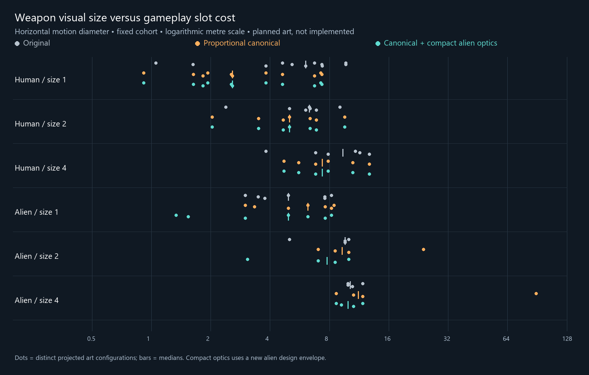

# Canonical turret scaling plan and projected fitting fallout

2026-10-21. **Planning only. No gameplay, template, mesh, hull-node or runtime
changes; no build, deployment or commit.** The
[25 mm proposal and evidence are archived](archive/25mm-autocannon-2026-10-21/README.md)
at the user's request. Existing 30/35/40 mm weapons remain the subject of this plan.

The recommended direction is **canonical bores and optical apertures with
unchanged combat statistics**, using proportional scaling where the existing
shape remains useful and a compact replacement optical head for alien lasers.
Scaling every alien laser component proportionally produces an avoidable giant
receiver/mount, not merely the required lens. Keep slot costs unchanged in the
initial art pass. Of the tier changes tested, heavy rail batteries 4 → 2 are
the most credible follow-up; they still need an explicit capital-eligibility
solution. Heavy coils 4 → 2 and the 6-inch gun 1 → 2 have substantial fallout.

Canonical scaling makes the largest human size-1/2/4 clearance bounds orderly,
but **does not uniformly tighten within-tier visual sizes**. It removes the
autocannon outlier while exposing the naval-gun and heavy-optics differences.
Two tier moves improve some ordering metrics, but cannot make different weapon
families share one physical footprint without further compromises.

## Scope, canonical definitions and deliverables

The user clarified that simulation physics is authoritative: the native
`mirrorRadius_cm = 60` becomes **1.20 m diameter**, so the 3D aperture must also
be 1.20 m. The earlier name-as-diameter interpretation is retained only as a
rejected sensitivity scenario. No laser field is halved, and this plan does not
implement the separate [larger-aperture balance proposal](larger-laser-aperture-proposal-2026-10-21.md).

| Family | Canonical target | Limits on the interpretation |
|---|---|---|
| Gunpowder | Declared `projectileDiameter_mm` | Match the inner polygon's inscribed circle; caliber does not specify receiver or barrel length |
| Magnetic | Current EEO collision diameter from complete round mass | A provisional absolute art reference, not a native stated caliber or a complete sabot design |
| Laser, including PD | `2 × mirrorRadius_cm / 100` metres | One effective optical system; several visible lenses cannot simply be assumed equivalent |
| Closed-face nose rails | New opening should accommodate the derived projectile | Existing art has no measurable bore; no defensible whole-model scale yet |
| Plasma, particle and missile art | Retain current geometry | No measured canonical aperture dimension was established; retained in every hull inventory maximum |

Magnetic diameter is `(4 × ammoMass / (pi × 19300 × 10))^(1/3)` metres, from the
current [collision math](../../TIEconomyMod/Core/ProjectileCollisionMath.cs).
No new caliber, projectile length/density, shot mass, velocity or clearance
allowance is introduced. The comparison also tests a magnetic alternative that
retains the original light-gun scale and corrects only family mass ratios.

The original reports are preserved. A separate [projected report set](canonical-turret-projection/README.md)
contains:

* [Weapon inventory](canonical-turret-projection/weapon-inventory.md): all 147
  original hull templates, all 35 original hull resources, and a complete
  166-template gun/magnetic/laser target ledger including noses.
* [Class/appearance clearance](canonical-turret-projection/class-clearance.md):
  all 28 classes and 64 appearances, combat/designer, native/global inventories,
  seven padding rules, actual gaps and before/after deltas.
* [Legal loadouts](canonical-turret-projection/legal-layouts.md): the additional
  current-footprint check, separating legal maximum packings from hypothetical
  large guns on every ordinary node.
* [Extra-node inventory](canonical-turret-projection/node-inventory.md),
  [tier coherence](canonical-turret-projection/size-tier-coherence.md), and
  [DPS/mass fallout](canonical-turret-projection/dps-analysis.md).

The projection reproduces **all 5,376 original fit records**, including pass/
fail, extra-node subsets and edge gaps; maximum gap discrepancy is **0 m**.
This guards the baseline before applying new factors. Full coordinate and
geometry provenance is in the [methodology](canonical-turret-projection/methodology.md).
No live rendering or combat test is claimed.

## Concrete proportional scale targets

These factors apply to the entire original weapon about its mount origin in
the proportional comparison. They therefore affect base, receiver, barrel,
pivot offset and overall length together. They are reproducible candidate
transforms, not proof that every resized mechanism remains aesthetically or
mechanically convincing.

| Gunpowder weapon | Target bore mm | Whole-model factor | Change |
|---|---:|---:|---:|
| 30 mm | 30 | 0.199859× | -80.0% |
| 35 mm nose | 35 | 0.233169× | -76.7% |
| 40 mm hull / nose | 40 | 0.266478× | -73.4% |
| 6-inch | 152.4 | 0.981646× | -1.8% |
| 8-inch | 203.2 | 1.060939× | +6.1% |
| 10-inch nose | 254.0 | 1.326173× | +32.6% |
| 12-inch nose | 304.8 | 1.181638× | +18.2% |

These differ slightly from the preceding audit's corner-width factors because
this plan fits the circular projectile **between the polygon flats**. The
30 mm gun becomes approximately **0.699 × 0.574 × 1.221 m** overall; the 40 mm
becomes **0.931 × 0.766 × 1.628 m**. Both remain size 1. The archived new 25 mm
weapon and two-cell autocannon proposal are not carried forward.

| Human magnetic example | Current size | Whole-model factor | Projected W × H × L m | Horizontal motion D m |
|---|---:|---:|---|---:|
| Light rail battery | 1 | 0.492× | 1.719 × 1.078 × 1.902 | 2.544 |
| Light coil battery | 1 | 0.270× | 0.942 × 0.623 × 1.162 | 1.633 |
| Medium coil battery | 2 | 0.335× | 1.172 × 0.763 × 1.411 | 2.032 |
| Heavy rail battery | 4 | 0.413× | 2.413 × 0.970 × 3.670 | 4.715 |
| Heavy coil battery | 4 | 0.517× | 3.023 × 1.215 × 4.159 | 5.599 |

Small and medium coils now differ by the expected 1.244× bore ratio. Mk I/II/III
can continue sharing art where complete round mass is unchanged. Siege and
Gen3 variants cannot automatically share the base scale: their projectile
proxies differ. The full target ledger retains these distinctions, oval alien
openings and the three unresolved closed-face nose-rail resources.

The absolute magnetic scale is the largest judgment call. Matching a collision
proxy can make a very powerful weapon's exposed assembly small; it does not
justify scaling its mass, energy or total below-deck machinery by the cube of
the art factor. A selectively remodeled tube with a substantial receiver is
also defensible. The `head_only` and `mag_relative` scenarios quantify why those
choices do not have the same footprint as uniformly shrinking everything.

| Human laser art | Canonical D m | Proportional factor |
|---|---:|---:|
| PD | 0.60 | 0.865× |
| Small hull | 1.20 | 1.123× |
| Medium hull | 2.40 | 1.464× |
| Large hull | 7.20 | 2.760× |
| Small nose | 4.80 | 3.017× |
| Medium nose | 9.60 | 3.578× |
| Large nose | 14.40 | 3.480× |
| Spinal nose | 19.20 | 3.852× |

Human ball-shaped optics scale reasonably in form, but their larger sizes still
require renewed foundation, elevation and nose-clearance inspection. Nose
dimensions are inventoried, **not certified against nose mounts** by the old
hull-node dataset. PD follows its native optical parameter even though its
localized name does not print a number.

## Why alien lasers need remodeled heads

| Alien optical system | Required D m | Existing per-lens D m | Proportional factor |
|---|---:|---:|---:|
| PD | 0.640 | 0.722 | 0.886× |
| Small hull | 1.280 | 0.528 | 2.424× |
| Medium hull | 2.560 | 0.536 | 4.772× |
| Large hull | 7.680 | 0.902 | 8.514× |
| Small nose | 5.120 | 0.692 | 7.402× |
| Medium nose | 10.240 | 1.033 | 9.913× |
| Large nose | 15.360 | 1.033 | 14.869× |
| Spinal nose | 20.480 | 1.384 | 14.795× |

The literal proportional hull case scales every existing lens and the entire
long support structure. Its heavy laser becomes **46.224 × 14.041 × 62.985 m**,
with a **96.966 m** full-rotation sphere. Retaining the base and scaling only the
moving assembly still gives an **81.699 m** bound. Tier reassignment cannot
repair that geometry.

The preferred alien alternative is a **new single-aperture optical head** per
weapon system. A concrete envelope contract is used for the projection:

* Clear aperture equals native `D`; exterior spherical housing diameter is
  **1.20 D**. The 20% housing allowance is an explicit design assumption, not a
  native measurement or a detailed optical-engineering design.
* Preserve the original stationary base. Center the new head horizontally over
  its mount; put its bottom at the base's top. Elevation pivot height is
  `baseTop + 0.60 D`.
* The moving sphere radius is `0.60 D`; the full node-centered sphere radius is
  `max(baseRadius, baseTop + 1.20 D)`. Horizontal motion diameter is
  `max(baseHorizontalDiameter, 1.20 D)`.
* Bake/normalize the new head's transforms so the existing alien nonuniform
  root and compensating child scales cannot distort it while elevating. Apply
  the intended scale in preview as well as combat.

This is **proposed replacement geometry**, not an assertion that existing art
shrinks into that envelope. It deliberately replaces the multiple visible
emitters with one optical aperture representing the one native focusing
parameter. It preserves shot power and beam quality. If multiple lenses must
remain for art identity, their effective aperture and support layout need a
separate design; summing their areas is not sufficient proof of equivalent
diffraction behavior.

The heavy alien hull design contract becomes **9.216 × 10.865 × 9.216 m**
including its preserved base, with a **21.640 m** 3D bound and **9.216 m**
horizontal bound. This avoids most of the proportional model's excess length.
Alien nose systems should use the same dimensioned-head design process, but
their larger 5.12–20.48 m pupils require a dedicated nose-attachment study;
their hull-node clearances are not inferred from these tables.

## Mount-clearance fallout

All values below use the **same conservative full-rotation spheres** as the
original report. A failed certificate is not proof of visible collision.

| Faction / size | Original worst D m | Proportional D m | Preferred alien-head alternative D m |
|---|---:|---:|---:|
| Human 1 | 12.952 | 10.429 | 10.429 |
| Human 2 | 12.175 | 12.917 | 12.917 |
| Human 4 | 14.637 | 17.499 | 17.499 |
| Alien 1 | 8.774 | 11.688 | 8.832 |
| Alien 2 | 12.037 | 31.794 | 12.037 |
| Alien 4 | 12.296 | 96.966 | 21.640 |

The human worst-case ladder changes from a size-1 gun larger than the size-2
maximum to a monotonic 1 < 2 < 4 progression. The binding human size-1 weapon
becomes the 6-inch gun, size 2 remains the 8-inch gun, and size 4 becomes the
large laser. These are sphere maxima; the visually widest/longest weapon can
still differ, as the full inventory shows.

| Native geometry, ≥5 m gap across every appearance | Original maximum size | Proportional | Compact alien optics |
|---|---|---|---|
| Frigate | NC | 1 | 1 |
| Destroyer | 4 | 2 | 2 |
| Cruiser | 4 | 4 | 4 |
| Battlecruiser | 4 | 4 | 4 |
| Lancer | 4 | 2 | 2 |
| AlienEscort / AlienMonitor | 4 | 1 | 2 |
| AlienFrigate / AlienCruiser / AlienBattleship | 4 | 1 | 2 |
| AlienDestroyer / AlienBattlecruiser / AlienLancer | 4 | 2 | 4 |
| AlienTitan | 4 | 1 | 2 |

Among the 22 classes with at least two ordinary hull cells, native-geometry
5 m certifications for size 1/2/4 change from **13 / 13 / 13** to
**14 / 7 / 2** under proportional scaling, or **14 / 13 / 5** with compact
alien heads. This is an all-node hypothetical test; it is not the number of
playable classes or a license to alter their fitting rules. Original native
Mothership duplicates are retained in that baseline for comparability.

### Existing legal ships and the corrected Mothership

The [legal-layout report](canonical-turret-projection/legal-layouts.md) enumerates
correct stock merge-node placements, avoiding the mistaken assumption that
every UI cell independently carries a large gun. The Monitor has two legal
two-cell guns and no FourHull block in the audited native grid. Its size-1
worst bound improves by **2.523 m**, while its size-2 worst bound worsens by
**0.742 m** as the 8-inch opening is corrected. No extra node or hull-slot repair
is proposed; inspect the small geometric change at the existing mounts.

| Current 0.10.4 Mothership, size 4 | Minimum active-node gap m | All seven margin tests | Geometrically compatible authored pairs |
|---|---:|---|---:|
| Existing weapon art | 21.904 | Pass | 20 |
| Proportional canonical art | -62.766 | NC | Ordinary set NC |
| Compact alien optical head | 12.560 | Pass | 20 |

The compact concept preserves a substantial margin on the corrected Mothership
without moving its symmetric mounts. It consumes **9.344 m** of the earlier
worst-case gap. This is a neighbor-envelope certificate, not a hull-surface,
gimbal, radiator or firing-arc test. The UI remains at **16 active guns**;
20 authored pairs do not remove the native 40-icon limit identified earlier.
No extra guns or corresponding mass increase are included.

Human Titan variants remain a priority for actual rendering: their existing
worst size-4 sphere gaps of **-1.597 / -8.197 / 3.263 / 14.363 m** become
**-4.459 / -11.059 / 0.401 / 11.501 m**. The negative results were already
conservative warnings; larger optics consume another 2.862 m. AlienTitan's
FourHull-only policy likewise makes its loss of the blanket size-4 certificate
an actual loadout-review priority, even with compact heads.

## Does this align visual size with gameplay size?

Use horizontal motion diameter for this question rather than charging vertical
pivot height against deck footprint. The [coherence report](canonical-turret-projection/size-tier-coherence.md)
includes ranges, quartiles, medians, coefficients of variation and cross-tier
inversions. Its paired cohort holds weapon/art representatives fixed before
and after, so splitting the shared 30/40 mm art does not bias the comparison.

| Paired human cohort | Original | Canonical art | Canonical + 6-inch up / heavy rail down |
|---|---:|---:|---:|
| Size-1 median horizontal D m | 6.056 | 2.578 | 2.561 |
| Size-2 median horizontal D m | 6.327 | 5.013 | 5.013 |
| Size-4 median horizontal D m | 9.352 | 7.343 | 7.882 |
| Size-1 coefficient of variation | 0.474 | 0.608 | 0.615 |
| Size-2 coefficient of variation | 0.309 | 0.419 | 0.379 |
| Size-4 coefficient of variation | 0.343 | 0.347 | 0.297 |
| Lower-size art larger than higher, 1 vs 2 | 48.1% | 29.9% | 22.2% |
| Lower-size art larger than higher, 2 vs 4 | 21.4% | 23.8% | 17.8% |

Median separation and size-1/2 ordering improve. Within-tier relative spread
does not uniformly improve: size-1 guns become very compact while naval,
particle and missile hardware retain larger envelopes. Even the tested pair
of retiers leaves size-1 variation worse. Canonical caliber/aperture and slot
cost describe different things; large per-shot energy, range, power machinery,
magazine and balance can legitimately cost slots without a matching exterior.

Alien proportional scaling is especially poor: size-4 horizontal max/min grows
from about **1.19× to 10.30×**. The compact-head alternative brings it back to
**1.36×**, close to the existing tier's consistency. It does not solve every
size-1/2 inversion, because its small optics are deliberately compact too.

## Optional tier moves and their cost

| Candidate | Visual rationale | Gameplay/fitting consequence | Recommendation |
|---|---|---|---|
| Heavy rail batteries 4 → 2 | Canonical 4.715 m horizontal bound fits the middle of size-2 art | Mk3 family raw output rises on compatible ordinary grids; capital eligibility breaks unless handled | Best conditional follow-up, after art acceptance |
| Heavy coil batteries 4 → 2 | Canonical 5.599 m bound overlaps size-2 art | Much larger output gains and capital blocker | Do not apply as a cosmetic correction |
| 6-inch gun 1 → 2 | Removes the largest size-1 sphere and places it beside the 8-inch | Removes naval hull guns from one-cell ships and horizontal-incompatible Escort | Keep size 1 initially; reconsider only with an explicit early-hull role decision |
| 8-inch 2 → 1 | Could fill small ships after other shrinkage | Makes the largest size-2 sphere a worse size-1 outlier | Reject for visual consistency |
| Heavy lasers 4 → a larger tier | Their optics now occupy more space | Requires new footprint/mapping/UI work; a tier label does not change physical separation | Redesign mount/head where needed before adding a tier |

All tested size-2 candidates use **TwoHullHoriz**. Vertical orientation is not
interchangeable: it can preserve the Escort's fit while changing other classes.
Do not promise every two-cell ship the same availability from slot count alone.

| Class / family, Mk3 where applicable | Original raw MJ/s | Candidate raw MJ/s | Change |
|---|---:|---:|---:|
| Monitor rail, heavy 4 → 2 | 81.648 | 112.696 | +38.0% |
| Cruiser rail, heavy 4 → 2 | 60.669 | 76.193 | +25.6% |
| Dreadnought rail, heavy 4 → 2 | 163.296 | 225.392 | +38.0% |
| Monitor coil, heavy 4 → 2 | 278.438 | 701.319 | +151.9% |
| Cruiser coil, heavy 4 → 2 | 204.229 | 415.670 | +103.5% |
| Dreadnought coil, heavy 4 → 2 | 701.319 | 1,402.637 | +100.0% |
| Escort naval, 6-inch 1 → 2 | 17.422 | 0 | -100.0% family availability |
| Corvette naval, 6-inch 1 → 2 | 8.711 | 0 | -100.0% family availability |
| Monitor naval, 6-inch 1 → 2 | 34.844 | 31.360 | -10.0% |
| Cruiser naval, 6-inch 1 → 2 | 26.133 | 15.680 | -40.0% |

These are optimal same-family grid loadouts, not whole-ship DPS or expected
damage through armor. Retiering keeps individual mass/crew/power unchanged:
for example, two heavy rails on a Monitor are **320 t versus 160 t** for its
prior two medium rails. Range, per-hit damage and power/heat also change when
the selected weapon changes. The full report includes all three magnetic
generations and every applicable class; a Mk3 outcome is not generalized to Mk1.

### Concrete prerequisite for a heavy-rail demotion

The current capital policy accepts `FourHull`, not a semantic heavy-weapon
category. Simply changing heavy rail IDs to `TwoHullHoriz` makes them illegal
on the Titan, including existing capital designs; the numerical table reports
zero eligible rail-family capital capacity rather than hiding this failure.

If the demotion is selected, first introduce one explicit capital-eligibility
predicate used consistently by footprint mapping, designer validation, AI,
legacy migration and loadout validation: existing FourHull weapons plus the
explicit heavy-rail family. Capital placement remains one eligible weapon per
cell; ordinary ships use the new two-cell footprint. Upgrade the capital layout
schema and preserve existing IDs, ammo fractions and weapon instances. Keep
tracking/HP at their pre-retier values unless a separate balance decision changes
them: native size-derived behavior must not silently turn faster when 4 becomes 2.
Review [CapitalMountPolicy](../../TIEconomyMod/Core/CapitalMountPolicy.cs),
[runtime validation](../../TIEconomyMod/Core/CapitalMountRuntime.cs) and
[fitting patches](../../TIEconomyMod/Patches/CapitalMountPatches.cs) together.

This is additional gameplay work, not part of the art-only phase. No tier move
is needed merely to retain the corrected Mothership geometry.

## Implementation sequence for a later authorized turn

1. **Finalize target ledger and model choice.** Adopt simulation-diameter lasers;
   retain plasma/particle/missile geometry. Confirm absolute magnetic proxy use
   versus bore-only remodeling before treating the proportional receiver sizes
   as final. Author proper mouths for the unresolved nose rails.
2. **Create per-template visual profiles.** Shared resources require separate
   factors for 30/35/40 mm, 8/10-inch, siege and Gen3 variants. Do not mutate a
   shared Unity mesh globally. Clone/bake variants or apply instance-local
   transforms keyed by template/profile, with source/build guards and idempotence.
3. **Keep mounts stable and align attachments.** Scale the base, moving vertices,
   pivot and fire-point exactly once in proportional profiles. Native SetWeapon
   copies only the base, first-child mesh and first fire-point transform, so
   changing a prefab root alone is insufficient in preview. Normalize new alien
   optical heads and explicitly reproduce their scale in designer/simple-hull
   paths. Preserve the Mothership's corrected symmetry and node identities.
4. **Inspect silhouette and articulation.** Small autocannons should read as
   compact CIWS-sized hardware; larger laser apertures must remain inside their
   housings. Check barbettes, pivot seating, elevation, recoil, muzzle/beam origin,
   renderer bounds, LOD and material behavior. No receiver or hidden machinery
   mass is inferred from visible mesh volume.
5. **Re-measure the final meshes.** Replace design-envelope rows with measured
   geometry and rerun the copied report set. Prioritize Titan/AlienTitan,
   Battleship/Dreadnought and changed two-cell naval guns on Monitor variants;
   perform a new nose-mount inventory for enlarged cannon optics.
6. **Build, deploy and test through the normal repository workflow.** Deployment
   must assert the game is closed. Verify both designer and combat, all variants,
   old saves/refits and feature-disabled behavior. Announce manual-test readiness
   immediately after a successful deployment.
7. **Evaluate one tier change separately.** Heavy rails are the first candidate;
   resolve the capital predicate/schema, then test progression and mixed layouts.
   Do not bundle heavy-coil density gains or removal of early naval-gun options
   into a graphical correction.

The archived 25 mm proposal remains historical evidence. The current plan
changes how existing weapons are represented, with any slot-cost change kept
explicit and separately reviewable.
