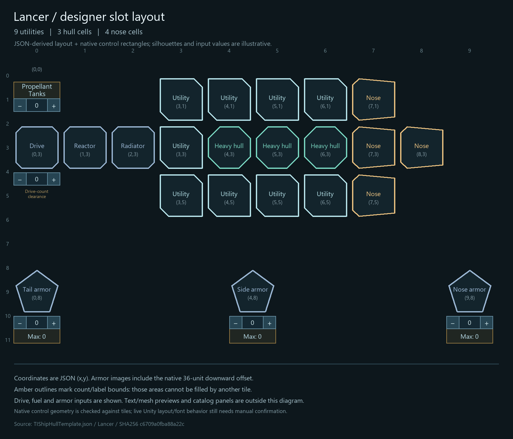
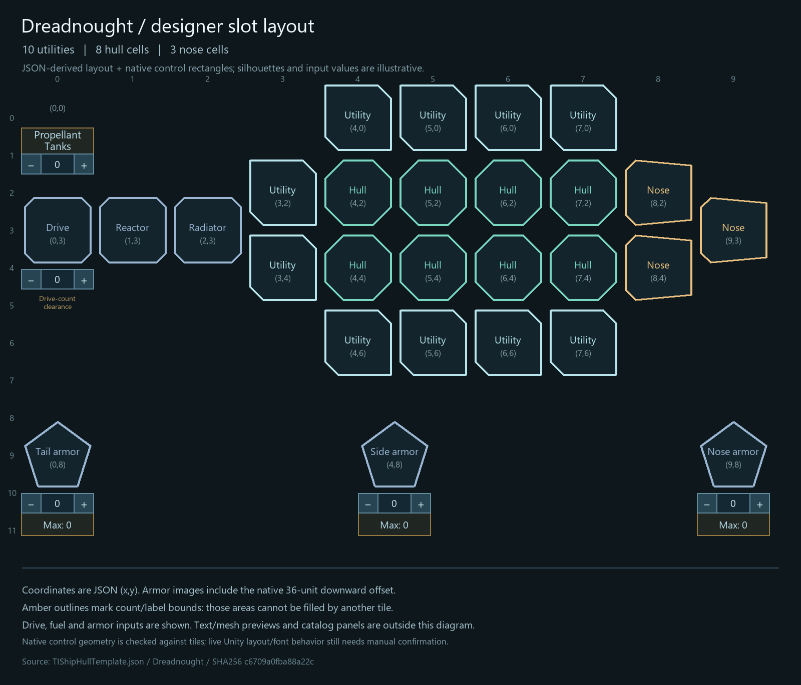
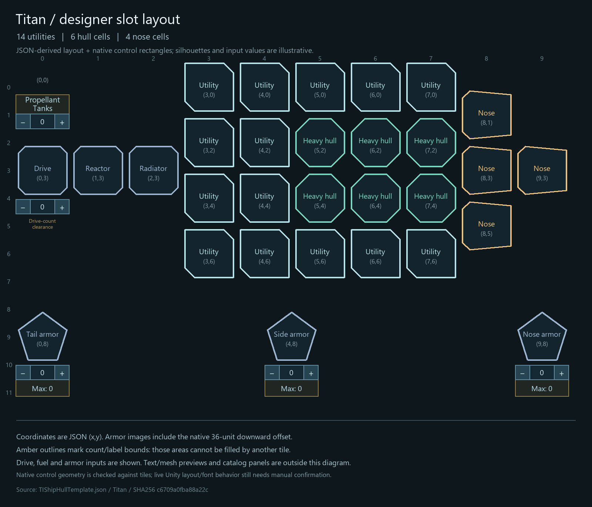
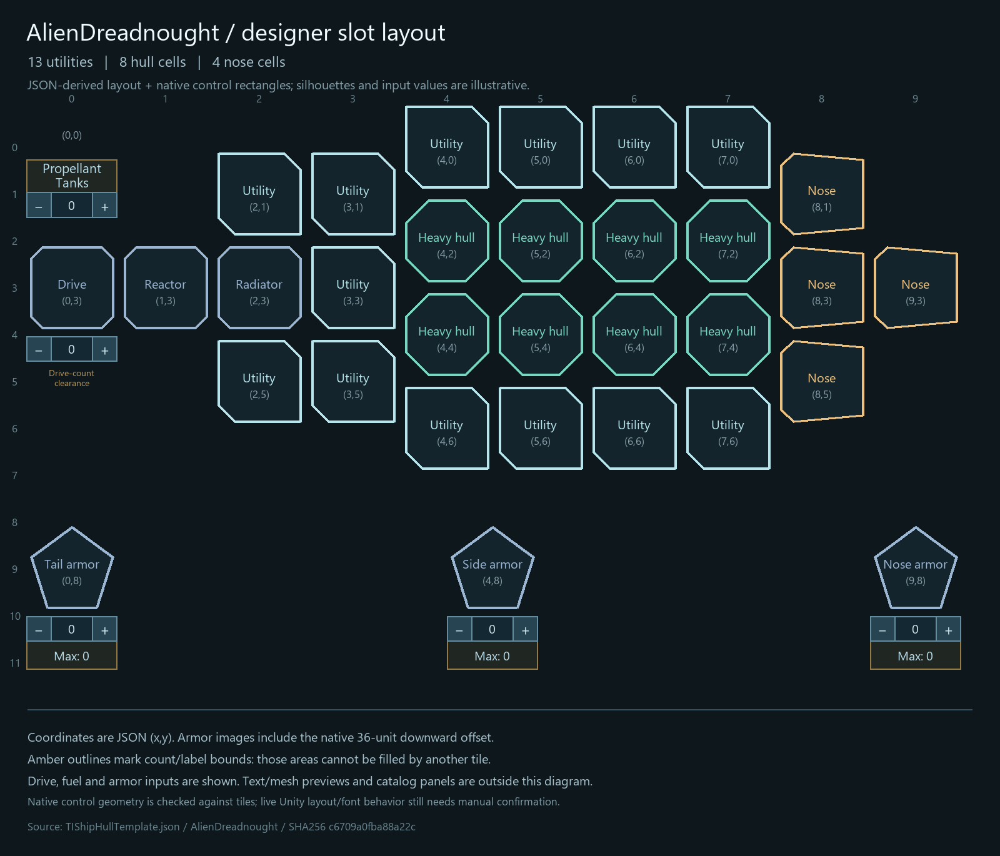
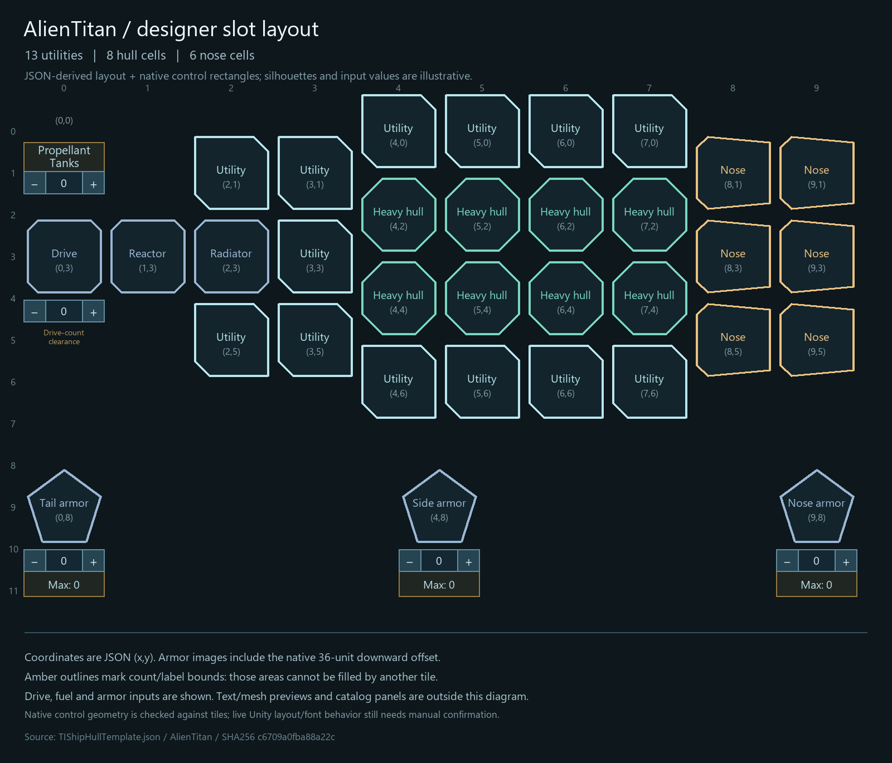

# Capital utility expansion and data-driven designer rows — 0.11.1

Status: **0.11.1 deployed for manual testing on 2026-11-04.** Values below are
the 0.11.1 baseline. [0.11.2](alien-capital-expansion-0.11.2-2026-11-04.md) adds
one more utility each to Alien Dreadnought/Titan and expands Mothership fitting;
the human values and JSON row count stay unchanged.

Add two utility slots through hull JSON to Human Lancer (7 → 9), Dreadnought
(8 → 10), Titan (12 → 14), Alien Dreadnought (10 → 12), Alien Titan (10 → 12).
Alien Lancer stays unchanged. Each pair adds 40 t of structure (20 t/slot);
human base crew increases by two and alien crew stays unchanged. Human bare
mass therefore rises by 46 t including existing 3 t/billet support.

Keep every existing serialized slot index and type. Lancer's single utility
column becomes three tall. Dreadnought utilities flank its aft hull-weapon
column. Titan's two three-high columns become four high, preserving relative
coordinates of existing multi-cell utilities. Alien additions use free aft
machinery columns. New entries append to the arrays; old weapon coordinates
are preserved. Armor coordinates move down into the added designer space.

The user's annotated screenshot specifies one full tile row of extra vertical
space between the existing content and bottom controls. Extend JSON layout
parsing to supply grid row count, origin and spacing. A generic UI adapter
allocates destinations declared by data, retains native armor spinners and
grows the window and central grid by the required row height. No class-specific
row count or utility placement belongs in C#. Standard template JSON continues
to own slot positions, counts, crew and structural mass.

Correct the existing appearance mass adapter to apply appearance *differences*
on top of JSON base mass, so future data changes cannot be silently cancelled.
Keep the current appearance differences and native construction/fitting tiers.

Use normal guarded deployment, with regression checks for index/type stability,
old multi-cell footprints, new row bounds, mass/crew and JSON layout parsing.
Do not rebuild separately or deploy over a running game. After deployment,
announce readiness and finish current tables/indexes. Native UI layout and
campaign/refit acceptance require manual testing.

## Deployed values

| Hull | Utility cells | Base crew | Structural mass (t) | Bare hull + base crew (t), V0 |
| --- | ---: | ---: | ---: | ---: |
| Human Lancer | 7 → 9 | 35 → 37 | 2,395 → 2,435 | 2,500 → 2,546 |
| Human Dreadnought | 8 → 10 | 52 → 54 | 3,044 → 3,084 | 3,200 → 3,246 |
| Human Titan | 12 → 14 | 56 → 58 | 3,632 → 3,672 | 3,800 → 3,846 |
| Alien Dreadnought | 10 → 12 | 50 | 2,750 → 2,790 | 2,900 → 2,940 |
| Alien Titan | 10 → 12 | 60 | 2,820 → 2,860 | 3,000 → 3,040 |

These increments are not rounded to another 100 tonnes. Each human appearance
retains its prior structural difference and gets the same +40 t, plus +6 t
crew support. Equipment, fuel and extra module crews remain additional costs.

## JSON layout and save compatibility

The [private JSON layout document](../../TIEconomyMod/ModFiles/Config/ship-designer-layout.eeo)
declares nine half-height rows, ten columns, 74-unit column pitch and 37-unit
half-row pitch. The loader accepts later rows declared by hull data, up to the
validated 32-row bound. Extra destination creation and panel growth are generic;
no ship-specific placement is encoded in the UI adapter. The `.eeo` extension
keeps this JSON object outside the native recursive template-array scanner.

The installed prefab contains 80 destinations, ten dormant. Native initialization
uses the 70 active destinations (seven half-rows). JSON adds two half-rows, one
full 74-unit row. Window height becomes 974 and central grid panel height 536,
up from 900/462. Native top-aligned header/input heights remain fixed. Complete
native armor/spinner containers supply the additional destination controls.

All hull armor positions are authored in row 8. Mothership lateral armor also
returns to column 4, between tail column 0 and nose column 8; retaining its
previous packed column 0 would collide with tail armor on the new row.
Human Titan utility columns 3/4 shift their existing three cells up one half-row
as a group, preserving multi-cell adjacency and saved anchors, then append a
fourth cell at row 6. Alien additions occupy (2,1)/(2,5) around the radiator.

**The native save version is unchanged.** The existing mod-owned
`eeoCapitalLayout` marker remains 3. Slots are appended without changing old
indices or types; armor coordinates and translated utility groups are layout
changes. No extra campaign conversion or research grants are introduced.
Added cells are empty on existing designs. Read the retained
[pre-change fixture](utility-expansion/hull-slots-before-0.11.1.json) and
[current runtime snapshot](utility-expansion/runtime-0.11.1.json) for exact arrays.

## Verification and remaining acceptance

Normal deployment passed **43 validators, 1,376 formula assertions**, and the
**121-feature / 261-patch** implementation matrix. All **54 installed files**
and their release-archive counterparts match. The release archive now also
explicitly includes the existing particle-weapon override. See the
[deployment receipt](utility-expansion/deployment-0.11.1.json) and
[native prefab inputs](utility-expansion/designer-prefab-inputs.json).

The layout validator tests strict parsing and six malformed-document rejections,
later data rows, all 28 hull grids through the native JSON reader, five exact
slot/mass/crew changes, previous indices/types and utility adjacency, and the
unchanged Alien Lancer. Formula tests verify that JSON reinforcement survives
each appearance adjustment. Existing save/import/AI migration checks still pass.
The UI patch target resolves; emitting/executing that native UI method requires
the Unity host and is not a headless-runtime pass.

Manual checks: restart; open existing designs on the five changed hulls; place
single/two/four-cell utilities; check armor spinners at the lower edge, window
fit at the user's UI scale, human crew/mass, alien weight and save/reload/refit.
Native UI behavior and campaign acceptance remain pending. No commit was made.

## JSON-derived review diagrams

These are data schematics, not screenshots or live UI acceptance.

DLL SHA256: `C181C567AA3E4553BA9C9506FCB384EDD7433D36B4BCB2CA520BA7BD9BABD859`.
