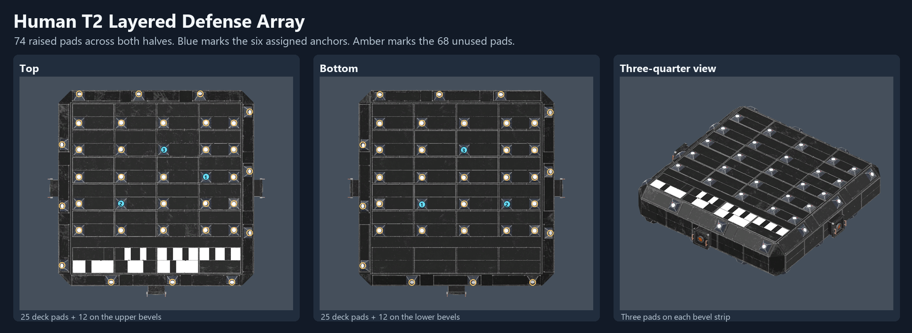

# Orbital defense module turret placements

Measured on November 22, 2026 from the installed Terra Invicta 1.0.65 assets. Counts cover orbital modules. Surface defenses use separate strategic combat rules.

| Module | Prefab anchors, top + bottom | Weapons in combat | What the shell adds |
| --- | ---: | ---: | --- |
| Human T1 Point Defense Array | 3 + 3 | 3 | Five flat circular markings on the top deck. The anchors sit in a separate row, with the middle anchor near the rim of the central circle. The underside has no matching markings. |
| Human T2 Layered Defense Array | 3 + 3 | 3 | 50 raised deck pads and 24 raised bevel pads. Six deck pads already have anchors. |
| Human T3 Battlestations | 4 + 4 | Up to 4 | Two raised gun towers on top, both with anchors. The remaining anchors sit on the deck and underside. The panel grid has no repeated sockets like T2. |
| Alien T1 Point Defense Array | 3 + 3 | 3 | The anchors are grouped on the two end assemblies. The render shows no clear spare pads. |
| Alien T2 Layered Defense Array | 3 + 3 | 3 | Two small turrets have modeled pedestals on each end, all four already anchored. The third anchor on each end is between those pedestals. |
| Alien T3 Battlestations | 3 + 3 | 3 | The central structure has the same two pedestal mounts and central anchor per end. Four outer pyramids each have an upper and lower raised housing. They offer eight possible locations if repurposed. Their purpose is ambiguous. |

[All six modules with top and bottom anchor overlays](orbital-defense-anchors.png)

[Proposed layouts and turret clearance](clearance.md) checks the three expanded human layouts and an alien layout for each tier.

[0.12 deployment and migration](implementation-0.12.md) records the released budget, shared combat adapters and checks.

## Human Layered Defense Array

**74 raised pads in the mesh.** Each broad face has a 5×5 grid. Four perimeter sides each have an upper and lower bevel, with three pads on each bevel. That gives **37 pad positions per half** and **68 unused pads across the module** after accounting for the six prefab anchors.

On each occupied pad, the authored anchor is within 0.30 prefab-local units of the center of the pad cap. The perimeter caps face outward at roughly 45° from vertical. The top and bottom grids differ in position, so a paired firing group needs an explicit mapping between different coordinates.

## Implications for a weapon expansion

The current game pairs a top turret and a bottom turret behind one weapon instance and picks the model facing the target. Keeping that principle gives the T2 room for **25 deck weapon groups**, with another **12 groups** possible if each upper/lower bevel pair gets a shared weapon. Assigning separate cooldowns to every pad would give 74 individual weapons and a different result when attacked from several directions.

Deck batteries and dedicated point defense can be tuned separately. The bevels are candidates for smaller interceptors, where outward coverage is useful. A sector can have several visible PD heads and a shared intercept cadence, or individual heads can contribute separately. That decision directly affects missile saturation and must inform the power and build cost. Barrel sweep, same-side arcs, hull and neighboring station clearance, and simultaneous fire still need testing with the actual weapon models.

The module JSON defines the economy and model resource. The installed assembly owns the weapon count in `TIHabModuleTemplate.weaponMounts`, the prospective list in `NotionalWeaponsList`, the campaign selection in `TIFactionState.GetBestHabWeapon`, and the rendered placement in `CombatHabModuleController.InitializeForCombat`. A shared loadout for an expansion needs to feed mounted combat, autoresolve, combat value and AI, stat displays, and reconstruction from existing saves. The [EEO cadence loop](../../../TIEconomyMod/Patches/WeaponCadencePatches.cs) already iterates the rendered module's constructed weapon list.

## Evidence

The six `stationModelResource` assets came from the installed `habmodules` Unity bundle. I enumerated the direct child transforms in prefab order, decoded the root meshes and materials with UnityPy, and rendered the bare shells with their diffuse and emission textures in Blender 2.79. The source meshes include placeholder weapon children. The render suppresses those children so the hull and overlay are visible together. The installed combat controller uses their transforms to place weapon models selected for combat.

I matched the T2 render to 74 welded ten-triangle raised-pad components. The cap centers and outward normals come from the two outward-facing cap triangles of each component. The Alien T3 perimeter count also matches eight separate repeated 56-triangle components. The position file records those housings by bounding-box center and size.

[Prefab anchors, T2 pad centers and normals, and Alien T3 housing bounds](mount-positions.json)
