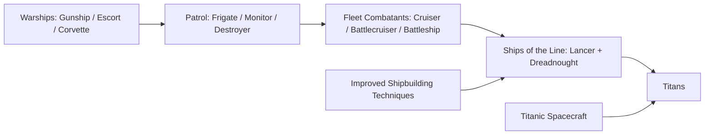

# Hull progression and capital-grade nose weapons

**Latest plan, 2026-11-04:** the [species-asymmetric proposal and cluster tables](asymmetric-human-alien-tier-plan-2026-11-04.md)
replace the earlier one-to-one species / tier-6 grouping. The separate
[alien bay implementation](alien-reactor-bay-implementation-2026-11-04.md) is
already deployed as 0.10.24; the tier and N5 proposals remain unimplemented.

**Geometry follow-up, 2026-11-04:** the completed
[alien prefab/machinery audit](alien-reactor-bay-measurements-2026-11-04.md)
adds source-mesh measurements, bounded bay candidates and common-scale art
comparisons. Mothership has three separate aft housings supporting a roughly
137,500 m³ modeled allowance, but current reactor templates already reach their
output ceilings with the old fallback. No candidate capacities are installed.

Analysis date: 2026-11-03. Baseline: installed Terra Invicta 1.0.53b and the
current EEO 0.10.23 source/package. **Research only: no gameplay implementation,
save editing, build or deployment.** The existing 0.10.22/0.10.23 work remains
uncommitted. The [data snapshot](hull-progression-audit-2026-11-03.json) records
merged hulls, unlock nodes, all 36 FourNose templates, every same-project /
same-family pair, selected save evidence and source hashes.

## Findings and recommendation

Lancer and Dreadnought share the same unlock: **Ships of the Line**. Both have
native `consTier=3`. In the latest save, neither is unlocked because **Improved
Shipbuilding Techniques** has not been researched. Their absence is consistent
with the recorded progression, rather than evidence that Lancer unlocks later.

The proposed six bands are useful as **combat/size progression bands**, but the
engine does not implement one universal tier field with those meanings. Keep
the native construction tier separate from research stage and combat role.
There are five human hull-unlock projects and three construction tiers; the
Mothership belongs to an alien branch rather than a sixth human research step.

The largest present discontinuity is the Lancer. The recent compact-capital
rule gives a human Dreadnought three independent size-4 nose weapons and eight
heavy hull weapons, while the Lancer retains a shared four-cell nose and only
three ordinary hull cells. It has lost its former exclusive access to a spinal
weapon at this research step. Restoring its nose-specialist identity should
precede adding another compulsory capital restriction.

The siege-only idea can create a distinct capital weapon category without
adding new geometric mount sizes. However, larger/heavier weapons do **not**
consistently deliver more sustained output per slot across families. The three
human siege coils do; the alien graser and relativistic particle cannon instead
trade cadence for other properties. Use an explicit, family-aware
`capital-grade` policy, not a name match, `FourNose` alone, or a global damage
multiplier. The user's subsequent tentative direction is formalized in the
[tier-4–6 / size-5 plan](tier-4-6-and-size-5-implementation-plan-2026-11-03.md):
mandatory N5 noses on Titans/Mothership, with N5 unavailable below tier 5,
double the selected weapons' own sustained output, fully compact tier-4 Lancers,
and revised capacity/crew/costs. Its coverage and migration decisions must be
settled before implementation. The related
[wavelength fix proposal](laser-wavelength-precision-bug-2026-11-03.md) uses
mod-owned integer angstroms with explicit conversions at native/UI boundaries.

## What the latest save actually contains

Read-only source: newest `Exitsave.gz`, whose game date is **2042-11-01**.
The active faction is **Project Exodus / EscapeCouncil**. The selected save
summary is sufficient to reproduce this finding; the full personal save is not
copied into the repository.

| Requirement | Recorded state |
| --- | --- |
| Interplanetary Warships | Completed |
| Patrol Vessels | Completed |
| Fleet Combatants | Completed |
| Improved Shipbuilding Techniques, global | Not completed; not one of the three current global research slots |
| Its immediate prerequisites: Industrialization of Space, Next-Generation Aerospace, Superalloys | All completed |
| Ships of the Line, faction project | Not completed, available, triggered, hidden or missed |
| Titanic Spacecraft, global | Not completed |
| Titans, faction project | Not completed or available |

The immediate route is to select and complete **Improved Shipbuilding
Techniques**, then obtain and complete **Ships of the Line**. That project
unlocks both Lancer and Dreadnought together. Existing faction designs cover
Destroyer, Frigate, Battlecruiser, Monitor and Battleship; the save contains no
Lancer or Dreadnought design. All seven human factions lack completed Ships of
the Line in this snapshot.

Unlock eligibility and project discovery are distinct. These five human hull
projects have `factionAvailableChance=100`; Patrol Vessels onward have
`initialUnlockChance=0`, `deltaUnlockChance=5`, `maxUnlockChance=100`.
`TIFactionState.RollToAddProjectTrigger` first checks prerequisites; its starting
trigger value also includes research-contribution and councilor-science bonuses.
`DailyProjectTriggerCheck` converts a monthly probability to a daily check.
These are not guaranteed instant discoveries, nor a flat 5% daily chance. The
current Lancer blockage occurs before that discovery stage.

## Actual research progression

Costs below are the current data's base research costs, before campaign research
speed or faction bonuses. Existing mod overrides do not change these hull-project
costs or prerequisites.

| Human hull project | Cost | Direct prerequisites | Hulls it unlocks | Native construction tiers |
| --- | ---: | --- | --- | --- |
| Interplanetary Warships | 250 | Orbital Shipbuilding | Gunship, Escort, Corvette | 1, 1, 1 |
| Patrol Vessels | 2,000 | Interplanetary Warships + Principles of Space Warfare | Frigate, Monitor, Destroyer | 1, 2, 2 |
| Fleet Combatants | 6,000 | Patrol Vessels + Militarization of Space | Cruiser, Battlecruiser, Battleship | 2, 2, 3 |
| Ships of the Line | 10,000 | Fleet Combatants + Improved Shipbuilding Techniques | Lancer, Dreadnought | 3, 3 |
| Titans | 10,000 | Ships of the Line + Titanic Spacecraft | Titan | 3 |

The relevant globals are: Orbital Shipbuilding 1,000; Principles of Space
Warfare 1,000; Militarization of Space 5,000; Improved Shipbuilding Techniques
20,000; Titanic Spacecraft 60,000. The last requires Fleet Logistics and
Diamondoids, both still unfinished in the selected save. These costs cannot be
added into an unconditional total without accounting for shared research and
alternative prerequisite paths.

Every standard alien hull in the inventory, including Mothership, refers to
`Project_AlienMasterProject`. That project is AlienCouncil-only and has research
cost -1. Advanced alien equipment also uses an Alien Advanced Master Project.
This establishes a different unlock architecture; it does not establish that
alien hulls are actually fielded equally early. AI selection, production,
resources and campaign behavior still determine appearances. A six-band
comparison must not imply a human Mothership unlock or six alien hull projects.

## What “tier” means in data and code

| Axis | Owning field/code | Meaning and consequences |
| --- | --- | --- |
| Construction tier | `TIShipHullTemplate.consTier`, integer, current hull data 1–3 | Shipyard build-time comparison, utility minimum tier, baseline systems power, multiple AI design heuristics |
| Shipyard tier | `TIHabModuleTemplate.tier` | Human Space Dock 1, Shipyard 2, Spaceworks 3; separate alien counterparts |
| Research stage | Hull `requiredProjectName`, project/global prerequisite graph | Five human hull projects; independent of construction tier |
| Geometry classification | `smallHull`, `mediumHull`, `largeHull`, `hugeHull` | Derived from length and species, not `consTier` |
| Runtime ship-size enum | `TISpaceShipTemplate.size` | Small / Medium / Large; huge hulls map to Large here |
| Mount geometry | `Mount` enum + `internalSize` + slot coordinates | Individual weapon footprint and legal placement |
| Equipment generation | Mk1/Mk2/Mk3, laser/arc/phaser, alien generations and their projects | Technology within a family, independent of footprint |
| Current compact capital policy | `CapitalMountPolicy.Applies` | Explicit list of Dreadnought, AlienDreadnought, Titan, AlienTitan, AlienMothership; not inferred from tier or size |

Human construction tier 1 contains Gunship/Escort/Corvette/Frigate; tier 2
contains Monitor/Destroyer/Cruiser/Battlecruiser; tier 3 contains
Battleship/Lancer/Dreadnought/Titan. Alien Battleship, Lancer and Dreadnought
remain construction tier **2**, while Alien Titan, Assault Carrier and
Mothership are tier 3. Species equivalents therefore do not share one tier map.

Human size flags use <=100 m for small, 100–200 m exclusive for medium, and
>=200 m for large. Alien thresholds are <=125, 125–250 exclusive, and
250–500 m for large. `hugeHull` is >=500 m; Mothership is 600 m. These are native
template lengths, not measured per-appearance mesh volumes. Known mod hulls use
measured reactor/drive geometry where available, so changing a tier number does
not itself enlarge the actual engine bay or hull mesh.

`ShipyardConstructionSpeedModifier` compares yard tier with `consTier`: a lower
yard applies `smallShipyardPenaltyPowerPerTier^(tier deficit)`, whose native
default is 1.5. A human T1 yard therefore has a 2.25x modifier for a T3 hull;
a T2 yard has 1.5x. Higher-tier yards apply their own speed modifier per surplus
tier; human T3 uses 0.6, so its T1/T2/T3 modifiers are 0.36 / 0.6 / 1.
This is a construction-time mechanism, not an unlock project. Other site,
ownership and construction conditions still apply.

**Do not renumber `consTier` to 4/5/6 merely to display six bands.** Existing AI
code includes `4 - consTier` and, for huge/noncombatant hulls,
`1 - 0.25*consTier` in a propulsion-design heuristic. They reach zero or become
negative outside their intended range. Other consumers select maximum engine
count at `consTier>=3`, scale desired armor, select surveillance utilities by
exact tier, and add 0.005 GW of systems demand per tier. Native
`constructionTime_Days(int shipyardTier, ...)` also expects a matching shipyard
template. A real six-construction-tier overhaul would need an audit of all those
consumers and new/retuned infrastructure; a display/combat-band catalog avoids
those unintended mechanical changes.

## A coherent six-band interpretation

| Proposed combat band | Human grouping | What makes it distinct |
| --- | --- | --- |
| 1 — light warships | Gunship, Escort, Corvette | Interplanetary Warships cohort |
| 2 — fleet escorts | Frigate, Monitor, Destroyer | Patrol Vessels cohort; Frigate is the light utility-oriented branch |
| 3 — fleet combatants | Cruiser, Battlecruiser, Battleship | Shared Fleet Combatants cohort: utility/endurance, nose assault and armored broadside roles |
| 4 — specialist capitals | Dreadnought + Lancer | Broadside capital versus nose specialist; shared Ships of the Line unlock |
| 5 — flagships | Titan | More resilience, utilities and power/support capacity; potential capital-grade nose equipment |
| 6 — strategic alien hull | Mothership | Alien boss/logistics/durability class; no existing human counterpart |

The [separate boundary review](frigate-and-cruiser-tier-boundary-plan-2026-11-03.md)
refines the initial grouping: move Frigate to band 2 and Cruiser/Battlecruiser
to band 3. This makes bands 1–5 match the five existing human unlock waves and
their MC costs; a separate Battleship unlock project is no longer needed simply
to distinguish bands 2 and 3. Lancer and Dreadnought remain sibling choices.
Use an explicit mod-owned combat-band/role mapping for UI and fitting policies,
while preserving native construction tiers until a deliberate infrastructure
overhaul is approved.

## Current endgame hull discontinuities

All counts below use current mod data and policy. “Shared” means the original
cells combine into a large weapon; it does not mean one large weapon per cell.
Bare masses include structural mass plus base crew support, appearance 0.

| Hull | Nose | Hull weapons | Utilities | Integrity | Bare mass (t) |
| --- | --- | --- | ---: | ---: | ---: |
| Human Lancer | 4 shared cells: one size-4 weapon | 3 ordinary cells | 7 | 36 | 2,000 |
| Human Dreadnought | 3 independent size-4 weapons | 8 independent heavy weapons | 8 | 48 | 3,200 |
| Human Titan | 4 independent size-4 weapons | 6 independent heavy weapons | 12 | 64 | 3,700 |
| Alien Lancer | 6 shared cells: native mixed arrangements | 4 ordinary cells | 7 | 52 | 1,656 |
| Alien Dreadnought | 4 independent size-4 weapons | 8 independent heavy weapons | 10 | 72 | 2,900 |
| Alien Titan | 6 independent size-4 weapons | 8 independent heavy weapons | 10 | 90 | 3,000 |
| Mothership | 6 independent size-4 weapons | 16 independent heavy weapons | 11 | 512 | 8,900 |

The Lancer's four native nose cells represent four ordinary capacity units;
the Dreadnought's three compact cells represent twelve. The latter also has
32 ordinary hull-cell equivalents against the Lancer's three. These are capacity
units, not a universal damage multiplier. The present rules nonetheless impose
a large role discontinuity at a shared unlock and the same human MC cost of 4.

Human Titan is also not simply “Dreadnought plus everything”: it has one more
nose weapon but **two fewer** heavy hull weapons, four more utilities and
greater integrity. Alien Titan and Mothership have the same six nose weapons;
Mothership's distinctive advantages include twice the hull weapons and 512 vs
90 integrity. Later bands can add endurance, survivability and supporting systems
without needing another caliber on every axis.

The user's tentative tier-4 conversion is now specified as the **complete**
compact system: human Lancer gets four independent regular N4 noses and three
heavy hull weapons; Alien Lancer gets six regular N4 noses and four heavy hull
weapons. That adds 21 human capacity units, so human base crew becomes **35**
and the same mass rule suggests a 2,500 t V0 bare hull. A nose-only conversion
would have yielded 26 crew / about 2,300 t, but would omit the hull implications
of joining Dreadnought's tier. Alien base crew stays 40 and the complete capacity
change suggests 2,300 t bare. These are proposed initial values. The separate
N5 restriction then distinguishes Titans from the Lancer's regular nose battery.

## Why four nose sizes and three turret sizes are not six tiers

| Weapon-size label | Native mount / occupied cells |
| --- | --- |
| Light hull turret | `OneHull`, 1 cell |
| Medium hull turret | `TwoHullHoriz` / `TwoHullVert`, 2 cells |
| Heavy hull turret | `FourHull`, 4 cells |
| Nose 1 / 2 / 3 / 4 | `OneNose` / two-cell orientations / `ThreeNoseAngle` / `FourNose` |

There are also specialized half mounts, point defense and defense installations.
The enum contains `ThreeHullHoriz`, but the inspected standard weapon-family
inventory does not use it as a fourth universal turret-size line. Conventional
guns stop below FourNose; plasma starts at medium/heavy turret and size-3/4 nose;
family coverage is not uniform. “FourHull” means a four-cell footprint, despite
being the third ordinary turret-size class.

Six ship bands therefore cannot map one-to-one to caliber. They need three
independent design axes: **size of each weapon, number/arrangement of mounts,
and technology/role of equipment**. The compact-capital implementation already
uses the second axis. Requiring only a hull's largest supported size also
removes point defense, missile and family choices unless explicit exceptions
are made. Larger mount size does not guarantee proportional damage: lasers
gain concentration and armor performance; kinetics mix mass, velocity and rate;
plasma and particles have different damage/interception behavior.

Adding a new `FiveNose`/`EightHull` enum is an invasive native-code and asset
change: `internalSize`, adjacency/occupancy, placement/core selection, catalogs,
AI, icons, model controllers, saves/refits, power/volume and scoring all consume
the present categories. A capital-grade weapon can remain `FourNose` and acquire
a separate fitting category. No fifth geometric size is required for that idea.

## Complete same-unlock size-4 comparison

The initial name-only siege filter was insufficient. This pass inventories all
36 current FourNose templates (26 human, 10 alien), groups by **exact required
project and weapon family**, and compares every within-group pair. Seven pairs
qualify. Cross-family weapons sharing Alien Master Project are not treated as
matched upgrades. Human particle projects were checked separately; their
size-4 lances/cannons use different project prerequisites. No additional DLC
weapon-template files were found in the installed DLC tree.

Ratios compare the second weapon to the first. Kinetic output uses damaging
mass at muzzle velocity; beam output uses pulse energy and native average
cooldown. These are nominal continuous-fire energy rates before armor, target
loss, interception, misses, support shortages or officer/faction modifiers.

| Same-project family pair | Energy/shot | Sustained raw output/slot | Loaded mass | Interpretation |
| --- | ---: | ---: | ---: | --- |
| Spinal Coiler I -> Siege I | 2.495x | 1.834x | 5.570x | Heavy siege alternative |
| Spinal Coiler II -> Siege II | 2.550x | 1.795x | 5.973x | Heavy siege alternative |
| Spinal Coiler III -> Siege III | 2.591x | 1.920x | 6.439x | Heavy siege alternative |
| Alien Spinal Mag -> Advanced Alien Spinal Mag | 2.395x | 3.426x | 1.000x | Generation-like upgrade at the same mass, not a heavy siege variant |
| Alien Orange -> Violet 1024 cm | 1.000x | 1.333x | 1.000x | Optical/generation upgrade, not heavier siege equipment |
| Alien 1024 cm Xaser -> Graser | 1.000x | **0.667x** | 1.878x | Heavier optical/armor specialist, not more raw throughput |
| Alien Spinal Particle -> Relativistic Particle | 3.160x | **0.993x** | 1.500x | Larger pulse and tighter beam, nearly unchanged raw throughput |

This identifies five plausible heavy-alternative pairs across three family
lines: the three human siege-coil marks, the alien relativistic particle cannon
and the alien graser. Only the coils consistently increase raw output per slot.
Neither “same tech” nor “heavier” establishes one common damage tier.

The proposed heavy variants also reuse their regular counterparts' model
resources. A separate logical size-5 category can enforce fitting and capacity,
but it does not itself supply a new mesh or establish a larger physical caliber.
The formal plan preserves art dimensions unless a separate clearance/visual
pass is selected.

### Human siege coils: useful slot density, expensive mass and support

The native `averageCooldown_s` is exactly
`(cooldown + (shots-1)*intraSalvo)/shots`. `Weapon.TryFireCommon` resets a completed
salvo and `EnterCooldown` distinguishes intra-salvo and final cooldowns. The
nominal calculation is grounded in those methods; real shot jitter, tracking
and power availability still change observed fire.

| Mark | Regular / siege raw MW | Regular / siege loaded mass (t) | Regular / siege velocity (km/s) | Regular / siege average electrical demand (GW) |
| --- | ---: | ---: | ---: | ---: |
| I | 228.42 / 419.00 | 296.25 / 1,650 | 9.0 / 4.5 | 0.608 / 1.117 |
| II | 443.52 / 796.22 | 276.25 / 1,650 | 10.1 / 5.1 | 0.924 / 1.659 |
| III | 997.61 / 1,915.63 | 256.25 / 1,650 | 12.4 / 6.3 | 1.634 / 3.127 |

Siege damaging mass is about tenfold, but halving speed leaves only 2.49–2.59x
kinetic energy per shot. Siege chipping fraction is 0.25 versus 0.35, so its
pre-armor **direct-energy component** is 2.88–2.99x per shot and 2.07–2.22x per
second. That is not a guaranteed post-armor hull-damage ratio.

Other costs and benefits:

- Siege mount mass is 1,500 t, versus 240/220/200 t. Each full magazine adds
  150 t instead of 56.25 t. Sustained raw output per loaded tonne is only
  30–33% of the regular weapon's value.
- Both require the same corresponding Coil Cannon project. This category would
  currently be a hull-fit privilege, not a later independent weapon technology.
- Both have the same 1,100 / 1,150 / 1,250 km range by mark. Siege arc is narrower,
  20 degrees versus 30. Its 1,000 km flight time is about 222/196/159 s, against
  111/99/81 s. Moving/closing targets change those times and impact velocities.
- Siege magazine has 120 rounds versus 450. Total carried kinetic energy is
  only 66.5–69.1% of the regular magazine despite the larger individual hits.
  Siege rounds have roughly tenfold ablative mass, but are slower, physically
  larger and fewer per salvo. Particle point defense also has a probabilistic
  destruction path. Interception performance cannot be inferred from raw DPS.
- Average electrical and waste-heat demand rise about 1.80–1.91x; electrical
  energy per shot rises 2.50–2.58x. Burst battery demand and continuous reactor/
  radiator demand are separate constraints. Native designer heat estimates use
  intra-salvo intervals, not the full-cycle average reported here.
- Resource vectors are in the snapshot. For Mk3, regular full weapon costs
  6.5625 volatiles / 9.25 metals / 9.0125 nobles / 0.8 exotics; siege costs
  46.5 / 58.5 / 54 / 6.0. These are different resources, not a single market-price
  total. Both include their standard magazine.

Four Mk3 siege weapons add **6,600 t** before propulsion, power, cooling, armor
and module-crew support. Human Titan's 3,700 t bare hull plus that nose bank is
already **10,300 t**, versus **4,725 t** with four regular Mk3 spinals. Nominal
nose raw output rises 3.990 -> 7.663 GW. This is strong slot density, but it is
not a free flagship upgrade and does not double the whole ship's output.

### Unnamed alien heavy alternatives

**Relativistic particle cannon:** 1,200 versus 800 t; 1,024 versus 324 MJ per
shot; three-shot cycle 70 versus 22 s. Raw output is 43.886 versus 44.182 MW.
Per-shot electrical energy is 6.32x and average electrical demand 1.99x because
efficiency falls from 0.2 to 0.1. Range rises 1,000 -> 1,200 km and arc narrows
30 -> 20 degrees. Lens radius doubles 128 -> 256 cm and emittance halves
0.02 -> 0.01 mrad, giving 1/16 the neutral-beam spot area at the same range.
That can improve coupling when the target is smaller than the beam spot, but
both computed spots at 1,000 km are already much smaller than a ship. It is not
a blanket 16x anti-ship bonus. The larger pulse may cross armor/damage thresholds;
the same raw sustained output must not be mistaken for identical combat behavior.

**Graser:** 1,827 versus 973 t; both deliver 448 MJ per pulse, but cooldown is
36 versus 24 s: **12.444 versus 18.667 MW**. Both require Alien Advanced Master
Project. Graser bombardment value is 12 versus 8, but neither wavelength is in
the native 380–740 nm atmospheric-bombardment window. It is not an unconditional
upgrade for every target or mission.

A concrete native type mismatch affects the graser analysis: its JSON wavelength
is 0.1 nm, while `TILaserWeaponTemplate.wavelength_nm` is an **integer**. A
standalone check using the installed game serializer reads that as **0**, versus
10 for the xaser. The live in-game template was not inspected. Both are also
jitter-limited: the graser's jitter is 1e-8 rad versus 1.3e-8. Using the verified
native values, their armor-effectiveness factors at 1,000 km are 0.062832 and
0.106247 respectively; lower favors the laser, and the graser factor is about
41% lower. This does not deliver a universal DPS multiplier. The fractional-
wavelength representation should be reviewed before making this the required
late-tier optical weapon. No wavelength fix is made by this analysis.

## Assessment of mandatory siege/capital-grade noses on bands 5–6

Two policies must be distinguished:

1. **Capital hulls accept only capital-grade noses.** This forces their role,
   but does not stop Dreadnoughts from using the same weapons.
2. **Capital-grade weapons are reserved for bands 5–6.** This creates an actual
   equipment distinction, but also excludes them from lower bands. Current
   Dreadnoughts already accept siege coils because they accept all FourNose.

A coherent tier privilege needs an explicit decision on both directions. A
new logical grade can keep the same FourNose footprint; it must be a curated
catalog shared by UI, eligibility, placement, AI, save/refit validation and
migration. Do not use `Contains("Siege")` as the production rule.

Existing inventory is enough for a narrow prototype with human siege coils and
selected alien particle/optical specialists. It is insufficient to promise
comparable heavy alternatives for every technology preference. There is no
matched size-4 heavy plasma pair, no human siege laser line, and no heavier
same-project alien magnetic counterpart in this inventory. Standard and
advanced alien magnetic guns are a different progression axis.

Mandatory noses could therefore exclude a player's laser/plasma build, leave
a researched Titan with no legal nose equipment until coils are unlocked, and
force alien compositions toward two specialist beams. Native AI role scores
may also favor their cheaper counterparts; a new catalog must have deliberate
role scores and support-system budgeting. A flagship research milestone should
not silently mean “all previous weapon preferences stop being valid.”

Recommended analysis-to-implementation sequence, incorporating the user's
tentative mandatory size-5 direction:

1. Record six combat bands independently of native construction tier and show
   their research requirements clearly. Keep existing saves' research intact.
2. Restore a distinct Lancer role, with an explicit human/alien count and mass
   decision. Keep Dreadnought as broadside capital and Titan as supported flagship.
3. Define capital-grade equipment by family: candidate identity, intended target,
   burst advantage, sustained advantage, mass/resource price, power/heat and
   interception behavior. The present graser and relativistic cannon should be
   identified as specialists, not advertised as generic raw-DPS upgrades.
4. Implement the selected exclusive N5 policy only after each intended faction
   has a viable research/equipment path and unsupported legacy fits have an
   approved migration rule. Halve both firing intervals to double each N5's own
   nominal sustained output, preserving per-shot behavior. This makes the graser
   1.333x its N4 parent's raw output, not 2x; the formal plan identifies that
   remaining acceptance decision rather than silently adding another buff.
5. Tune by scenario: armored stations, comparable line ships, agile ships and
   layered laser/particle PD; compare both matched slot count and matched fleet
   mass/resource/MC budgets. Require successful AI auto-design at early and late
   equipment unlocks, not just an ideal endgame fit.

Implementation complications are material. Save migration schema 2 already
means compact hull and nose cells on five hull classes. Another pass must keep
those one-cell entries intact, expand only newly converted Lancer layouts, and
separately handle now-forbidden regular capital or lower-band siege equipment.
The existing migration deliberately retains legacy equipment when research
cannot supply a replacement; a new restriction needs a clear rule for preserving,
upgrading or downgrading that equipment without granting research or erasing
ammo/damage/repair state. Siege and regular FourNose currently both charge four
internal-size units (1,600 m³ at the default nose volume), despite very different
mass. A new grade's occupied volume/support budget may need its own definition.
Added weapon counts also require distinct controller anchors and native-grid
capacity; a logical grade change alone does not require extra slots or meshes.

## Sources and verification limits

Installed templates: TIShipHullTemplate, TIProjectTemplate, TITechTemplate,
TIHabModuleTemplate, and all six standard weapon-family files, merged with their
current repository overrides. Current game assembly was freshly decompiled for
TIShipHullTemplate, TISpaceShipTemplate, TIHabModuleTemplate, TIFactionState,
TIProjectTemplate, TIShipWeaponTemplate, TIProjectileWeaponTemplate,
TIMagneticGunTemplate, TILaserWeaponTemplate, TIParticleWeaponTemplate,
TIBeamWeaponTemplate, Weapon, ProjectileController, TISpaceCombatProjectileState
and Mount. Source identities and derived numbers are in the linked snapshot.

Repository authorities include [capital fitting/migration](capital-mount-expansion-2026-11-02.md),
[magnetic cadence and damage inputs](details/weapons/magnetic-tier-progression-rework.md),
[the older size-4 proposal](nose-battery-and-spinal-tier-proposal-2026-09-25.md),
`CapitalMountPolicy`, `HullFuelCapacityFeature`, `WeaponPowerMath` and the
projectile geometry/damage patches. The older proposal is not current fitting.

This analysis performs static data/code and native-serializer checks. It does
not establish live combat balance, actual AI fleet composition, live graser
template values or user acceptance of the still-pending capital/rendering builds.
