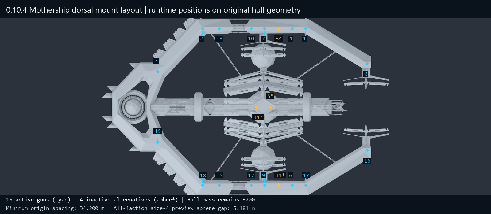
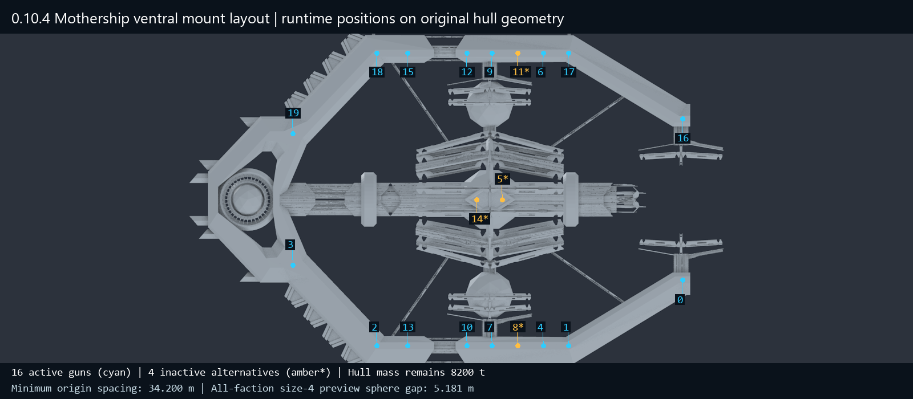

# Mothership symmetric mount correction and weapon-size follow-up

Research baseline committed before implementation: `d5cf300`.

## Authorized scope and UI decision

Implement a full symmetric Mothership mount arrangement suitable for size-4
turrets. Add four UI guns and another 100 tonnes only if the existing designer
has room. Investigate the surprising weapon-envelope rankings visually and
clarify the Monitor without adding Monitor slots; propose any needed Monitor
correction separately.

The current Mothership has 38 authored UI slots. Native coordinates are ten
columns (0..9) and seven half-height rows (0..6); armor images shift down one
half-row. Full icons need two half-rows. At most four non-overlapping full icons
fit per column (40 total), whereas four new guns would require 42. Preserving
the current layout leaves only one free full-icon position at (9,5) or (9,6),
which overlap each other. Accordingly, do not expand the UI or increase mass:
retain 16 active hull guns, four nose cells, 11 utilities, and 8,200 tonnes.
The unchanged 100 base crew add 300 t under the existing crew-support rule,
giving 8,500 t before other fitted equipment; distinguish that from template hull mass.

## Implementation plan

1. Retain the eight outer ordinary mount locations and correct the duplicated
   ventral index 18 by mirroring the proper ventral index 2.
2. Move the eight central ordinary mounts to the previously inspected left/right
   rim positions, preserving their original logical indices and pairing.
3. Re-space the four inactive alternative controllers: two on the central
   diamond's axis and one mirrored pair on the rim, clear for full-size-4 weapons.
   A four-point crown diamond was rejected because the ventral side has raised
   ribs at its lateral points; the selected locations are checked on both faces.
   This does not activate extra UI weapons or change DPS.
4. Use a Mothership-only, all-or-nothing geometry guard before native weapon
   initialization. Preserve rotations, scales, references and muzzle hierarchies;
   handle already-initialized orientation parents idempotently.
5. Validate the position catalog, symmetry, original-asset guards and native
   Harmony target; update the implementation matrix and run normal deploy.ps1
   immediately when implementation is ready. Record actual results afterward.
6. Render weapon meshes at a common scale and distinguish physical dimensions,
   yaw/elevation reach and the previous conservative sphere. Retain the committed
   research snapshot and document refinements rather than silently rewriting it.

## Deployed result: 0.10.4

The correction is implemented and deployed. It preserves all existing weapon
indices, rotations, scales and fire-point hierarchies. `CapitalMothershipGeometryPatch`
validates both twenty-controller lists and every original/already-corrected
position before moving the root-relative anchors. It recognizes native
`Base Orientation` parents on a reused model, so repeated preparation does not
apply root coordinates in an aimed weapon's local frame. Unexpected layouts
produce a warning and are not deliberately repositioned.

The eight ordinary central mounts now use mirrored rim positions at
Z=61.8, -6.6, -40.8 and -120 m. Two inactive alternatives use the crown axis
at Z=7.063 and -27.337 m; the other two use a mirrored rim pair at Z=27.6 m.
The crown's lateral underside has raised ribs, so a four-point diamond there
was rejected after probing both faces. The final sites retain the original
structural surfaces and require no new barbette or hull-mesh edits.

These are offline geometry views with the implemented coordinate catalog
overlaid, not in-game screenshots. Cyan marks the sixteen active indices;
amber marks the four alternatives that remain unavailable in the UI.

| Measure | Before | 0.10.4 |
| --- | --- | --- |
| Active hull guns | 16 | 16 |
| Authored paired controller indices | 20 | 20 |
| Hull mass | 8,200 t | 8,200 t |
| Minimum ordinary origin spacing | 0.000 m | 34.200 m |
| Minimum spacing across all twenty indices | 0.000 m | 34.200 m |
| Native size-4 combat sphere gap | -12.296 m | 21.904 m |
| Native size-4 preview sphere gap | -24.822 m | 9.378 m |
| All-faction size-4 preview sphere gap | -29.019 m | 5.181 m |
| Same fitted weapons: raw DPS change | — | 0% |

The preview branch was explicitly included because some Mothership placeholder
scales are larger than combat resource scales. All figures above use the earlier
conservative sphere method; even that stricter test clears a 5 m margin for the
largest size-4 art in either inventory. They do not prove firing-arc or animated
hull-intersection behavior.

Exact original guards, target coordinates and support probes are in the
[layout evidence](turret-clearance/mothership-layout-2026-10-21.json).
The [existing UI schematic](figures/alienmothership-designer-layout.png) remains
applicable because no UI slots were changed. Activating four alternatives would
require a separate UI enlargement or removal of existing cells, outside the
condition authorized for this change.

## Validation and deployment

The final normal `tools/deploy.ps1` run passed all 39 validators and 1,204
formula assertions, including the new Mothership source-bundle hash check,
forty altered-coordinate rejection cases, original and already-corrected
catalog acceptance, 34.2 m spacing and unchanged slot/mass assertions. Harmony
bound the new prefix; the implementation matrix now covers 211 patch classes.
All 47 deployed package files were verified by SHA-256. Neither
`-SkipVerification` nor a game-open override was used.

Final deployed DLL SHA-256:
`38E62BA2C5AC7ED8507B36F42EFE9CF1D0E4726B5A8F8593D8E97F058A4267E0`.
The [retained deployment log](turret-clearance/mothership-deployment-2026-10-21.txt)
records the successful final build. An initial release-version guard caught an
outdated 0.10.3 expectation and was synchronized to 0.10.4 before deployment.
An earlier combat-only spacing pass was superseded by this preview-aware build.
No later rebuild has been performed.

The implementation matrix update changed only F104, H104 and J104; its affected
range was rendered and all other workbook cell values/formulas were compared
against the pre-edit file.

## Manual acceptance still required

1. Open a Mothership design and confirm sixteen heavy hull cells, unchanged
   utilities/nose layout, and unchanged mass (8,200 t template hull, 8,500 t
   including the existing base crew support, before other equipment).
2. Inspect both faces of a fully fitted ship in preview and combat. Confirm the
   empty mirrored rim position is filled, the duplicated ventral origin is gone,
   and the relocated guns remain seated on their supporting surfaces.
3. Fire/aim the relocated guns and verify base, barrel, muzzle effect and projectile
   origins agree. Check saved ships, refits and a newly constructed instance.
4. Check the log for `Mothership mount geometry guard` warnings; unexpected asset
   layouts must be investigated rather than treated as a passed runtime result.

No in-game result is claimed. Monitor and weapon-art scaling proposals remain
unimplemented. See the [weapon mesh and Monitor follow-up](turret-clearance/weapon-shapes-and-monitor-2026-10-21.md)
for the revised interpretation of the original large envelope numbers.
