# Visual inspection of close hull mounts and repair proposals

Research follow-up, 2026-10-20. **The suspicious small distances are mostly real, authored local clusters—not a global scale error or accidental counting of dorsal/ventral copies. The Mothership duplicate is a separate, well-supported placement defect.** Its missing counterpart has an appropriate existing rim surface, so the minimal repair should move one mount Transform, without editing hull vertices or adding a barbette.

This report interprets the [numerical clearance study](README.md) through direct visual inspection of decoded assets. It covers all four appearances of Escort, Frigate, Monitor, Battleship, Dreadnought and Titan, plus Alien Destroyer, Dreadnought, Assault Carrier and Mothership: **28 appearances in 10 classes**. The repeated “battleships” in the request was interpreted broadly to include the large-hull outliers.

**Status:** proposals and documentation only. No installed asset, gameplay configuration or runtime code was changed. No new build/deployment was performed for this follow-up.

## What was actually inspected

The figures are offline renders of the installed triangle meshes with authored controller origins overlaid. They are not generated concept art or in-game screenshots. Top and side views, close views of limiting pairs, and numerical vertical surface intersections were examined. Main hull meshes retain their authored dimensions; textures, weapons, drive subtrees and radiators are omitted from the clay views so that a turret placeholder cannot be mistaken for a permanent hull foundation.

For the Mothership, I also decoded the original UVs and albedo textures of `Hydra_Mothership_Outer_A` and `Hydra_Mothership_Central_A` and rendered the relevant surfaces with them. That checks whether an apparently plain surface has a painted turret foundation. These albedo views do not reproduce Unity's normal-map, metallic, emission or lighting pipeline.

Cyan markers are ordinary logical mount origins; amber markers are alternative controller origins. A marker is not a physical turret. Numbers are controller-list indices, not UI serialized slot indices. One dorsal and one ventral representation normally belong to the same logical gun. “Barbette” below means a visible modeled turret seat, ring or foundation; it does not claim a simulated armor/rotation mechanism.

Geometry, renderer classifications, surface probes, source hashes and proposal coordinates are retained in [visual-evidence.json](visual-evidence.json). The exact analysis recipe is archived as [research text](visual-analysis-recipe.txt).

## Why a huge hull can have a small minimum spacing

The earlier number was the **closest pair**, not average spacing or available deck area. Art can spend most of its length on tanks, habitats, machinery, open trusses or structural arms while clustering guns onto a few specific foundations. Increasing total hull length does not enlarge a paired foundation on one module.

All twelve large-human cases below have their limiting pair on the **same dorsal side**. These small numbers are not the distance through the hull to a mirrored ventral turret. The side views also show that the close pairs are not separated by large elevations that would explain away the plan-view crowding.

The human worst-size-4 full-rotation diameter bound is 14.637 m. A 5 m gap therefore requires 19.637 m between equal-scale origins. The final column is the additional separation needed to pass that sufficient bound. It is **not** a measured penetration depth or an instruction to move a mount by exactly that amount. Real triangle meshes may clear in a particular pose while their conservative spheres overlap.

| Class/art | Limiting pair | Minimum m | Median consecutive dorsal spacing m | Extra separation for 5 m bound |
| --- | --- | --- | --- | --- |
| [Battleship/0](visuals/battleship-0-dorsal-detail-annotated.png) | 3 / 4 | 13.330 | 32.059 | 6.307 |
| [Battleship/1](visuals/battleship-1-dorsal-detail-annotated.png) | 2 / 3 | 18.800 | 24.250 | 0.837 |
| [Battleship/2](visuals/battleship-2-dorsal-detail-annotated.png) | 4 / 5 | 13.900 | 14.805 | 5.737 |
| [Battleship/3](visuals/battleship-3-dorsal-detail-annotated.png) | 2 / 3 | 9.160 | 24.160 | 10.477 |
| [Dreadnought/0](visuals/dreadnought-0-dorsal-detail-annotated.png) | 6 / 7 | 8.600 | 9.300 | 11.037 |
| [Dreadnought/1](visuals/dreadnought-1-dorsal-detail-annotated.png) | 1 / 2 | 6.920 | 13.820 | 12.717 |
| [Dreadnought/2](visuals/dreadnought-2-dorsal-detail-annotated.png) | 3 / 4 | 13.400 | 25.600 | 6.237 |
| [Dreadnought/3](visuals/dreadnought-3-dorsal-detail-annotated.png) | 6 / 7 | 20.800 | 22.500 | 0.000 |
| [Titan/0](visuals/titan-0-dorsal-detail-annotated.png) | 2 / 3 | 13.040 | 19.965 | 6.597 |
| [Titan/1](visuals/titan-1-dorsal-detail-annotated.png) | 2 / 3 | 6.440 | 26.250 | 13.197 |
| [Titan/2](visuals/titan-2-dorsal-detail-annotated.png) | 4 / 5 | 17.900 | 40.700 | 1.737 |
| [Titan/3](visuals/titan-3-dorsal-detail-annotated.png) | 4 / 5 | 29.000 | 47.800 | 0.000 |

The median is computed after sorting ordinary dorsal nodes along the ship axis; it is included to expose clustering, not as another clearance certificate. For example, Titan/1 has a **26.250 m median** but a **6.440 m minimum**. Battleship/3 has **24.160 m versus 9.160 m**.

## Battleships: foundation layout explains all four cases

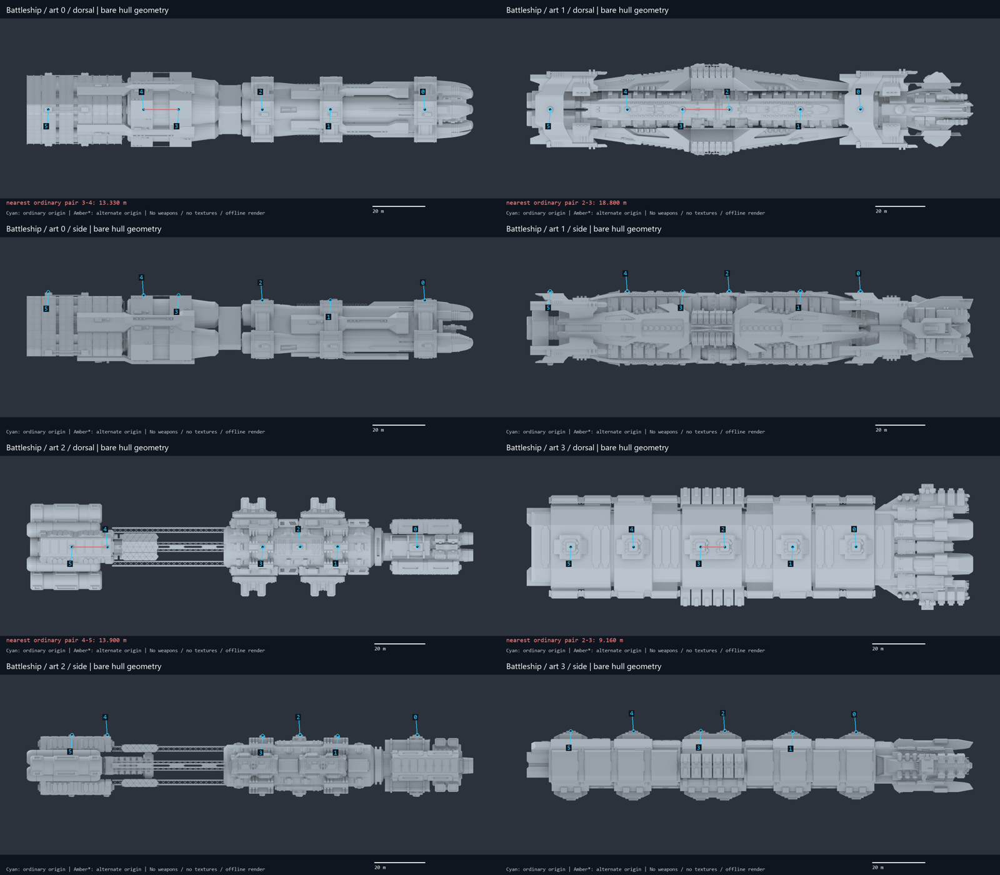

| Art | Visual interpretation |
| --- | --- |
| 0 | Two foundations on the same shoulder section; large inter-module gaps do not help this pair. |
| 1 | Separate small circular foundations along a relatively continuous axial deck; closest to passing the 5 m bound. |
| 2 | Closest pair is on the aft tank/module assembly, not across the very long open truss. |
| 3 | Two distinct square foundations share one central module. Deliberate close grouping, not coincident nodes. |

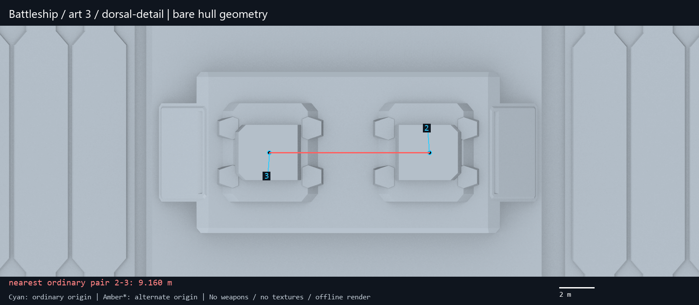

Battleship/3 is the clearest example: nodes 2 and 3 are centered on two separate square seats attached to the same backing plate. The 9.160 m value matches the actual two-seat artwork. These are not duplicate pointers, one shared origin, or two vertices of one mount. The seats' top surfaces are about 13.207 m high, while both origins are at 13.200 m: the roughly 7 mm difference is ordinary seating/intersection detail, not evidence of a misplaced gun.

**Semantic conclusion:** keep the current layout when using weapons appropriate to those seats. If the goal is unrestricted larger turrets, move or rebuild the two seats and their backing plate together. Moving only the origins would detach the guns visually from their foundations. Battleship/1 is a less invasive enlargement candidate than /3: it misses the worst-size-4 5 m bound by only 0.837 m of pair separation, although its individual rings would still need to follow any movement.

## Dreadnoughts: local triples and short intervals dominate

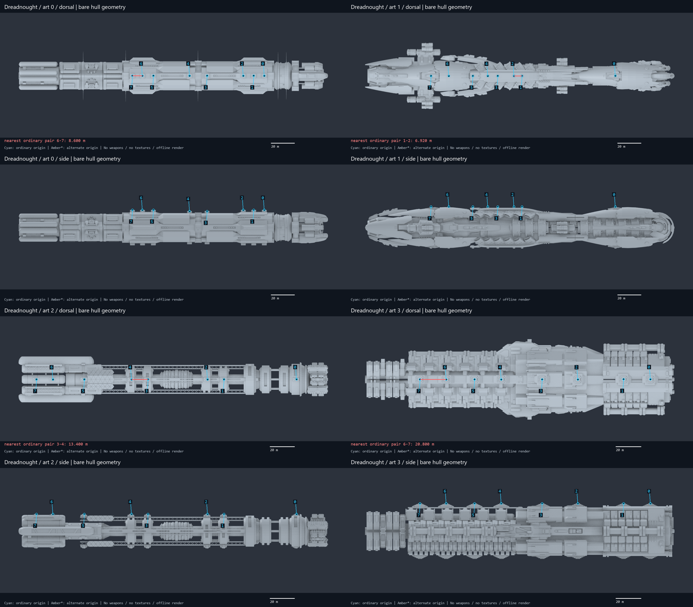

| Art | Visual interpretation |
| --- | --- |
| 0 | Repeated three-mount weapons sections. Eight nodes are concentrated on a few sections. |
| 1 | Separate circular rings on one axial strip; the 1–2 pair is genuinely close. |
| 2 | Repeated foundations on separated collars and the aft assembly; the long scaffold is not usable deck. |
| 3 | Individual foundations spread across substantial modules. No comparable tight cluster. |

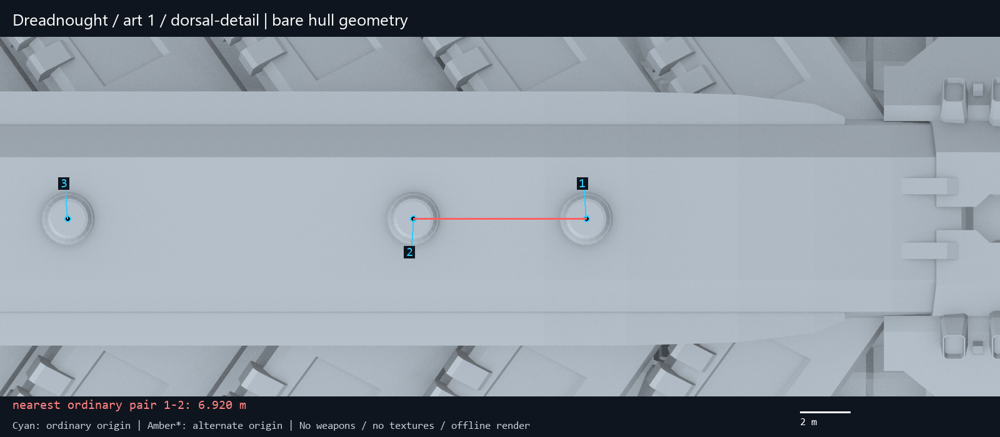

Dreadnought/0 places three foundations on each of two weapons sections. The limiting 6–7 pair is 8.600 m apart, and the median consecutive spacing is only 9.300 m. This is extensive concentration, not one isolated bad coordinate. Its foundation surfaces belong to `Earth_DR_Weapons`.

Dreadnought/1 is different: it has a long narrow axial strip with visible circular seats, but unequal spacing. Nodes 1 and 2 are 6.920 m apart; both seat surfaces are about 17.750 m high and both origins 17.740 m. They are seated on the modeled rings, so the small value is not a coordinate extraction mistake. There is room elsewhere on the silhouette, but not every apparently empty part is equivalent mounting deck.

**Semantic conclusion:** /0 needs a weapons-section redesign to spread all eight larger guns; /1 is a candidate for re-spacing the ring geometry along its existing strip; /2 needs collar-aware changes rather than placing guns into the open truss. /3 already has the most accommodating layout and should not be modified merely to impose consistency with a more crowded appearance.

## Titans: a very large ship can still carry a small two-seat platform

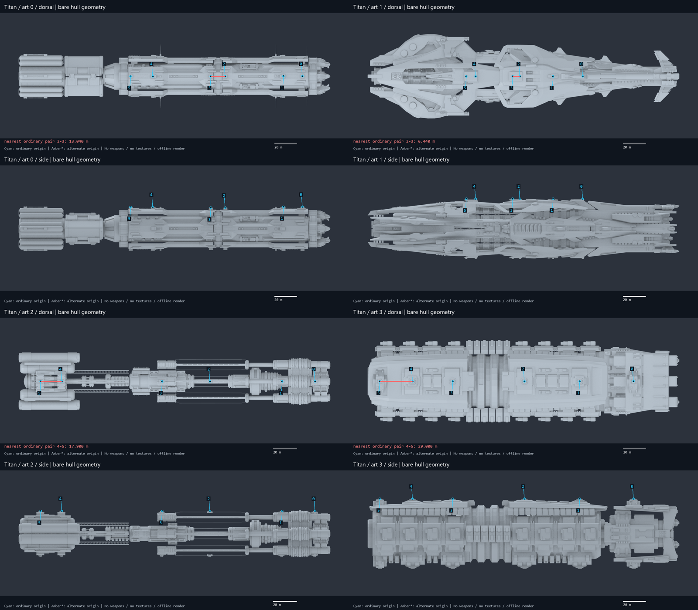

| Art | Visual interpretation |
| --- | --- |
| 0 | Three paired sections; central pair limits clearance despite the large hull. |
| 1 | Two circular seats on one raised platform. A second tight pair, 4–5, is only 8.310 m apart. |
| 2 | The aft pair on the tank section is limiting; the long forward/middle separations are irrelevant to the minimum. |
| 3 | Broad, separately spaced foundations, consistent with its much larger minimum gap. |

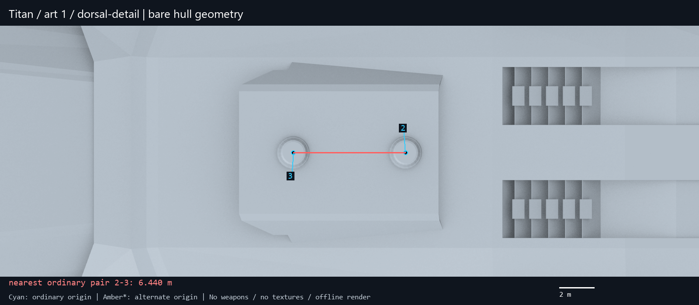

Titan/1 has a visibly authored paired platform, not two random origins floating over empty space. Nodes 2 and 3 sit over separate circular rings on that same platform. Both origins are at Y=26.600 m; the local ring surface is about Y=26.752 m. That small inward seating offset does not turn 6.440 m of separation into a large gap.

The platform ends and nearby grille structures make a simple one-axis shift aesthetically questionable. Meeting the 19.637 m center-spacing target would add 13.197 m to this pair. That is a substantial change to the platform, not a rounding correction. Moving only one node would also create an asymmetric seat arrangement.

**Semantic conclusion:** the current capital rule allowing a heavy gun per logical cell does not prove every art variant was designed for that visual footprint. /1 is the strongest candidate for an appearance-specific foundation redesign; /0 and /2 have milder paired-section constraints; /3 already spaces foundations generously. The prior worst-case bounds remain conservative, so an actual weapon-family/aim-pose collision study would be appropriate before deciding how much geometry to change.

## Smaller and alien edge cases

| Class/art | Minimum m | Observed meaning |
| --- | --- | --- |
| Escort 0/1/2/3 | 15.600 / 13.700 / 17.650 / 14.230 | Two seats on a short hull. The proportions and placement are coherent; no duplicate origin found. |
| Frigate 0/1/2/3 | 16.438 / 19.100 / 29.500 / 30.900 | Later appearances spread the two mounts across more separated modules. Art 0/1 crowding is genuine, not class-name confusion. |
| Monitor 0/1/2/3 | 7.554 / 11.320 / 12.800 / 17.800 | Four nodes share compact modules. Art 0 node 2 lies on the connecting strip between two raised seats, not on another distinct large seat. |
| AlienDreadnought/0 | 4.000 ordinary; ~2.000 with alternatives | Left/right ordinary origins are at X=±2 m. Alternative origins sit near X=0 on the same ribbed panel. |
| AlienAssaultCarrier/0 | 12.000 | Regular groups of three centerline origins on panelled sections; no coincident origins. |
| AlienDestroyer/0 | 44.000 ordinary; 21.000 including the middle | The alternative lies on the same broad axial panel between ordinary mounts; a coherent extra-gun candidate. |

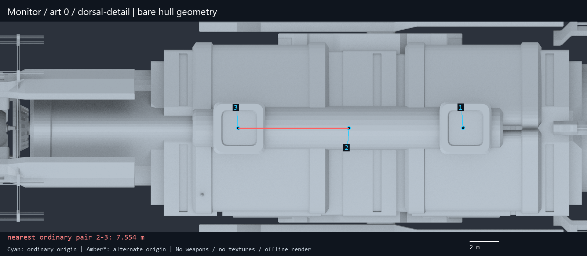

The Monitor illustrates why node count and visible dedicated foundations need not match one-to-one. The gun asset supplies its own base, so an origin without a separate raised hull seat is not automatically a defect. Nevertheless, installing a much larger gun at the intervening origin would be a different visual arrangement from enlarging the two existing seats. Compare [all Monitor variants](visuals/monitor-all-variants.png), [Escort variants](visuals/escort-all-variants.png) and [Frigate variants](visuals/frigate-all-variants.png).

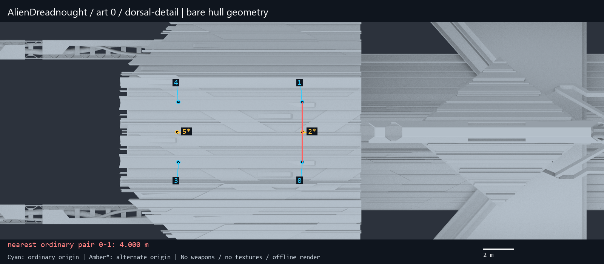

Alien Dreadnought's 4 m number has a clear semantic cause: the two ordinary guns are alternatives to a central combined placement on a common panel. The spare controller between them should not be interpreted as another independently roomy barbette. Promoting every such origin into a simultaneous gun needs more physical deck allocation, not only a larger UI allowance. The panels have modeled ribs, but no separate circular barbette geometry under each marked origin in this view.

[Alien Assault Carrier close view](visuals/alienassaultcarrier-0-dorsal-detail-annotated.png) shows a repeated 12 m rhythm on a shared strip. [Alien Destroyer close view](visuals/aliendestroyer-0-dorsal-detail-annotated.png) supports the earlier middle-node proposal: unlike the 2–4 m clusters, its 21–23 m neighboring distances leave meaningful space.

## Mothership: the duplicate and the appropriate repair surface

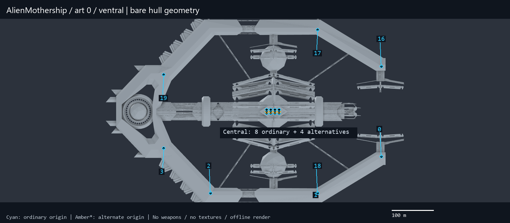

The ordinary outer pattern has four stations on each side. Dorsal indices 2 and 18 are a left/right pair at Z=-161.4 m. Ventral index 2 has the expected left counterpart, but ventral index 18 sits at index 1's position at Z=96 m. This leaves the right aft counterpart empty. The object names reinforce the geometric diagnosis: `Base 56` has inherited the position of `Base 60`, while its matching left aft seat is `Base 50`. This is strong evidence of an authored placement/copy mistake, though the original artist's intent is not available.

| Ventral controller | Object | X m | Y m | Z m |
| --- | --- | --- | --- | --- |
| 1 (retain) | Ventral Turret Mount Base 60 | -196.500 | -23.180 | 96.000 |
| 2 (mirror reference) | Ventral Turret Mount Base 50 | -196.500 | -23.590 | -161.400 |
| 18 (current defect) | Ventral Turret Mount Base 56 | -196.500 | -23.180 | 96.000 |
| 18 (proposed) | same object and list index | 196.500 | -23.590 | -161.400 |

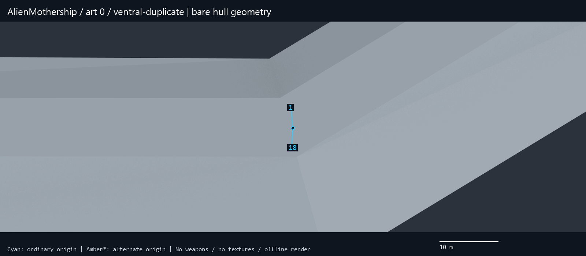

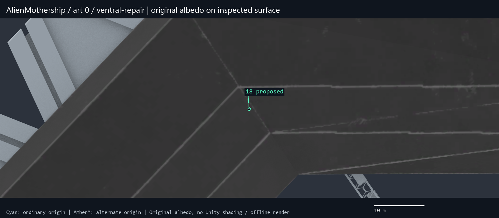

**Visual finding:** the replacement is on the same kind of broad, beveled outer-rim panel as the existing opposite-side mount. There is no separate modeled circular turret ring at either point. The original albedo shows panel seams and surface wear rather than a dedicated painted circular seat. A new barbette is therefore **not required to match the existing outer-mount style**. Compare the [unchanged opposite-side geometry](visuals/alienmothership-0-ventral-mirror-source-annotated.png).

This refines the earlier description “existing foundation”: the suitable support is the structural rim surface, not an unused ornamental turret pedestal. Adding a new ring at only the repaired site would actually reduce visual consistency; any optional cosmetic ring should be introduced symmetrically across the equivalent outer mounts.

| Surface check at proposed index 18 | Result |
| --- | --- |
| Support mesh | Hydra_Mothership_Outer_A |
| Surface Y at center | -23.644494 m |
| Proposed origin Y | -23.590000 m, matching ventral index 2 |
| Origin seating relative to surface | 0.054494 m inward; same as the mirror reference |
| Eight samples on a 2 m radius ring | All hit the support; height variation about 0.001823 m |
| Eight samples on a 4 m radius ring | All hit the support; height variation about 0.004858 m |
| Eight samples on a 6 m radius ring | All hit hull, but variation about 0.858 m: the larger ring reaches the bevel |
| Position change | ΔX=+393.000 m; ΔY=-0.410 m; ΔZ=-257.400 m; distance 469.791 m |

These are point/ring surface probes, not a continuous base-to-hull collision test. They support the proposed placement and indicate where the rim begins to slope. Final gun-base seating still needs its actual mesh footprint.

**Do not simply negate dorsal Y.** The matching dorsal position is at Y=+25.350 m, whereas the existing opposite ventral reference is Y=-23.590 m. A naïve Y mirror would place the new origin 1.760 m farther outward than its ventral counterpart. Mirror X from the correct ventral reference instead.

## Minimal correction: edit a Transform, not a skeletal mesh

All surveyed main hull surfaces are static `MeshFilter`/`MeshRenderer` geometry. None of the 28 inspected main hulls uses a `SkinnedMeshRenderer`; the human skinned renderers encountered belong to radiator systems. The Mothership hierarchy has no skinned renderers at all. The mount is a child GameObject with a Transform and a weapon-visual controller, not a bone whose skin weights must be repaired.

For the affected Mothership prefab, the target is a direct child of `AlienMothership`, with unit inherited scale. The exact serialized edit would be:

```text
Prefab: assets/artresources/ships/alien/mothership/alienmothership.prefab
Controller list: ventralHullWeaponControllers[18]
Object: AlienMothership/Ventral Turret Mount Base 56
ShipWeaponVisController path ID: 700196163148817806
Transform path ID: -1311517130906965347
localPosition: (-196.5, -23.18000030517578, 96.0)
           -> (196.5, -23.59000015258789, -161.39999389648438)
localRotation: preserve (0, 0, 1, 0)
localScale: preserve approximately (0.2, 0.2, 0.2)
Parent, child weapon/fire point, list order and references: preserve
```

The positional values above are local to the prefab root at this stage. Unity applies parent transforms when converting local positions to world space; do not reuse those numbers as absolute combat-world coordinates. [Unity Transform.localPosition documentation](https://docs.unity3d.com/ScriptReference/Transform-localPosition.html).

**Preferred first implementation:** an appearance-specific, guarded instance correction before `ShipModelController.BuildShip` initializes weapons. Check the Mothership class, expected prefab/object identity, both relevant list entries, original coordinates and parent relationship. Apply once; accept an already-correct position; reject/log an unexpected layout. This avoids editing the shipped bundle and makes comparison/rollback straightforward. Do it before weapon initialization creates the `Base Orientation` parent, because applying the same `localPosition` afterward would address a different coordinate frame. This is a proposed hook, not an implemented or Harmony-validated patch.

The slot index and controller object remain unchanged, so there is no intended capacity, ammo-index or DPS change and no obvious need for a design-data migration. Still test saved ships, refits, designer previews and new combat instances. Muzzle and shot-effect origins move with the hierarchy; that makes this more than a purely cosmetic screenshot correction.

| Mothership metric | Current asset | Minimal correction | Meaning |
| --- | --- | --- | --- |
| Ordinary logical mounts | 16 | 16 | No capacity change |
| Authored paired indices including alternatives | 20 | 20 | No extra gun enabled |
| Minimum ordinary center spacing | 0.000 m | 8.000 m | Exact duplicate removed; central pair becomes limiting |
| Worst-size-4 conservative ordinary gap | -12.296 m | -4.296 m | Still not a global heavy-turret clearance certificate |
| Minimum with every alternative active | 0.000 m | 4.000 m | Central merge origins remain tightly grouped |

## Optional Mothership redesign: relocate the crowded central battery symmetrically

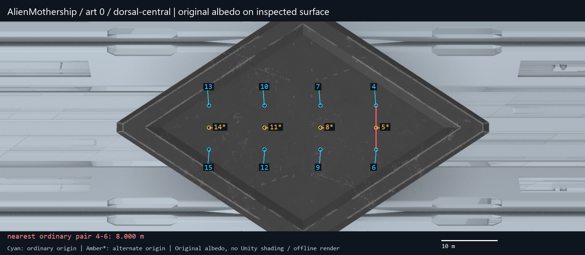

The central battery sits on a common diamond-shaped face, not on twelve dedicated barbettes. The flat face has vertices approximately `(X,Z)=(±16.803,-10.137), (0,15.337), (0,-35.612)`, at Y≈88.931 m. Its full width is 33.606 m and length 50.949 m. The ordinary columns are X=±4 m; their rows are Z=3,-7,-17,-27 m. Alternatives occupy X≈0.

Simply widening the columns is not enough: row-to-row spacing stays 10 m. Moreover, at Z=3 m, a test at X=±9 m hits the raised bevel at Y≈89.343 m, about 0.433 m above an unchanged Y=88.91 origin. The footprint reaches the beveled margin before a naïve rectangular enlargement looks plausible. Enlarging this battery in place would therefore entail redesigning the diamond platform or adopting a different arrangement—not just changing X coordinates.

A more spacious option is to retain the eight original outer mounts, repair ventral index 18, and move the eight ordinary central mounts onto symmetric points of the existing long rim sections. This retains 16 logical guns and the current heavy-per-node rule. The following coordinates are **proposal seeds**, not approved edits. Dorsal/ventral Y is the sampled hull surface plus 0.10 m outward allowance; final base seating may need a different allowance.

| Paired indices (left/right) | X m | Z m | Dorsal Y m | Ventral Y m |
| --- | --- | --- | --- | --- |
| 4 / 6 | -196.500 / +196.500 | 55.000 | 25.281842 | -23.402092 |
| 7 / 9 | -196.500 / +196.500 | 10.000 | 25.321471 | -23.465595 |
| 10 / 12 | -196.500 / +196.500 | -35.000 | 25.362076 | -23.530995 |
| 13 / 15 | -196.500 / +196.500 | -120.000 | 25.462998 | -23.692573 |

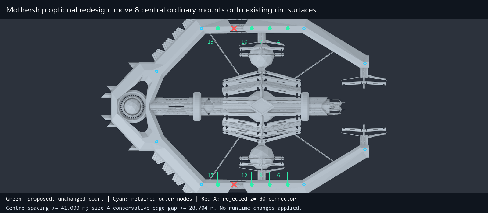

The four proposed rows all hit `Hydra_Mothership_Outer_A` on both sides. Eight test points on each 4 m radius ring vary in height by less than 0.012 m. This is useful evidence of a broad, almost planar support region, although it does not replace continuous footprint and animated clearance checks.

**Rejected site:** X=±196.5, Z=-80 m looks attractive if one spaces the stations arithmetically, but it lies in the rim interruption/connector area. The ray hits `Hydra_Mothership_Outer_B` around Y=17.1–17.8 m dorsally, roughly 7.5–8.2 m below the assumed rim height. Its 4 m ring varies by about 3.47 m. The red crosses in the figure identify this false candidate. Z=-120 m returns to the suitable rim panel.

| Metric | After minimal repair | After optional redistribution | Delta |
| --- | --- | --- | --- |
| Ordinary logical guns | 16 | 16 | 0 |
| Minimum ordinary center spacing | 8.000 m | 41.000 m | +33.000 m |
| Native size-4 conservative gap | -4.296 m | 28.704 m | +33.000 m |
| Nominal size-4 capacity | 64 units | 64 units | 0 |
| Same fitted weapons: raw DPS | unchanged | unchanged | 0% |
| All 20 authored indices simultaneously active | 4.000 m minimum | 10.000 m minimum | Still constrained by four central alternatives |

**Semantic tradeoff:** the eight ordinary central guns would become a distributed rim battery, leaving the diamond crown visually sparse. This is a deliberate composition change, not a necessary part of repairing the duplicated slot. The rim's existing style does not require individual barbettes, but an optional new seat design should repeat symmetrically at every relocated station. Do not claim the redesign enables four additional heavy guns: the retained central alternatives still have only 10 m spacing and would need their own layout/fitting work.

The 28.704 m conservative gap applies to the unchanged 16 ordinary mount indices after the proposed relocation, including the matching dorsal/ventral geometry. It does not certify hull/weapon intersection, muzzle visibility, line of fire, radiator/appendage clearance, or the visual quality of a complete fitted ship.

## If actual hull-foundation geometry must be edited

For the human paired-seat cases, the appropriate object is often a static mesh that contains several foundations and other details. Examples include `Earth_DLCA_BS_Common_Details_A` (Battleship/3), `Earth_DR_Common_Back_C` (Dreadnought/1), and `Earth_TI_ALT_Common_Head` (Titan/1). Moving that entire object would move unrelated hull geometry. The redesign should select the foundation's vertex/triangle islands, adjust the backing deck if necessary, and move the matching controller origin by the same root-space displacement.

Preserve UVs, material/submesh assignments, winding, normals/tangents, mesh bounds and any relevant collider relationship. Move both members of a symmetric pair, and the corresponding ventral pair, with an explicit per-appearance specification. Do not treat a circular seat in an atlas or one disconnected decorative island as the complete support assembly without checking it in 3D. On assets that genuinely use skinning, bind poses, bone weights and animation ownership would matter; those are not implicated by these main-hull measurements.

For runtime experiments, create an instance-specific mesh copy before changing vertices. Unity warns that editing `sharedMesh` changes every object using that shared asset; `MeshFilter.mesh` creates a duplicate when first accessed. [Unity sharedMesh](https://docs.unity3d.com/ScriptReference/MeshFilter-sharedMesh.html), [Unity mesh](https://docs.unity3d.com/ScriptReference/MeshFilter-mesh.html).

For an offline asset release, work from a separate asset project/package and retain the original bundle hashes and reference identities. The inspected Mothership serialized asset reports Unity **2020.3.49f1**; that is bundle metadata, not a claim about the current executable's engine version. Confirm the player/bundle version and reference/manifest requirements before rebuilding. Unity does not guarantee that bundles made by newer editors load in older players, so exporting from an arbitrary current editor is not a safe replacement workflow. [Unity AssetBundle compatibility guidance](https://docs.unity.cn/2023.1/Documentation/Manual/AssetBundlesIntro.html).

The minimal Mothership fix needs none of that vertex editing: either correct the single serialized Transform in a separately validated package or apply the guarded instance relocation proposed above.

## Recommended next scope and validation

1. Implement **only the Mothership ventral index-18 correction** first. Verify the same 16 logical weapons, unique ordinary origins, preserved references/rotations/scales, and the intended mirrored outer-rim location.
2. Inspect a fitted Mothership in designer and combat, from both sides, before and after. Fire the affected gun and confirm its base, barrel, muzzle effect and projectile origin agree. Include a loaded save and a refit/new-instance path.
3. Treat crowded but correctly seated human foundations as a separate visual-capacity project. Start with Titan/1 or Battleship/3, choose the target weapon families and required padding, then move seats plus origins together. Preserve other appearances until individually specified.
4. If retaining full heavy-per-node Mothership clearance is the goal, review the optional rim redistribution as a distinct art choice. It changes placement substantially while retaining count and nominal DPS.

This follow-up adds visual semantics to the previous study. It does not replace conservative sphere bounds with a claim of exact mesh collision, and it does not turn a proposed coordinate into tested in-game behavior. No game process was launched for this inspection.

## Validation of this follow-up

Source SHA-256 values for the base/DLC ship bundles, weapon bundle and installed game assembly matched the prior measurement snapshot. Checks passed for 28-appearance coverage; the 0→8 m ordinary and 0→4 m all-node minimal-repair deltas; the optional 41.000 m ordinary spacing; left/right coordinate symmetry; and the mesh identity/height variation of all tested 4 m support rings. All report links and Markdown tables passed the existing report-integrity check. The report retains 28 referenced figures; intermediate and duplicate renders were removed through an exact hashed manifest.

These checks validate the saved analysis and proposal arithmetic. The proposed runtime hook, edited assets, complete fitted-weapon intersections and in-game behavior have not been implemented or tested.
