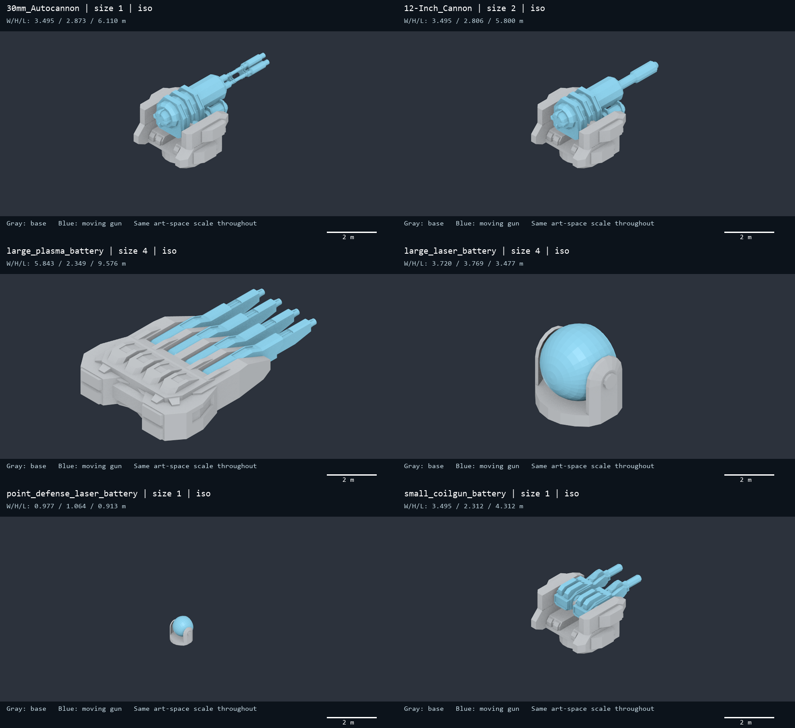
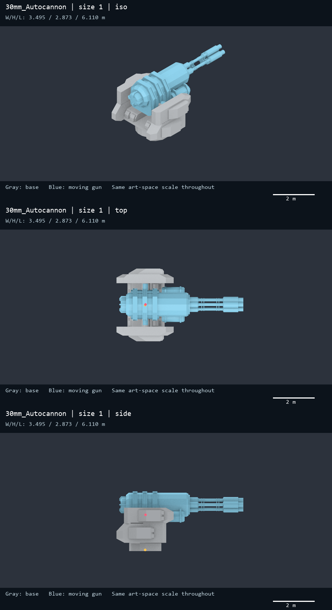
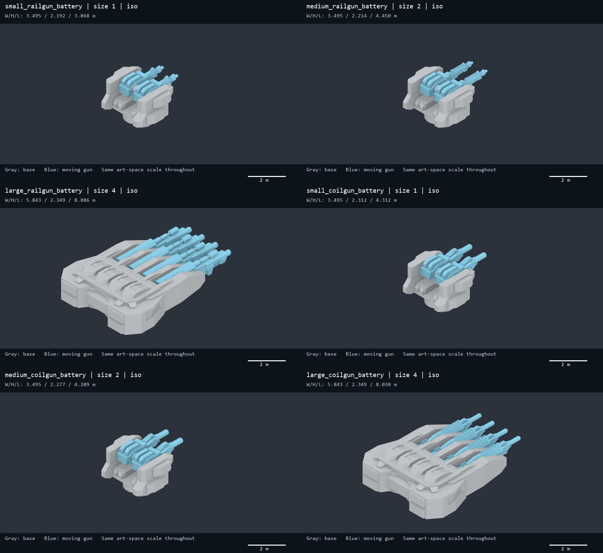
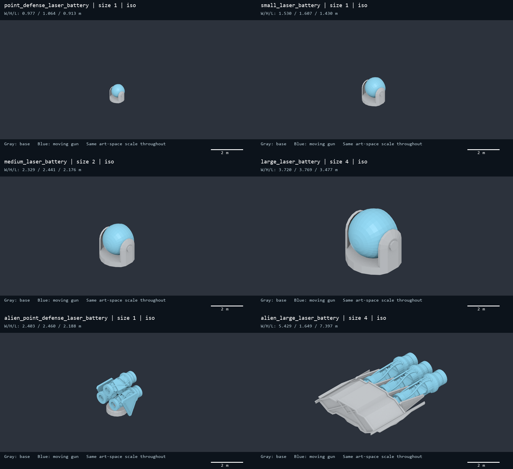
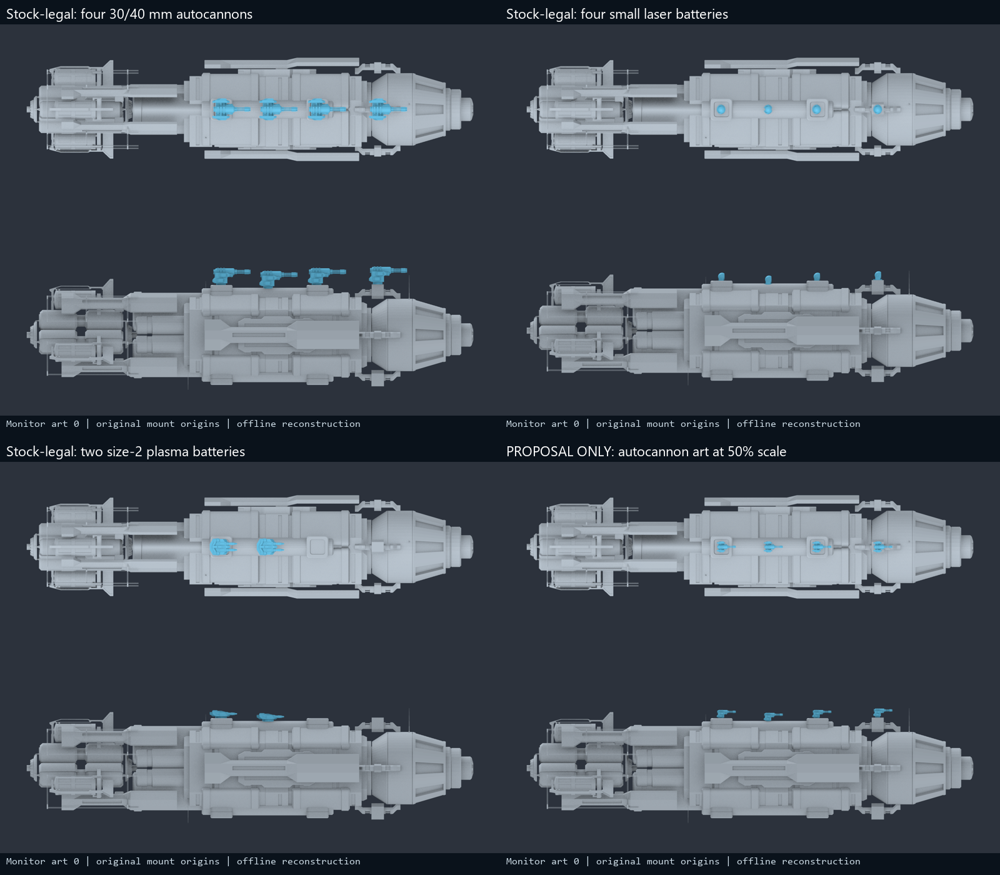

# Why the turret sizes look surprising: mesh and Monitor follow-up

2026-10-21. **Your visual impression is largely right: many weapons are far smaller than the mount-spacing limits implied by the earlier worst-of-size tables.** The 30 mm autocannon is a genuine long-barrel outlier, several size-1 and size-2 guns share the same pedestal, and the earlier sphere diameter is a conservative motion bound rather than a visible mesh diameter. I should have emphasized those distinctions more strongly when interpreting the first report.

I decoded and rendered all **35 distinct hull-weapon resources** at a common art-space scale. The grey geometry is the weapon base; the blue geometry is its moving gun assembly. These are the actual installed meshes, with resource scales and child offsets, not imagined replacements. The figures use neutral materials to reveal shape and are not captured in-game frames. Source templates and bundle hashes remain those in the [committed audit](methodology.md). The new per-resource measurements are in [weapon-mesh-inspection-2026-10-21.json](weapon-mesh-inspection-2026-10-21.json).

The Mothership correction was separately implemented and deployed as 0.10.4; see [implementation and validation](../mothership-symmetric-mount-implementation-2026-10-21.md). **No Monitor fitting, weapon statistics, or weapon-model scaling changes were applied.**

## The 30 mm autocannon really is a long exposed gun

The installed art is an exposed rotary-barrel assembly on a substantial open cradle. It is not a compact enclosed CIWS enclosure. Its base mesh is literally named `base_medium`, shared in name and measured dimensions with the small/medium human naval, rail and coil mounts. The current 30 mm and 40 mm autocannon templates use this same resource.

The long forward barrel makes the gun the largest size-1 yaw-reach outlier, even though its pedestal is not unusually large within the human projectile-gun family. It is 3.495 m wide, 2.873 m high and 6.110 m long in the resource-scale pose. That is quite different from saying it is a solid 12.952 m-wide object.

| Autocannon quantity | Metres | Interpretation |
| --- | --- | --- |
| Full visible envelope W × H × L | 3.495 × 2.873 × 6.110 | Forward authored pose |
| Base envelope W × H × L | 3.495 × 2.085 × 2.754 | The broad shared pedestal |
| Moving assembly length | 5.972 | Receiver plus long rotary barrels |
| Elevation-pivot height above mount origin | 1.690 | Height, not horizontal deck demand |
| Yaw-only diameter in the forward/elevation-zero pose | 9.478 | Circle enclosing the long forward reach |
| Pitch-and-yaw horizontal diameter bound | 9.673 | New, tighter horizontal motion bound |
| Earlier full 3D sphere diameter | 12.952 | Conservative sphere centered at the mount origin |

The old sphere bound combines the pivot offset and the farthest moving vertex using the triangle inequality. The roughly 1.69 m vertical pivot offset contributes to its radius even when it does not consume horizontal deck spacing. The new horizontal bound reduces the autocannon diameter from 12.952 to 9.673 m, about 25.3%. The actual forward mesh remains only 6.110 m long and 3.495 m wide.

A swept circle also contains empty space: the gun can point in many directions, but does not occupy every one of those orientations at once. Two weapons tracking roughly the same target can look comfortably separated even when two independent all-aim envelopes overlap. Conversely, one comfortable forward pose is not proof that barrels never clip when they aim in different directions.

## Similar slot sizes do not imply a consistent physical scale ladder

The art uses a small number of reusable mount forms. Cell cost and weapon performance are not a uniform linear dimension rule. This is especially obvious in the human magnetic family.

| Resource | Size | Width m | Height m | Length m | Base mesh |
| --- | --- | --- | --- | --- | --- |
| 30mm_Autocannon | 1 | 3.495 | 2.873 | 6.110 | base_medium |
| 8-Inch_Cannon | 1 | 3.495 | 2.843 | 4.986 | base_medium |
| 12-Inch_Cannon | 2 | 3.495 | 2.806 | 5.800 | base_medium |
| small_railgun_battery | 1 | 3.495 | 2.192 | 3.868 | base_medium |
| medium_railgun_battery | 2 | 3.495 | 2.214 | 4.450 | base_medium |
| large_railgun_battery | 4 | 5.843 | 2.349 | 8.886 | base_large |
| small_coilgun_battery | 1 | 3.495 | 2.312 | 4.312 | base_medium |
| medium_coilgun_battery | 2 | 3.495 | 2.277 | 4.209 | base_medium |
| large_coilgun_battery | 4 | 5.843 | 2.349 | 8.038 | base_large |
| medium_plasma_battery | 2 | 2.729 | 1.355 | 4.381 | medium_plasma_battery_base |
| large_plasma_battery | 4 | 5.843 | 2.349 | 9.576 | base_large |

Small and medium coil batteries have the same 3.495 m-wide pedestal and almost identical moving assemblies. Their total lengths are 4.312 and 4.209 m respectively; the medium art is slightly shorter in this pose. The large battery switches to a broad multi-barrel cradle. Thus a maximum over all size-1 models can easily be close to, or larger than, a maximum over size-2 models.

The largest size-4 sphere is set by the heavy plasma art, whose long barrels extend from `base_large`. That base is 5.843 m wide and 6.383 m long. The heavy laser instead uses a compact ball-shaped optical assembly: it is taller, but much shorter in plan view. “Largest” depends on the dimension or motion you care about.

The human point-defense laser is only about 0.98 m wide. The size-1 small laser is 1.53 m wide, and the size-4 large laser 3.72 m wide. These are good examples of the roomy-looking turrets you described. A class-wide test using the autocannon or heavy plasma maximum is intentionally much stricter than a laser-specific fit assessment.

Resource names also retain historical conventions. They must not be used as the authoritative caliber or slot-size label:

| Current template | Slot size | Model resource | Moving mesh name |
| --- | --- | --- | --- |
| 30mmAutocannon / 40mmAutocannon | 1 | 30mm_Autocannon | 30mm_Autocannon |
| 6-inchCannon | 1 | 8-Inch_Cannon | 6-Inch_Cannon |
| 8-inchCannon | 2 | 12-Inch_Cannon | 12-Inch_Cannon |

## How the refined horizontal bound was calculated

For each resource, the base and moving meshes are decoded separately. The child scale, child offset, initial child rotation and root scale are applied as in the resource pose. I sample a complete 360° elevation rotation about the gun's local X axis in 1° increments and take the maximum distance in the root's XZ plane. Base yaw can rotate that horizontal reach around the mount axis without changing its radius.

To avoid claiming that discrete samples are an exact continuous maximum, the radius receives an additional bound `2 × max(|rootScale|) × max(|childScaledVertex|) × sin(0.25°)`. Every unsampled angle is within 0.5° of a sample, so this term bounds the omitted displacement. This is still conservative, but it does not charge the entire vertical pivot height against horizontal separation.

This is a resource-space, upright-mount footprint bound. It does not replace the full 3D calculation for arbitrarily tilted mounts, different parent scales or detailed hull intersections. Static missile launchers do not actually rotate; their rotation columns are hypothetical comparison bounds, not required launcher movement. The old sphere remains a safe sufficient bound; its failure should be described as **not certified**, not as proved visual collision.

## Monitor: what is and is not fine as-is

**For the existing fitting rules, leave the Monitor unchanged.** There is no newly demonstrated misplaced/duplicated node requiring a patch. The previous tables were largely answering a more aggressive question: what if a large gun could occupy every ordinary node independently? Keeping the same number of nodes does not make that capacity change equivalent to stock fitting.

In the currently installed Monitor grid there are four single-cell placements, two legal horizontal two-cell placements, no vertical two-cell placement and **no FourHull rectangle**. The two hull rows are separated by four half-rows rather than the two needed for a FourHull rectangle. This is a statement about the inspected current template, not a general claim about every historical game version.

The following reconstruction uses the actual Monitor/0 hull and native controller mappings. Weapon root and child transforms are replaced using the combat branch of `SetWeapon`, retaining the mount origins and authored rotations. These are offline reconstructed poses, not an in-game sweep test.

The stock four-autocannon forward pose has visible separation, while the small lasers are much roomier. Two medium plasma weapons also fit as a native two-cell loadout. The original all-aim worst-case sphere result did not demonstrate that these poses overlap. Monitor/0 remains the most demanding case if one requires a guaranteed arbitrary-aim margin for the longest size-1 art.

If your intended policy were instead “size 4 at all four nodes,” I would not treat all Monitor appearances as automatically safe. That is a different fitting rule and would need weapon-family-specific checks or a visual scaling policy. I have not implemented it.

## Optional fix that keeps turrets within the existing mounts

If you want a strict all-aim gap for unusually long art, retain all origins and foundations and scale only the offending weapon art around its base origin. Scale the complete base hierarchy so the moving gun and fire point remain aligned. Do not shrink all lasers merely because a different weapon defines the global maximum.

For the autocannon, the following factors use the smallest same-face horizontal origin separation on each appearance and the refined 9.673 m diameter bound. The rule is `factor ≤ (distance − requiredGap) / diameter`, capped at 1. These factors are proposal limits for upright mounts; they do not add guns or change damage statistics.

| Monitor art | Horizontal spacing m | Unscaled bound gap m | Scale for ≥2 m gap | Scale for ≥5 m gap |
| --- | --- | --- | --- | --- |
| 0 | 7.540 | -2.133 | 0.573 | 0.263 |
| 1 | 11.320 | 1.647 | 0.963 | 0.653 |
| 2 | 12.800 | 3.127 | 1.000 | 0.806 |
| 3 | 17.800 | 8.127 | 1.000 | 1.000 |

A uniform 50% autocannon-art option would make the model approximately **1.748 × 1.436 × 3.055 m** and its horizontal motion diameter about **4.837 m**. On Monitor/0 that leaves approximately **2.703 m** under this bound. The lower-right reconstruction shows this option without moving a single mount. It looks closer to a compact CIWS and sits inside the existing foundation footprint.

That is a **proposal only**, not a necessary repair proven by these renders. A global autocannon-art change would affect every hull and both current 30/40 mm templates; an appearance/loadout-specific rule would be narrower. Either needs separate approval and checks for base seating, native aim rotations and muzzle/effect positioning. The default recommendation for this task is to preserve the existing Monitor rules and art.

## Complete per-resource dimensions and bounds

| Resource | Size | W × H × L m | Pose yaw diameter m | Pitch/yaw bound m | Old sphere diameter m |
| --- | --- | --- | --- | --- | --- |
| 30mm_Autocannon | 1 | 3.495 × 2.873 × 6.110 | 9.478 | 9.673 | 12.952 |
| 8-Inch_Cannon | 1 | 3.495 × 2.843 × 4.986 | 7.209 | 7.371 | 10.624 |
| 12-Inch_Cannon | 2 | 3.495 × 2.806 × 5.800 | 8.835 | 9.024 | 12.175 |
| small_railgun_battery | 1 | 3.495 × 2.192 × 3.868 | 5.126 | 5.173 | 8.773 |
| medium_railgun_battery | 2 | 3.495 × 2.214 × 4.450 | 6.250 | 6.327 | 10.000 |
| large_railgun_battery | 4 | 5.843 × 2.349 × 8.886 | 11.316 | 11.414 | 13.597 |
| small_coilgun_battery | 1 | 3.495 × 2.312 × 4.312 | 6.005 | 6.056 | 9.371 |
| medium_coilgun_battery | 2 | 3.495 × 2.277 × 4.209 | 5.824 | 6.062 | 9.302 |
| large_coilgun_battery | 4 | 5.843 × 2.349 × 8.038 | 9.680 | 10.822 | 13.118 |
| alien_small_coilgun_battery | 1 | 1.648 × 1.147 × 4.118 | 7.024 | 7.574 | 8.774 |
| alien_medium_coilgun_battery | 2 | 2.831 × 1.640 × 5.250 | 9.451 | 9.608 | 11.807 |
| alien_large_coilgun_battery | 4 | 5.143 × 1.562 × 7.223 | 9.822 | 9.943 | 10.222 |
| point_defense_laser_battery | 1 | 0.977 × 1.064 × 0.913 | 0.994 | 1.056 | 1.834 |
| small_laser_battery | 1 | 1.530 × 1.607 × 1.430 | 1.556 | 1.627 | 2.755 |
| medium_laser_battery | 2 | 2.329 × 2.441 × 2.176 | 2.368 | 2.386 | 4.145 |
| large_laser_battery | 4 | 3.720 × 3.769 × 3.477 | 3.783 | 3.811 | 6.339 |
| alien_point_defense_laser_battery | 1 | 2.403 × 2.460 × 2.188 | 3.228 | 3.767 | 5.748 |
| alien_small_laser_battery | 1 | 1.648 × 1.096 × 2.301 | 3.455 | 3.485 | 4.821 |
| alien_medium_laser_battery | 2 | 2.353 × 1.250 × 2.763 | 4.933 | 5.027 | 6.663 |
| alien_large_laser_battery | 4 | 5.429 × 1.649 × 7.397 | 10.164 | 10.488 | 11.388 |
| point_defense_particle_beam_battery | 1 | 2.597 × 1.168 × 3.643 | 4.585 | 4.618 | 5.355 |
| 60_generic_battery | 1 | 3.495 × 2.262 × 4.617 | 6.648 | 6.726 | 10.034 |
| 120_generic_battery | 2 | 3.495 × 2.231 × 4.701 | 6.778 | 6.857 | 10.106 |
| 240_generic_battery | 4 | 3.495 × 3.406 × 4.589 | 6.688 | 6.805 | 10.020 |
| 480_generic_cannon | 2 | 2.236 × 1.485 × 3.802 | 4.913 | 5.013 | 6.833 |
| 960_generic_cannon | 4 | 2.236 × 1.574 × 5.259 | 7.812 | 7.882 | 9.669 |
| alien_point_defense_particle_beam_battery | 1 | 3.703 × 1.125 × 5.739 | 8.135 | 8.194 | 8.565 |
| medium_plasma_battery | 2 | 2.729 × 1.355 × 4.381 | 5.265 | 6.378 | 7.409 |
| large_plasma_battery | 4 | 5.843 × 2.349 × 9.576 | 12.645 | 12.749 | 14.637 |
| alien_medium_plasma_battery | 2 | 2.831 × 1.656 × 5.329 | 9.402 | 10.030 | 12.037 |
| alien_large_plasma_battery | 4 | 5.006 × 1.521 × 8.044 | 11.673 | 11.793 | 12.296 |
| missile_launcher | 1 | 1.258 × 0.602 × 1.341 | 1.690 | 3.813 | 3.999 |
| torpedo_launcher | 1 | 2.608 × 1.287 × 2.807 | 3.504 | 7.330 | 8.365 |
| alien_missile_launcher | 1 | 1.221 × 0.615 × 1.221 | 1.475 | 3.002 | 3.434 |
| alien_torpedo_launcher | 1 | 2.000 × 1.031 × 2.000 | 2.417 | 4.958 | 5.680 |

Same-scale visual inventory: [resources 1–6](weapon-visuals/inventory-01.png), [7–12](weapon-visuals/inventory-02.png), [13–18](weapon-visuals/inventory-03.png), [19–24](weapon-visuals/inventory-04.png), [25–30](weapon-visuals/inventory-05.png), [31–35](weapon-visuals/inventory-06.png).

The figures and tables explain the asset design; they do not infer weapon caliber from mesh dimensions or equate a bounding box with occupied volume. The archived research commit is `d5cf300`. This follow-up clarifies its interpretation and supplies a tighter horizontal metric without silently replacing the original measurements.

## Verification

All 35 resource dimension records were independently reproduced from the saved
posed vertices. Seven hundred off-grid elevation samples were checked against
the refined bounds and passed; [retained result](weapon-inspection-validation-2026-10-21.txt).
The common-scale figures and native-footprint Monitor reconstructions were
visually inspected. Gold dots in the autocannon top/side views mark the base
origin; pink dots mark the elevation pivot. The full procedure is retained in
[the analysis recipe](weapon-and-layout-analysis-recipe-2026-10-21.txt).
These checks do not substitute for an in-game aiming test.
